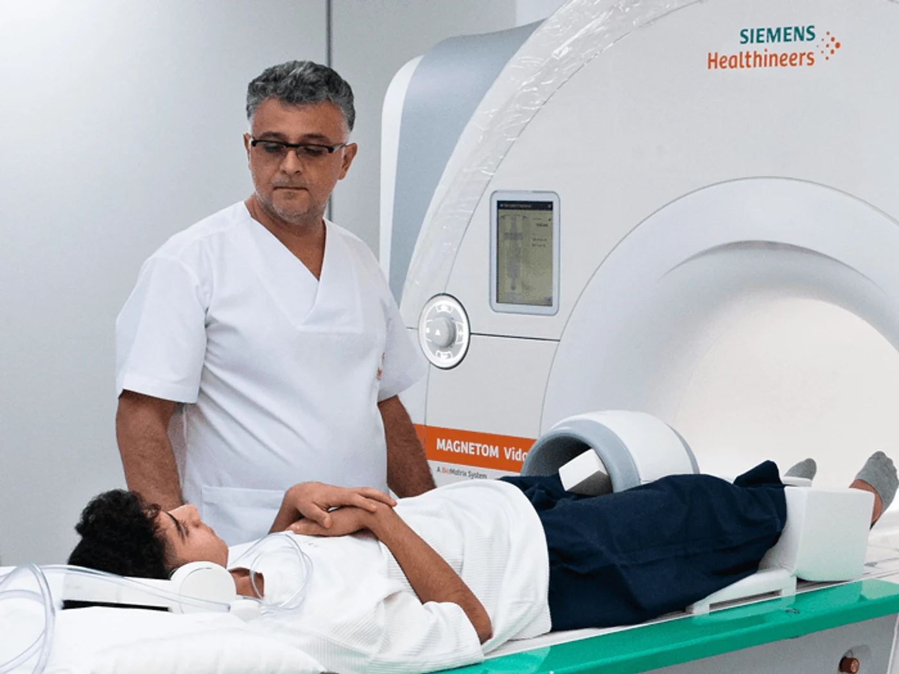

تُصنَّف أجهزة الرنين المغناطيسي بحسب شدة مجالها بوحدة التسلا. كانت الأجهزة الأولى بقوة 0.02 تسلا، وكانت الفحوصات تستغرق وقتًا طويلًا جدًا وتبدو الصور باهتة. ثم دخلت أجهزة 0.5 و1 تسلا حيّز الاستخدام فقصُرت المدة قليلًا وصارت الصور أوضح. وخلال الثلاثين سنة الماضية جعلت أجهزة 1.5 تسلا الصور أوضح وقصّرت مدة الفحص أكثر، ودخلت تقنيات جديدة كالتحليل الطيفي وتصوير المسالك العصبية والرنين الوظيفي ورنين القلب. وخلال العشرين سنة الماضية حسّنت أجهزة 3 تسلا كل ذلك، إلى جانب جودة صور الرنين الاعتيادي، وقصّرت مدة الفحص أكثر. كما اتّسعت الأنفاق التي يدخلها المرضى وتحسّنت راحتهم. وبفضل شدة المجال الأعلى في 3 تسلا صارت التسلسلات أقصر مما هي عليه في أجهزة 1.5 تسلا، وقلّت سماكة المقاطع وازدادت حدّة الصور، فأمكن تقييم التشريح بوضوح أكبر بكثير. وصار بالإمكان إجراء التحليل الطيفي على مساحات أصغر بكثير، كما أتاح التقدّم في تصوير الانتشار إجراء الرنين متعدد المعايير للبروستاتا بصور أفضل وأدقّ مقاطع. وأصبح إجراء رسم T1 وT2 وتصوير التروية ممكنًا في أوقات أقصر وبمقاطع أرفع.

<figure></figure>

<h4>ما مزايا الرنين المغناطيسي 3 تسلا؟</h4>

بفضل شدة مجاله الأعلى، يقدّم جهاز 3 تسلا <strong>تصويرًا أسرع وأدقّ مقاطع وأعلى جودة</strong> من الأجهزة ذات المجال الأضعف. ويزداد الفارق وضوحًا في الفحوصات المتقدمة كالرنين الوظيفي وتصوير المسالك العصبية والتحليل الطيفي، كما يصبح ممكنًا إجراء التحليل الطيفي للكتل الشوكية. وبالذكاء الاصطناعي يمكن تسريع التسلسلات حتى أربعة أضعاف. وعند الحاجة توفّر خاصية <strong>«الرنين الصامت»</strong> تجربة <strong>أكثر راحة</strong>. والرنين المغناطيسي للجسم بالكامل أسرع وأعلى جودة. والفحص أكثر راحة، ولا سيّما للمصابين برهاب الأماكن المغلقة، بفضل المغناطيس الذي يبلغ عرضه 70 سم وإمكانية مشاهدة التلفاز أو الاستماع إلى الموسيقى. والفحوصات المتقدمة كرنين القلب والرنين متعدد المعايير للبروستاتا والكبد أعلى جودة على جهاز 3 تسلا. ويمكن تصوير المرضى حتى وزن 250 كجم. كما يمكن إجراء تصوير الأوعية في حالات التهاب الأوعية وتصوير الأعصاب الطرفية بالرنين.

