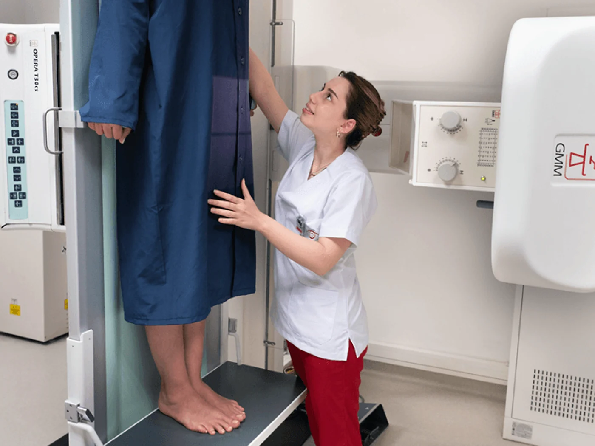
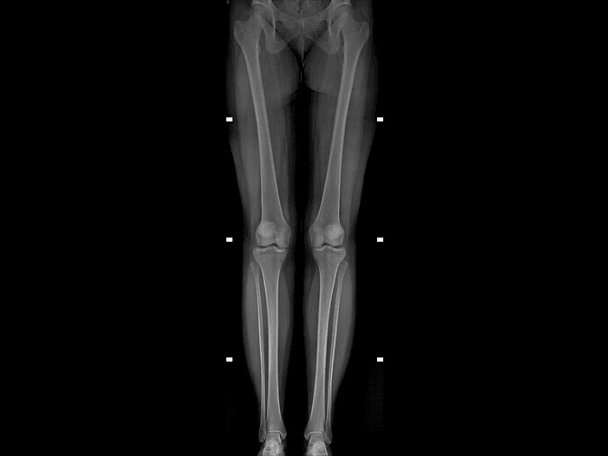

<strong>هو تصوير شعاعي يتيح تقييم جميع البُنى العظمية في الطرفين السفليين — من الورك إلى القدم — في صورة واحدة. ويُنتَج، كما في تصوير الجنف، بالتقاط ثلاث أو أربع صور ودمجها معًا.</strong>

<figure></figure>

<h4>كيف يُجرى هذا التصوير؟</h4>

بجهاز الأشعة الرقمي لدينا تُلتقط الصور بالتتابع تحت تحكّم حاسوبي، حيث يميل الأنبوب بينما يبقى المريض بلا حركة تامة. ثم تُدمج الصور الناتجة بالذكاء الاصطناعي لتكوين الصورة الكاملة. ويتيح ذلك مقارنة طول الساقين وتقييم البُنى العظمية والمفاصل. ويُجري القياسات أطباؤنا ذوو الخبرة.

<figure></figure>

<!--faq-->
[
  {
    "q": "متى يكون هذا التصوير ضروريًا؟",
    "a": "يُجرى تصوير الطول الكامل للطرفين السفليين لإظهار القِصَر والتشوّهات في الساقين في صورة واحدة. ولأن أقصى ما يمكن التقاطه في صورة واحدة نحو 40 سنتيمترًا، تُلتقط صورتان أو ثلاث من الورك حتى باطن القدم بتقنية التجميع مع إمالة الأنبوب آليًا، ثم تُدمج بالحاسوب."
  },
  {
    "q": "هل يُستخدم الإشعاع؟",
    "a": "هذا فحص بالأشعة الرقمية، والجرعة الإجمالية تعادل صورتين أو ثلاث صور صدر شعاعية. وتبلغ جرعة صورة الصدر نحو 0.02 ميلي سيفرت. أما الجرعة السنوية التي تسمح بها منظمة الصحة العالمية فهي نحو 50 ميلي سيفرت."
  },
  {
    "q": "ماذا نفعل من أجل راحتكم وسلامتكم؟",
    "a": "لأن التقاط الصور ودمجها يتمّان بتحكّم حاسوبي كامل وبشكل آلي، يقلّ احتمال الخطأ في التركيب إلى أدنى حدّ. وبعد التقاط الصور تُجرى القياسات ويُجهَّز القرص المدمج والتقرير خلال ساعة أو ساعتين. وتُحفظ التقارير في أرشيف PACS لدينا لمدة 15 عامًا على الأقل. ودقة الكاشف الرقمي 9 ميغابكسل، ولذلك فإن جودة الصور عالية.\n(تُحفظ الصور والتقارير في نظام PACS لدى مركزنا لمدة 15 عامًا على الأقل.)"
  }
]
