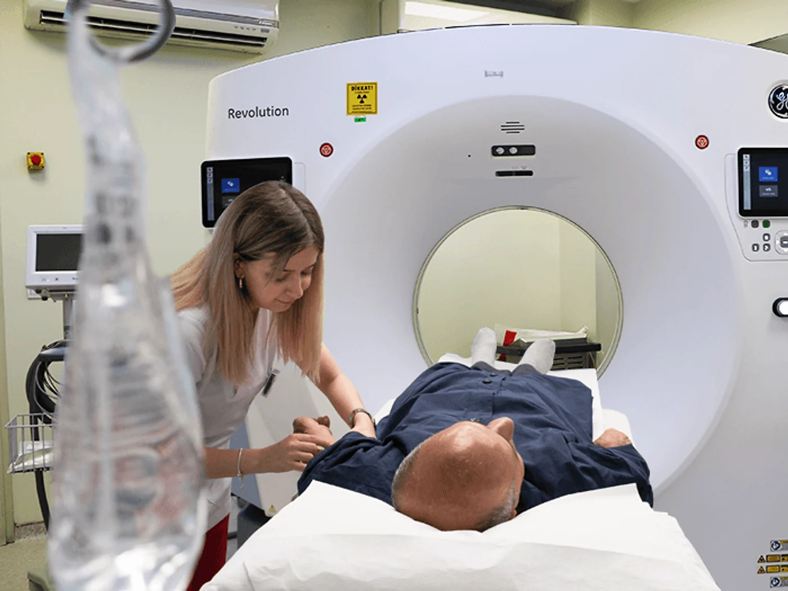
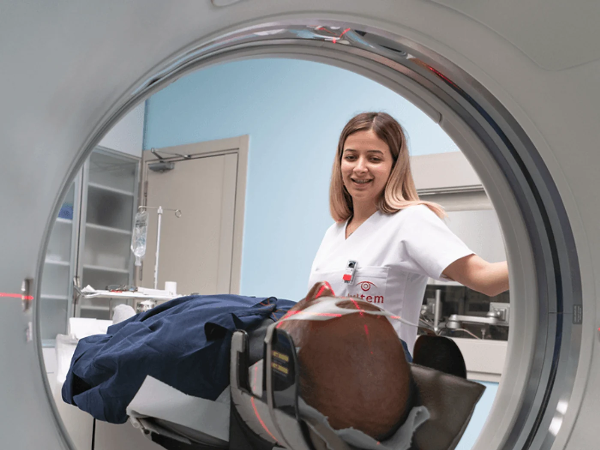
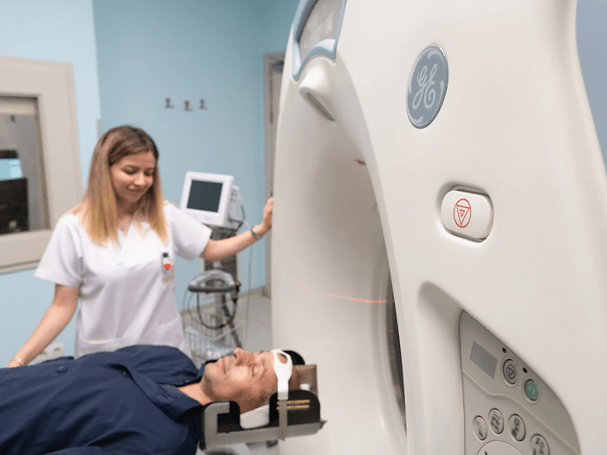

<strong>يتكوّن جهاز التصوير المقطعي المحوسب من وحدة أشعة سينية حلقية الشكل وطاولة متحركة للمريض. وتُلتقط أثناء الفحص صور مقطعية للأعضاء أو العظام أو الأنسجة من زوايا مختلفة، ثم يجمع الحاسوب هذه المقاطع في صورة ثلاثية الأبعاد.</strong>

<figure></figure>

نُجري بجهاز التصوير المقطعي GE Revolution Maxima ذي الـ128 شريحة تصوير الأوعية التاجية وتصوير أوعية الجسم بالكامل بجرعة منخفضة. وتُتيح مصفوفة 1024 رؤية أوضح لنسيج الرئة وصور الأذن. وتُنجَز قسطرة القلب التصويرية وتنظير القولون الافتراضي وقياس كثافة العظام بتقنية QCT خلال 4 إلى 5 ثوانٍ.

<figure></figure>

تستغرق فحوصات التصوير المقطعي من 5 إلى 15 ثانية إجمالًا. كما يتوفّر تصوير أوعية القلب المقطعي. وبتنظير القولون الافتراضي يمكن فرد عُرى الأمعاء وفحصها بزاوية 360 درجة، فيُمكن بذلك فحص الأمعاء الغليظة دون الحاجة إلى تنظير تقليدي. وتُتيح تقنية QCT إجراء قياس كثافة العظام بدقة أعلى بكثير، ولا سيّما لدى المرضى كبار السن.

<figure></figure>

<!--faq-->
[
  {
    "q": "متى يكون التصوير المقطعي المحوسب ضروريًا؟",
    "a": "لأن التصوير المقطعي يمكنه تصوير جميع مناطق الجسم، فهو صالح للاستخدام في كل حالة تقريبًا تستدعي التصوير. وهو يتفوّق عمومًا على الرنين المغناطيسي في أمراض الرئة على وجه الخصوص، كما يتفوّق على سائر الفحوصات في تصوير الجيوب الأنفية والعظم الصدغي، أي الأذن الوسطى والداخلية. ويُستخدم على نطاق واسع في تصوير الشرايين التاجية وأوعية الجسم كافة، لأنه يُظهر بنية جدار الوعاء وتجويفه معًا. وله مزايا على الرنين المغناطيسي وغيره في فحص أعضاء البطن وفي إظهار النزيف داخل الدماغ. وله مكانة مهمة في كسور العظام وتقييم المفاصل. ومع تنظير القولون والقصبات الافتراضي يمكن تقييم الأعضاء ذات التجويف من الداخل بثلاثة أبعاد. وهو أداة تشخيصية مهمة لإظهار حصوات الكلى الصغيرة والتهاب الزائدة الدودية."
  },
  {
    "q": "هل يُستخدم الإشعاع في التصوير المقطعي المحوسب؟",
    "a": "التصوير المقطعي المحوسب جهاز يُنتج الصور باستخدام الإشعاع. ومع أجهزة التصوير متعددة الشرائح المستخدمة اليوم انخفضت كمية الإشعاع والزمن اللازم انخفاضًا كبيرًا."
  },
  {
    "q": "ماذا نفعل من أجل راحتكم وسلامتكم؟",
    "a": "لأن فحص التصوير المقطعي يستغرق من 5 إلى 10 ثوانٍ ولأن الجرعة المُعطاة انخفضت كثيرًا، تُجرى فحوصاتنا بجرعات أقل بكثير من الحدود التي تسمح بها منظمة الصحة العالمية. وتُستخدم مآزر الرصاص لدى الأطفال لتغطية المناطق غير المشمولة بالفحص. ويُجري الفحوصَ فنيون ذوو خبرة بمرافقة طبيب أشعة، وتُسلَّم النتائج في اليوم نفسه. كما يستطيع المرضى وأطباؤهم الاطلاع على جميع الصور عبر الإنترنت من خلال نظام PACS.\n(تُحفظ الصور والتقارير في نظام PACS لدى مركزنا لمدة 15 عامًا على الأقل.)"
  }
]
