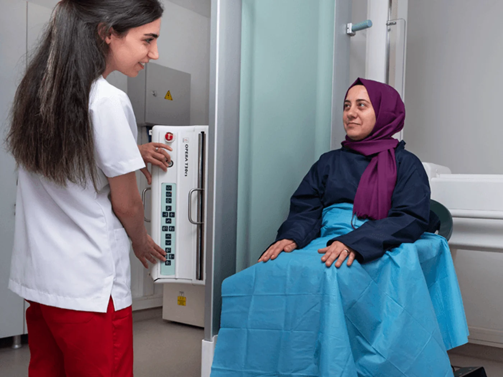

<strong>بعد الحقنة الشرجية تُحقن عبر المستقيم مادة تباين محضّرة خصيصًا بقوام شبيه بالبراز، ويُصوَّر المريض بجهاز أشعة رقمي مزوّد بالتنظير الفلوري أثناء إخراجها في وضعية الجلوس. ويعطي الفحص معلومات عن تشريح العضو ووظيفته معًا.</strong>

<figure></figure>

<h4>كيف يُجرى الفحص؟</h4>

إجراء الفحص في وضعية الجلوس ومتابعته بالتنظير الفلوري أمران مهمان لتصوير عملية التغوّط. أما البديل، وهو تصوير التغوّط بالرنين المغناطيسي، فيستلقي فيه المريض داخل نفق الجهاز، وصعوبة هذه الوضعية تجعل تصوير التغوّط الفسيولوجي بالغ الصعوبة.

<h4>متى يكون هذا الفحص ضروريًا؟</h4>

يتيح تصوير التغوّط الرقمي ملاحظة اضطرابات المنطقة الشرجية — كالقيلة المستقيمية، وقصور العضلة الشرجية، والانغلاف المستقيمي الشرجي، والقيلة المعوية — ملاحظةً مباشرة بالتنظير الفلوري، وتشخيصها والمساعدة في علاجها. ومن المهم جدًا أن يُجري الفحص ويفسّره فني وطبيب أشعة ذوا خبرة على جهاز أشعة رقمي عالي الجودة. وتُجرى فحوصات تصوير التغوّط في مركز إيتيم للتصوير دون ألم بالأشعة الرقمية المزوّدة بالتنظير الفلوري. كما يخضع المريض بعدها لفحص بالرنين المغناطيسي لتقييم البُنى التشريحية.

<!--faq-->
[
  {
    "q": "هل يُستخدم الإشعاع في تصوير التغوّط؟",
    "a": "لأن الفحص يُجرى بجهاز أشعة رقمي مزوّد بالتنظير الفلوري، فإنه ينطوي على بعض الإشعاع وإن كانت الجرعة منخفضة. ويمكن أثناء الفحص متابعة الحالات المرضية التي تحدث أثناء التغوّط في الزمن الحقيقي بالتنظير الفلوري. كما يُضاف في مركزنا فحص بالرنين المغناطيسي للمنطقة المحيطة بالشرج ليتسنّى فحص البُنى التشريحية بتفصيل أكبر."
  },
  {
    "q": "ما مقدار الإشعاع في هذا الفحص؟",
    "a": "يُجرى الفحص بجهاز أشعة مزوّد بالتنظير الفلوري، وتُستخدم كمية ضئيلة جدًا من الإشعاع أثناء التنظير. وبعد الفحص الفلوري يُنقل المريض إلى جهاز الرنين المغناطيسي لإجراء فحص إضافي للمنطقة الشرجية، ولا يُستخدم الإشعاع في الرنين المغناطيسي."
  },
  {
    "q": "ماذا نفعل من أجل راحتكم وسلامتكم؟",
    "a": "من المهم إجراء الفحص جلوسًا في الوضعية الطبيعية للتغوّط، إذ لا يمكن تصوير الحركات الشرجية الفسيولوجية إلا بهذه الطريقة. ويُجرى الفحص الفلوري في مركزنا والمريض جالس، ثم يليه فحص بالرنين المغناطيسي لرؤية التشريح بوضوح أكبر. أما تصوير التغوّط بالرنين المغناطيسي وحده دون الفحص الفلوري فيمكن إجراؤه والمريض مستلقٍ داخل الجهاز، لكنه لا يعطي نتائج موثوقة لتعذّر إجرائه جلوسًا في الوضعية الطبيعية للتغوّط.\n(تُحفظ الصور والتقارير في نظام PACS لدى مركزنا لمدة 15 عامًا على الأقل.)"
  }
]
