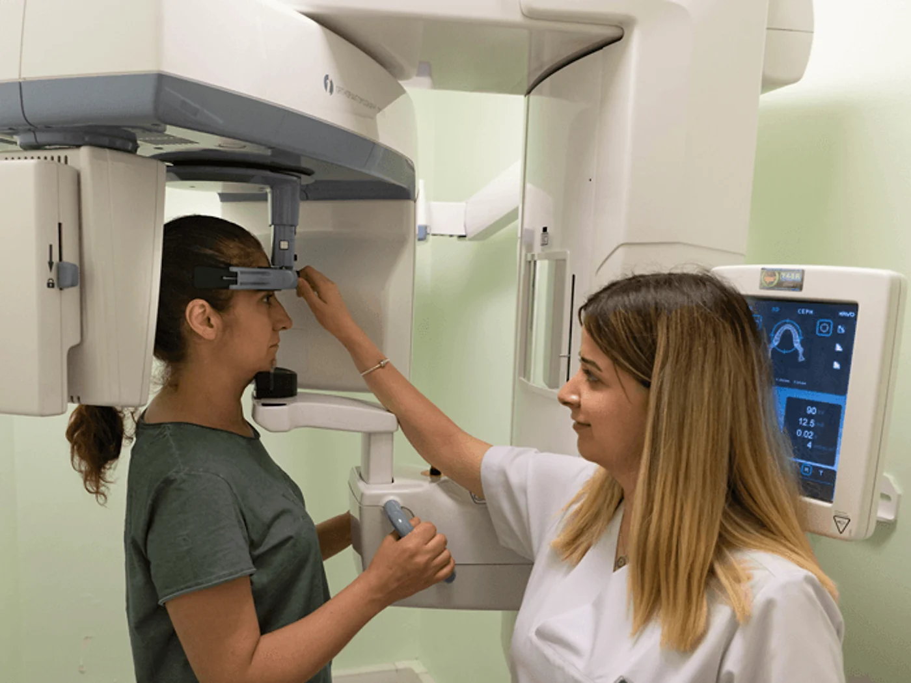
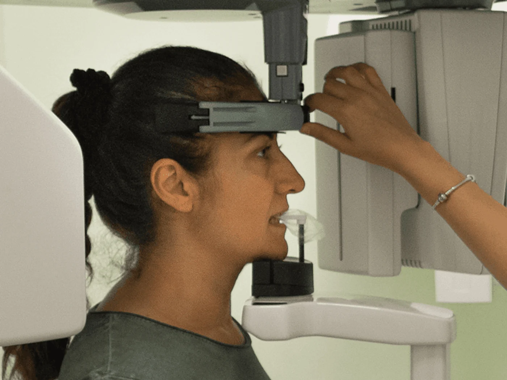
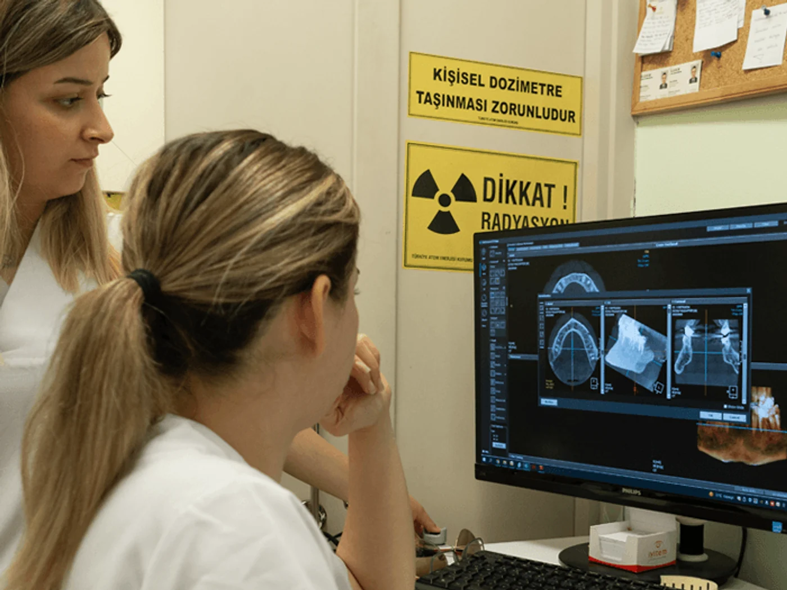

<strong>جهازنا للتصوير المقطعي للأسنان والأشعة البانورامية هو جهاز KAVO المخروطي الحزمة الحجمي ثلاثي الأبعاد. وبقدرته على التمييز حتى 85 ميكرونًا للفوكسل ضمن مجال 5×5 سم وإتاحته التقييم اللبّي ثلاثي الأبعاد، يمكّننا — مع فنيينا ذوي الخبرة — من تقديم معلومات مفصّلة وموثوقة، ولا سيّما لأطباء الأسنان الذين يُجرون زراعة الأسنان.</strong>

<figure></figure>

نستطيع فحص جذور الأسنان بالتفصيل وتقديم معلومات موثوقة عن سماكة العظم وكثافته. وبمجال رؤية يبلغ 13×15 سم يُصوّر الجهاز الوجه بأكمله وقاعدة الجمجمة، ما يجعله مفيدًا لجراحة الفكّ وجراحة الوجه والفكّين. ويمكن تقييم منطقتَي الوجه والفكّين والجيوب الأنفية بدقة عالية بفوكسل 0.32 مم وبجرعة منخفضة جدًا.

<figure></figure>

تُعالَج الصور وتُقيَّم باستخدام برنامج Cliniview ووحدة OnDemand 3D للأسنان، ثم تُسلَّم إلى طبيب الأسنان عبر نظام PACS أو على قرص مدمج أو فيلم. ويمكن التخطيط للزراعة افتراضيًا بوحدة In2Guide لتخطيط الزراعة.

<figure></figure>

<!--faq-->
[
  {
    "q": "متى يكون التصوير المقطعي للأسنان ضروريًا؟",
    "a": "يمكن استخدام التصوير المقطعي ثلاثي الأبعاد للأسنان في تشخيص أي حالة سنّية، لأنه يقدّم معلومات مفصّلة عن التشريح والمرض معًا. غير أنه بالغ الأهمية قبل العلاج لدى المرضى المقبلين على زراعة الأسنان. فقياس سماكة عظم الفكّ والفكّ العلوي وطولهما يتيح إظهار البُنى التشريحية بثلاثة أبعاد. ويقدّم التصوير المقطعي معلومات مهمة عن كيفية وضع الزرعة وبأي زاوية، وعن الطول والسماكة المناسبين لها. كما يمكن إظهار التفاصيل التشريحية والآفات التي لا تُرى في الأشعة البانورامية ولا في أفلام الأسنان الصغيرة."
  },
  {
    "q": "هل يُستخدم الإشعاع في هذا الفحص؟",
    "a": "التصوير المقطعي للأسنان جهاز يعمل بالإشعاع. ويُعطي الفحص قدرًا من الإشعاع يقارب ما تُعطيه الأشعة البانورامية، أو أقل من صورة الصدر الشعاعية."
  },
  {
    "q": "ماذا نفعل من أجل راحتكم وسلامتكم؟",
    "a": "تستغرق فحوصات الأشعة البانورامية والتصوير المقطعي للأسنان أقل من دقيقة. ويُنتج جهاز KAVO لدينا صورًا عالية الجودة بجرعة إشعاعية منخفضة جدًا. وإجراء الفحص والقياسات على يد فنيي الأشعة ذوي الخبرة لدينا يرفع من جودة النتائج.\n(تُحفظ الصور والتقارير في نظام PACS لدى مركزنا لمدة 15 عامًا على الأقل.)"
  }
]
