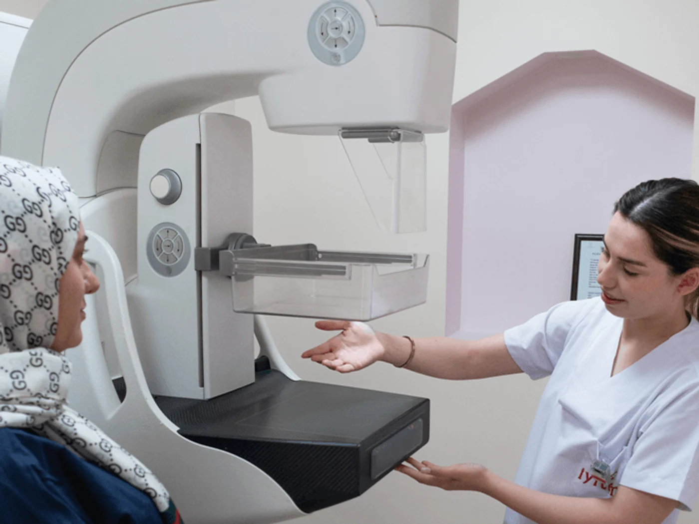
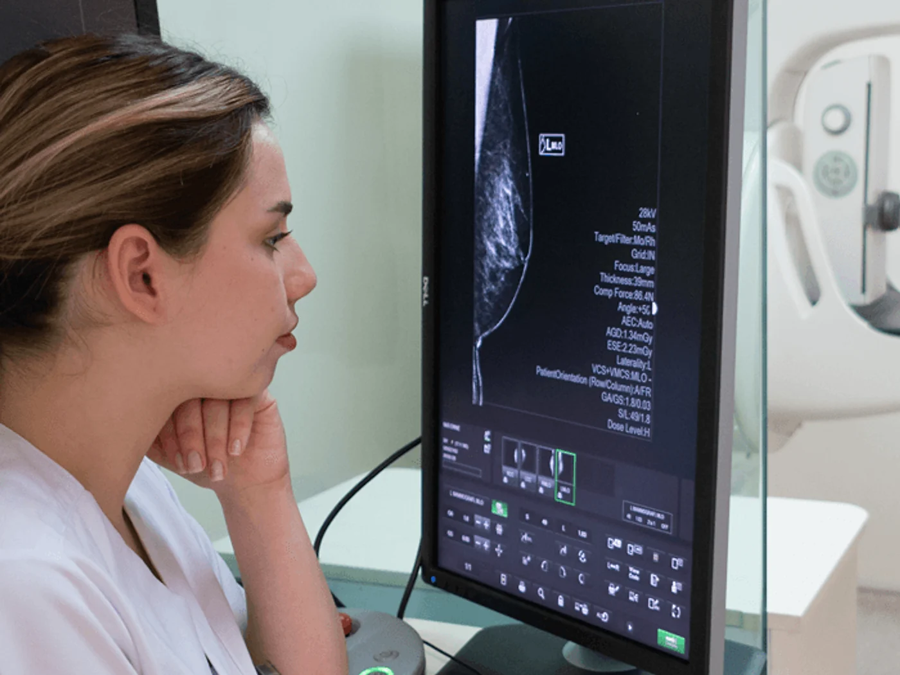

<strong>تصوير الثدي الشعاعي الرقمي فحص صحي يُنصح بإجرائه سنويًا للنساء ابتداءً من سنّ الأربعين. تُلتقط صورة رقمية للثدي الموضوع بين لوحين مخصّصين، ويستغرق هذا الفحص دقائق معدودة وقد يوفّر التشخيص المبكر الذي يُنقذ الحياة.</strong>

<figure></figure>

في تصوير الثدي الرقمي يُسقَط نسيج الثدي على الكاشف بالأشعة السينية وتتكوّن الصورة في الحاسوب. ويُستخدم إشعاع أقل بكثير مما كان يُستخدم في التصوير التماثلي القديم، وجودة الصورة أعلى بكثير. ويفضّل جرّاحو الثدي صور التصوير الرقمي. ولأن الصور يمكن تكبيرها خمس إلى ست مرات على شاشات طبية بدقة 5 ميغابكسل، يمكن كشف تكلّسات لا يتجاوز قطرها بضعة مليمترات. والتكلّسات المليمترية غير منتظمة الحدود في أورام الثدي تظهر على أفضل وجه بالتصوير الرقمي، إذ لا يمكن رؤية هذه التكلّسات الصغيرة بالتصوير التماثلي ولا بالموجات فوق الصوتية ولا بالرنين المغناطيسي.

<figure></figure>

<!--faq-->
[
  {
    "q": "متى يكون تصوير الثدي الرقمي ضروريًا؟",
    "a": "يُستخدم تصوير الثدي الشعاعي الرقمي لإظهار أورام الثدي، ولا سيّما التكلّسات المليمترية التي تظهر في الأورام."
  },
  {
    "q": "كم مرة ينبغي إجراء تصوير الثدي الرقمي؟",
    "a": "ينبغي للنساء فوق سنّ الأربعين إجراء الفحص روتينيًا مرة واحدة سنويًا. وإذا ظهرت آفة مشبوهة فإما أن يُجرى فحص متقدّم أو تُقصَّر الفترة بين الفحوصات إلى 4 أو 6 أشهر."
  },
  {
    "q": "ماذا نفعل من أجل راحتكم وسلامتكم؟",
    "a": "تصوير الثدي الرقمي فحص يُضغط فيه نسيج الثدي ضغطًا خفيفًا بين لوحين، ويجب أن يكون الفني الذي يُجريه ذا خبرة ودقة. ومن المهم تقييم الصور على شاشات طبية بدقة 5 ميغابكسل، كما أن خبرة طبيب الأشعة عامل مهم.\n(تُحفظ الصور والتقارير في نظام PACS لدى مركزنا لمدة 15 عامًا على الأقل.)"
  }
]
