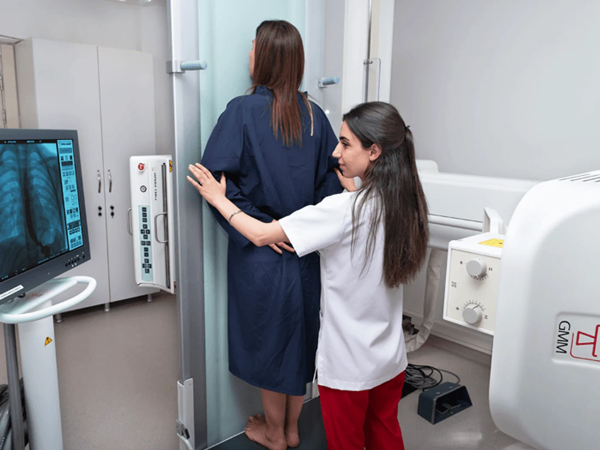
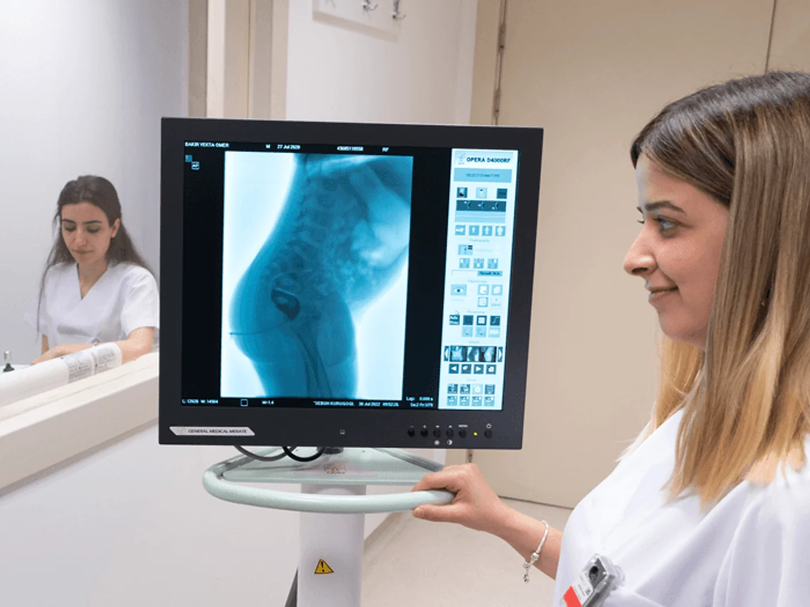
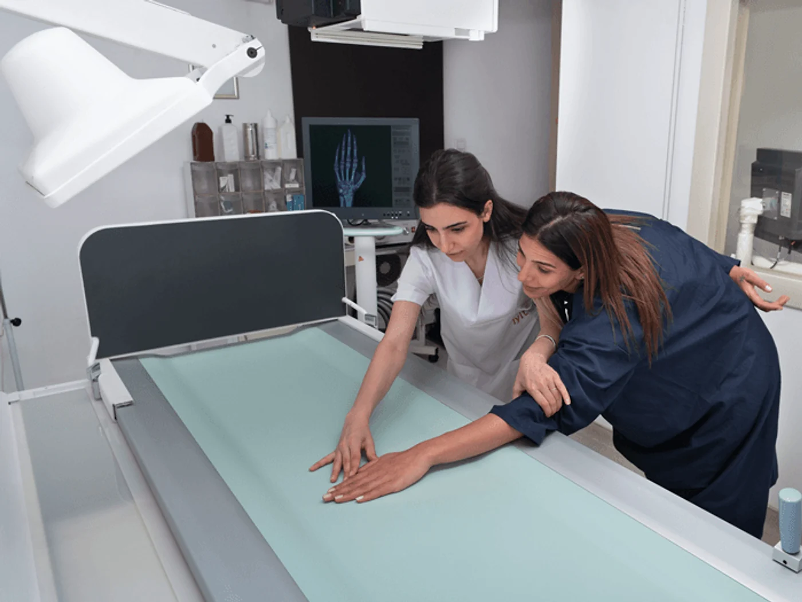

<strong>يتيح التصوير الشعاعي الرقمي إجراء فحوصات مثل تصوير الرحم والبوقين (HSG)، وتصوير الطول الكامل للأطراف وقياساته، وفحوصات المريء والمعدة والاثني عشر، وتصوير الأمعاء الدقيقة بالتباين المزدوج، وتصوير الأمعاء الغليظة (القولون) بالتباين المزدوج، وتصوير المثانة والإحليل أثناء التبول، وتصوير الإحليل الراجع.</strong>

الصورة الشعاعية هي الصورة الناتجة عن مرور الأشعة السينية عبر الأنسجة وسقوطها على كاشف. فالأشعة السينية تمرّ بسهولة عبر الأنسجة الرخوة فتُظلم الصورة، وتمرّ بصعوبة أكبر عبر العظم فيظهر العظم أبيض. وبذلك تُميّز هذه التقنية بين النسيج الرخو والعظم، وتُستخدم غالبًا لتصوير أمراض العظام.

ومع تطوّر التقنية أتاحت ألواح الكشف الرقمية الحصول على صور أعلى جودة بجرعة أشعة أقل بكثير. ويتيح التنظير الفلوري متابعة النسيج حيًّا بالأشعة السينية، ولذلك يُستخدم <strong>في تصوير المريء والمعدة والأمعاء، وفي إجراءات الخزعة، وفي تصوير الرحم والبوقين.</strong>

<figure></figure>

<h4>كيف تُجرى فحوصات التصوير الشعاعي الرقمي؟</h4>

نستخدم في مركز إيتيم للتصوير جهاز GMM Opera T للتصوير الشعاعي الرقمي المزوّد بالتنظير الفلوري. ويُجرى تصوير الجنف آليًا بالكامل بتقنية التجميع (stitching)، حيث يميل الأنبوب بواسطة الجهاز وتُدمج الصور تلقائيًا. وتُجرى بالتقنية نفسها <strong>صور الطول الكامل للأطراف</strong> وقياساتها. وفي التصوير الشعاعي الاعتيادي، تمنح اللوحة المسطحة الرقمية عالية التقنية بدقة 9 ميغابكسل أفضل جودة صورة ممكنة.

<figure></figure>

<strong>يُجرى تصوير الرحم والبوقين (HSG) دون ألم بواسطة قسطرة وبمرافقة فنية.</strong> ويمكن إجراء <strong>فحوصات المريء والمعدة والاثني عشر، وتصوير الأمعاء الدقيقة بالتباين المزدوج، وتصوير الأمعاء الغليظة (القولون) بالتباين المزدوج</strong> للأطفال والبالغين على حدّ سواء. أما تصوير المثانة والإحليل أثناء التبول فهو فحص يُظهر ارتجاع البول من المثانة إلى الحالبين، وهما القناتان الممتدتان من الكليتين إلى المثانة، ويُجرى في إيتيم على أيدٍ خبيرة. و<strong>تصوير الإحليل الراجع</strong> تقنية تصوير تفحص الإحليل، أي القناة الخارجة من المثانة.

<figure></figure>

<!--faq-->
[
  {
    "q": "متى يكون التصوير الشعاعي الرقمي ضروريًا؟",
    "a": "تُؤخذ الصور الشعاعية للكشف عن المشكلات في البُنى العظمية في الجسم. وفي بعض الحالات قد تُؤخذ أيضًا للكشف عن التكلّسات في الأنسجة الرخوة وعن الأجسام الغريبة والحصوات. وتنتج الصورة الشعاعية الرقمية عن مرور حزمة الأشعة السينية عبر الجسم وسقوطها على الكواشف ثم تكوين الصورة في الحاسوب. وبمجرد وجود الصورة في الحاسوب يصبح إرسالها وحفظها أسهل. وكلما ارتفعت دقة الكواشف بالبكسل تحسّنت جودة الصورة."
  },
  {
    "q": "هل يُستخدم الإشعاع في التصوير الشعاعي الرقمي؟",
    "a": "يستخدم التصوير الشعاعي الرقمي الأشعة السينية وبالتالي الإشعاع. وتُستخدم جرعات منخفضة جدًا عند متابعة الصورة الحيّة بالتنظير الفلوري. وتبلغ الجرعة في كل صورة شعاعية نحو 0.02 ميلي سيفرت، وهي كمية ضئيلة جدًا. وللمقارنة، فإن مشاهدة التلفاز من ساعتين إلى ثلاث ساعات يوميًا تُعرّض الإنسان لنحو 3 إلى 4 ميلي سيفرت سنويًا."
  },
  {
    "q": "ماذا نفعل من أجل راحتكم وسلامتكم؟",
    "a": "في التصوير الشعاعي الرقمي تُعيد الكواشف عالية التقنية إنتاج الصورة بأقصى درجة من الأمانة. ويمكن الحصول على الصور بإشعاع أقل بمقدار 30 إلى 50 ضعفًا مقارنةً بالتصوير الشعاعي التقليدي. ويمكن حفظ الصور الناتجة في الحاسوب وإرسالها عبر الإنترنت.\n(تُحفظ الصور والتقارير في نظام PACS لدى مركزنا لمدة 15 عامًا على الأقل.)"
  }
]
