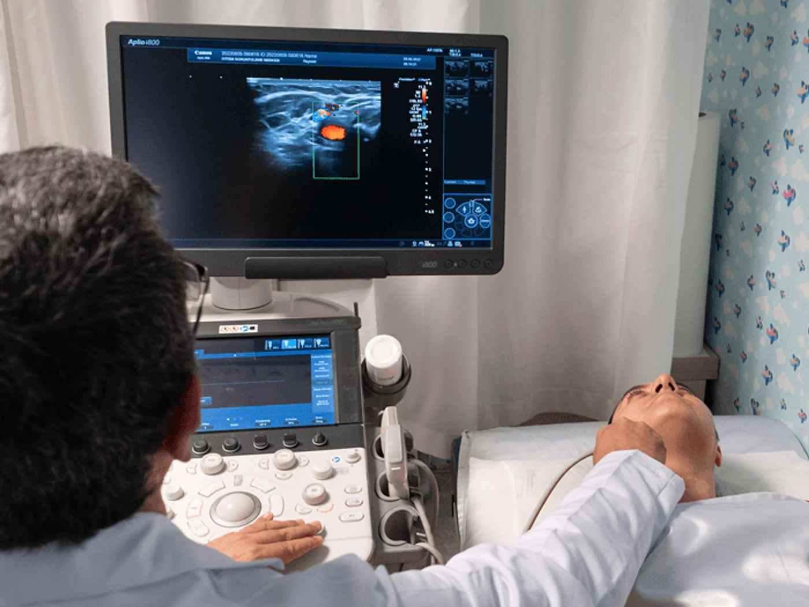
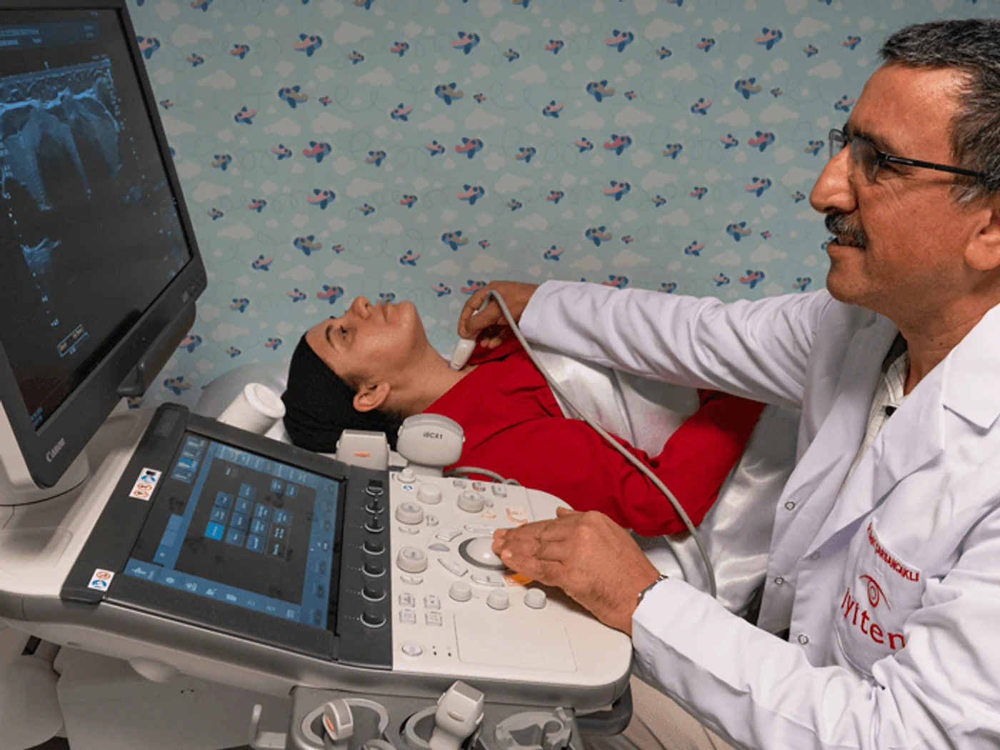

<strong>يتألف جهاز دوبلر الملوّن بالموجات فوق الصوتية من حاسوب رئيسي ووحدة تحكّم وشاشة ومجسّات. وتُظهر خاصية الدوبلر الملوّن سرعة الدم المتدفق في الأوعية ونمط جريانه بالألوان.</strong>

<figure></figure>

ينتج تصوير دوبلر الملوّن صورة حيّة من فروق التردد التي تُقاس عندما ترتدّ الموجات الصوتية المُرسَلة عبر المجسّ عن الأنسجة المختلفة. وله مزايا على طرق التصوير الأخرى في تقييم بعض الأنسجة كالمرارة.

<figure></figure>

نقدّم في مركز إيتيم للتصوير خدماتنا بجهاز Canon i800 لتصوير دوبلر الملوّن موديل 2019. ويُجرى في مركزنا تصوير دوبلر الملوّن لفحص أوعية الجسم كافة، وتخطيط صدى القلب لفحص القلب، وكذلك الخزعات الموجَّهة بالموجات فوق الصوتية.

<figure></figure>

<!--faq-->
[
  {
    "q": "متى يكون تصوير دوبلر الملوّن ضروريًا؟",
    "a": "التصوير بالموجات فوق الصوتية طريقة فحص تُنتج الصور باستخدام الموجات الصوتية، وهي ذات قيمة خاصة في فحص أعضاء البطن والغدة الدرقية وبُنى الرقبة. ولها مزايا على غيرها من وسائل التصوير في اضطرابات المرارة وأمراض الثدي وفحص نسيج الغدة الدرقية. كما تتيح خاصية الدوبلر الملوّن تقييم اتجاه الدم المتدفق في الأوعية وصوته ونمط جريانه، ويمكن إظهار التروية الدموية للكتل الورمية. ويمكن كذلك تصوير الجنين في رحم الأم، وفحص نسيج الدماغ وأوعيته لدى الأطفال، كما يمكن استخدامها في تقييم أمراض المفاصل."
  },
  {
    "q": "هل يُستخدم الإشعاع في تصوير دوبلر الملوّن؟",
    "a": "كما يدل الاسم، فإن التصوير بالموجات فوق الصوتية طريقة فحص تُنتج الصور باستخدام الموجات الصوتية، ولا يُستخدم فيها أي إشعاع. والموجات الصوتية لا تُلحق أي ضرر بجسم الإنسان، بل يمكن إجراء الفحص حتى للجنين في رحم أمه."
  },
  {
    "q": "ماذا نفعل من أجل راحتكم وسلامتكم؟",
    "a": "يستخدم مركزنا جهاز دوبلر ملوّن من كانون عالي التقنية يقدّم صورًا عالية الجودة. وإلى جانب المجسّات المستخدمة روتينيًا، يتوفّر مجسّ خاص بالأطفال يتيح فحص بطون الأطفال والرضّع. ويمكن إجراء تخطيط صدى القلب بمجسّ الإيكو. ويُجري الفحوصَ أطباء أشعة ذوو خبرة، ويُسلَّم قرص مدمج للفحص مع التقرير بعد 10 إلى 15 دقيقة من انتهائه.\n(تُحفظ الصور والتقارير في نظام PACS لدى مركزنا لمدة 15 عامًا على الأقل.)"
  }
]
