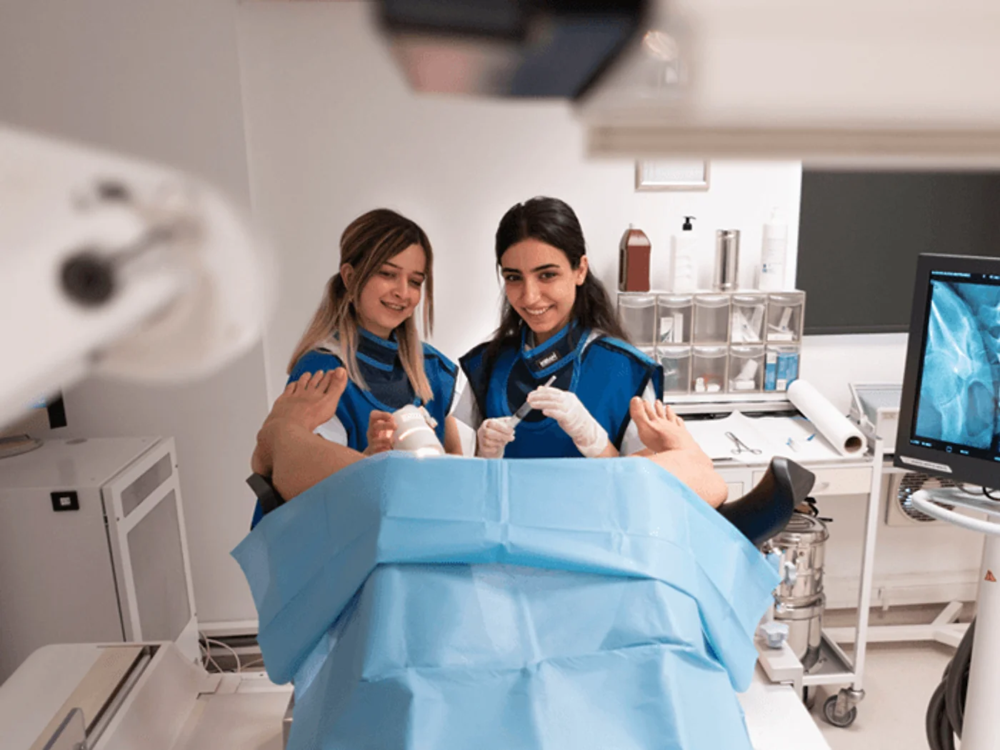
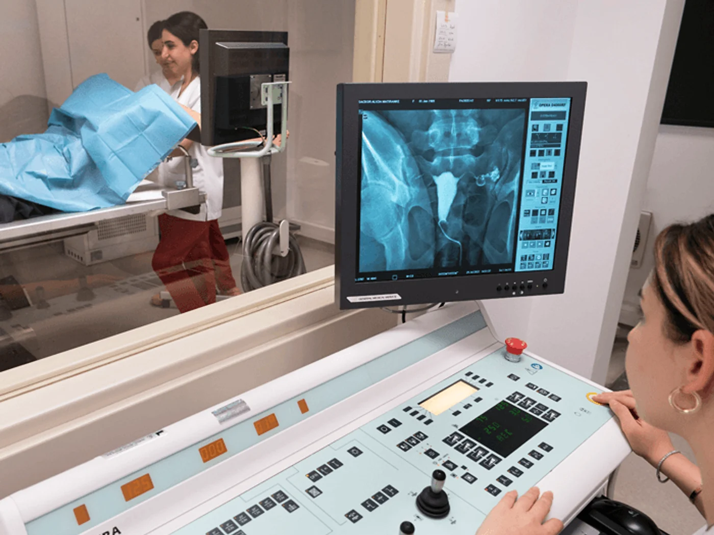
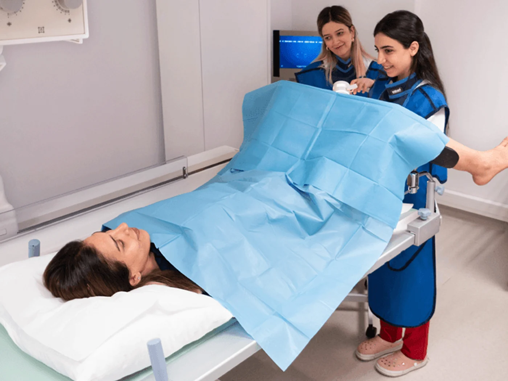
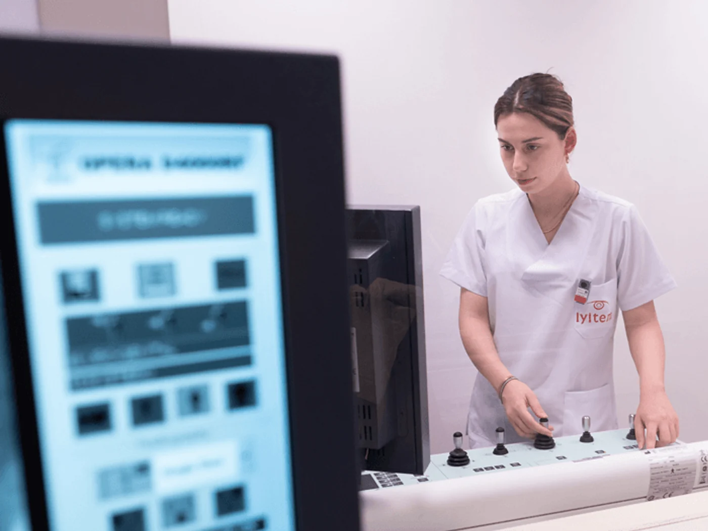

<strong>تصوير الرحم والبوقين (HSG) طريقة تصوير لفحص الرحم وقناتي فالوب. وهو فحص بالأشعة السينية يُجرى لتقييم حالة قناتي فالوب — وهما الطريق الذي يلتقي فيه الحيوان المنوي بالبويضة — وحالة تجويف الرحم الذي يقضي فيه الجنين نحو تسعة أشهر.</strong>

<figure></figure>

كان هذا الفحص فيما مضى مكلفًا وصعبًا نسبيًا. أما اليوم، ومع أجهزة الأشعة الرقمية والقساطر الليّنة الخاصة ومواد التباين المائية من الجيل الجديد، ومع ازدياد عدد أطباء الأشعة ذوي الخبرة بتزايد عدد الفحوصات، تراجعت التكلفة إلى مستوى معقول وصار ممكنًا إجراء فحوصات عالية الجودة بإشعاع منخفض ودون ألم يُذكر وبأقل قدر ممكن من المضاعفات. ومن المهم أن يكون من يُجري الفحص — طبيب أشعة كان أم فنيًا — ذا خبرة. ويولي مركزنا عناية خاصة لخصوصية المريضة، ويُنتج صورًا عالية الجودة بجهاز الأشعة الرقمي لدينا. والألم أثناء الفحص هو ما تخشاه المريضات أكثر من غيره؛ وباستخدام قسطرة بالونية رفيعة وبمرافقة فنياتنا ذوات الخبرة يُجرى الفحص دون ألم.

<figure></figure>

<h4>تقنية الفحص</h4>

هو إجراء من إجراءات الأشعة التداخلية يُوسَّع فيه المهبل بأداة تُسمى المنظار المهبلي، ثم تُوضع قسطرة بالونية رفيعة عند مدخل الرحم وتُحقن مادة التباين. ويُقيّم الفحص جدران الرحم وقناتي فالوب، ويمكن متابعة انفتاح القناتين وانتقال مادة التباين إلى تجويف البطن مباشرةً بالتنظير الفلوري.

فإذا لم يكن ثمة انسداد في القناتين وانتشرت مادة التباين في تجويف البطن انتشارًا طبيعيًا، فلا مانع من الحمل من هذه الناحية. أما إذا وُجدت التصاقات في القناتين، أو توسّعات وانسدادات ناجمة عن التهابات سابقة، ولم تتمكّن مادة التباين من الانتشار بحرية في تجويف البطن، فذلك يعني وجود مشكلة في انتقال البويضات إلى الرحم وفي حدوث الحمل. كذلك يتعذّر الحمل إذا وُجدت تشوّهات بنيوية أو التصاقات في تجويف الرحم، أو كتلة تُضيّقه. وبإظهار هذه التشوّهات وتشخيصها بهذا الفحص ينفتح الطريق أمام العلاج.

<figure></figure>

<strong>إجراء الفحص على جهاز أشعة رقمي عالي الجودة أمر بالغ الأهمية لجودة الصورة</strong>، لأن قناتي فالوب رفيعتان جدًا وتلزم صورة عالية الدقة لإظهار مرور مادة التباين فيهما. وأحيانًا تنفتح الالتصاقات في القناتين بضغط مادة التباين أثناء الفحص، فيكون الفحص نفسه علاجًا يُسهم في حدوث الحمل.

يُجرى الفحص بين اليوم الثامن والحادي عشر من بدء الدورة الشهرية، ويُطلب من المريضة الامتناع عن الجماع من انتهاء الدورة حتى موعد الفحص. ولأن العدوى قد تحدث نادرًا بعد الفحص، يُعطى علاج بالمضادات الحيوية قبله وبعده احتياطًا. ويمكن للمريضة العودة إلى حياتها الطبيعية بعد الإجراء. ولأنه غير مؤلم فلا حاجة إلى التخدير، والتخدير يزيد من مدة الإجراء وتكلفته. ومع ذلك يُعطى التخدير على يد طبيبة تخدير للمريضات اللواتي يطلبنه.

<figure></figure>

<!--faq-->
[
  {
    "q": "متى يكون تصوير الرحم والبوقين ضروريًا؟",
    "a": "هو فحص قد يطلبه طبيبك لمعرفة حالة قناتي فالوب، وما إذا كانت هناك تشوّهات بنيوية أو التصاقات في تجويف الرحم، أو كتلة تُضيّق التجويف وتحول دون الحمل. وبإظهار هذه التشوّهات وتشخيصها بهذا الفحص ينفتح الطريق أمام العلاج."
  },
  {
    "q": "هل يُستخدم الإشعاع في هذا الفحص؟",
    "a": "لأن الفحص يُجرى على جهاز أشعة رقمي مزوّد بالتنظير الفلوري، فإن الإشعاع يُستخدم فيه. ولأن الإجراء يكتمل بصورتين أو ثلاث فإن الجرعة منخفضة جدًا. ويُتابَع انتقال مادة التباين إلى الرحم وقناتي فالوب وانتشارها في تجويف البطن مباشرةً بالتنظير الفلوري."
  },
  {
    "q": "ماذا نفعل من أجل راحتكم وسلامتكم؟",
    "a": "يُجري الفحص فنيات حصرًا، وتُراعى الخصوصية طوال الإجراء. ولأن مادة التباين تُحقن عبر قسطرة فإن الفحص غير مؤلم ولا يحتاج إلى تخدير. ويُجرى في مركزنا دون ألم، ويُسلَّم التقرير خلال ساعة إلى ساعتين مع قرص مدمج للصور. وتُحفظ الصور والتقارير في مركزنا لمدة 15 عامًا على الأقل، ويمكن الاطلاع عليها عبر موقعنا عند الطلب."
  }
]
