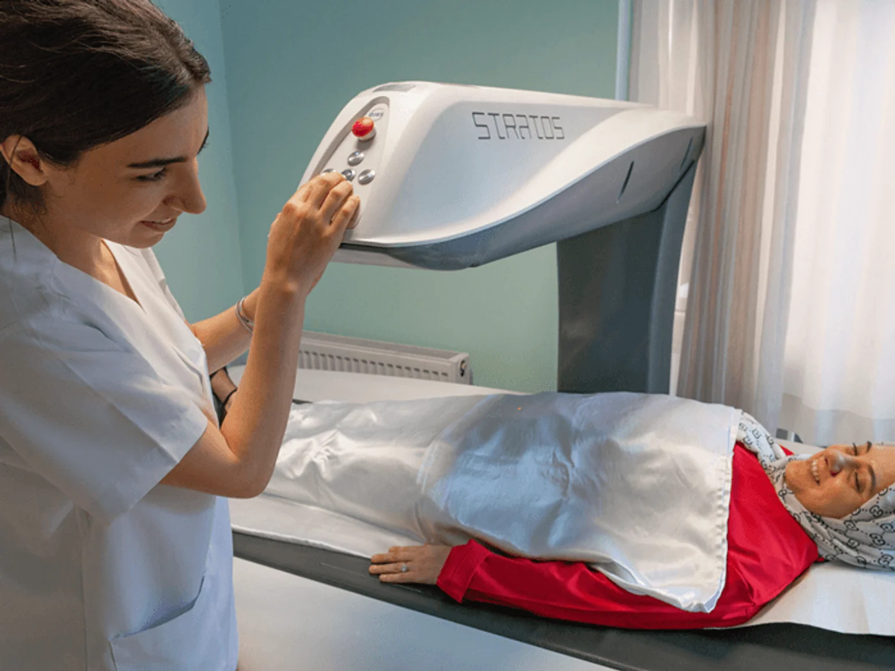
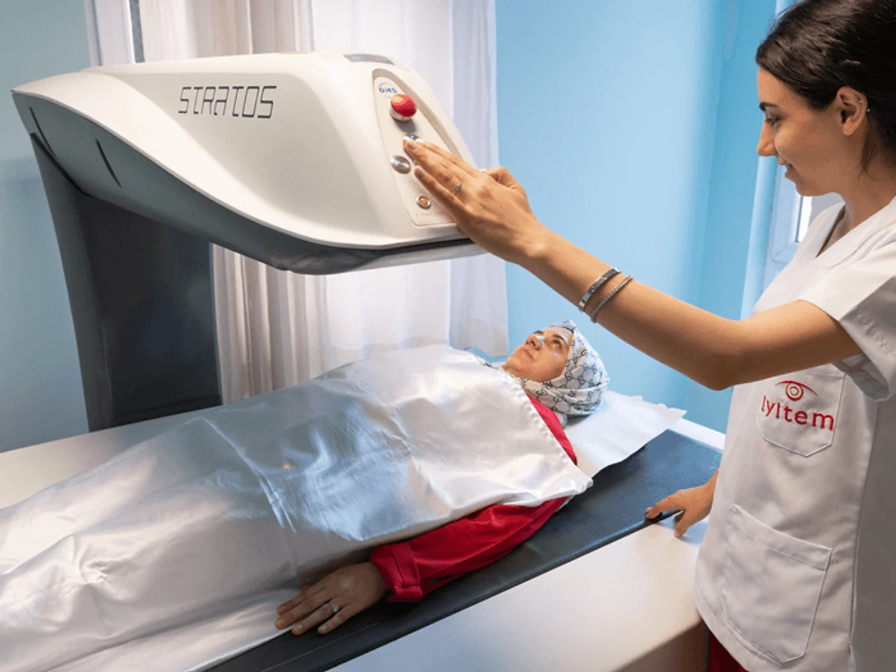
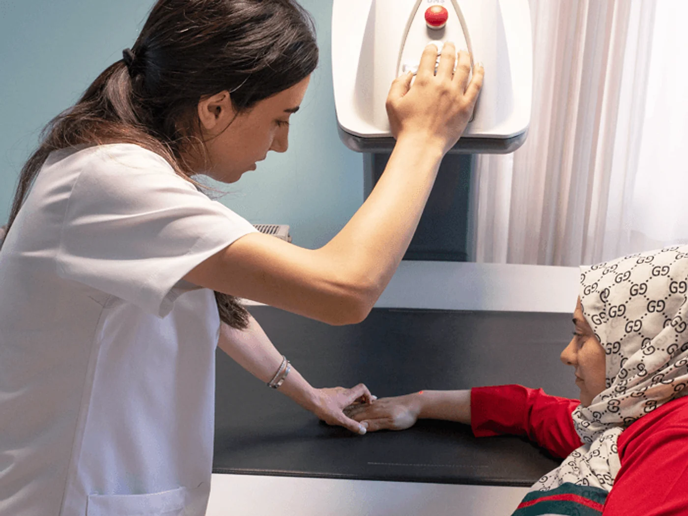

<strong>قياس كثافة العظام شكل متطوّر من التصوير الشعاعي يستخدم جرعة منخفضة من الأشعة السينية. تُصوَّر الفقرات بين L1 وL4 وعظم الورك، لأنها تُظهر فقدان كتلة العظم بوضوح. ويحدّد الفحص درجة الضعف في العظام وخطر الكسور.</strong>

<figure></figure>

يُعدّ فقدان كثافة العظام مشكلة صحية مهمة اليوم، ولا سيّما بين كبار السن. ومن المهم قياس درجة هذا الفقدان ومتابعته بأساليب معتمدة دوليًا.

نقدّم هذه الخدمة في مركز إيتيم للتصوير بجهاز DMS لقياس كثافة العظام. وإلى جانب القياس المعياري، يمكن إجراء قياس كثافة العظام للجسم بالكامل، وقياس كثافة عظم الكعبرة، وقياس كثافة العظام لدى الأطفال.

<figure></figure>

كما يتوفّر في مركزنا قياس كثافة العظام بتقنية QCT باستخدام جهاز التصوير المقطعي. ولأن تقنية QCT تقيس من الجزء المركزي للعظم في الفقرات القطنية، فإنها تُتيح نتائج أكثر موثوقية لدى المرضى الذين لديهم نتوءات عظمية.

<figure></figure>

<!--faq-->
[
  {
    "q": "متى يكون قياس كثافة العظام ضروريًا؟",
    "a": "فقدان كثافة العظام مشكلة خطيرة، ولا سيّما لدى النساء بعد سنّ اليأس. ومع التشخيص المبكر والعلاج المناسب يمكن منع المزيد من الفقدان. ومن المهم قياس كثافة العظام ومتابعتها وفق المعايير الدولية وعلى الجهاز نفسه إن أمكن. كما يلزم القياس والمتابعة لدى المصابين باضطرابات هرمونية، ومن تعرّضوا لرضوض، ومن أمضوا فترة طويلة في الراحة بالفراش."
  },
  {
    "q": "هل يُستخدم الإشعاع في قياس كثافة العظام؟",
    "a": "تعمل أجهزة قياس كثافة العظام بالإشعاع، غير أن الجرعة المُعطاة أقل بكثير من جرعة صورة الصدر الشعاعية، ولذلك لا ضرر منها."
  },
  {
    "q": "ماذا نفعل من أجل راحتكم وسلامتكم؟",
    "a": "يُجري قياس كثافة العظام فنيون ذوو خبرة على جهاز مطابق للمعايير الدولية. وينتهي الفحص خلال دقائق معدودة وتُسلَّم النتائج فور مراجعتها من طبيب الأشعة.\n(تُحفظ الصور والتقارير في نظام PACS لدى مركزنا لمدة 15 عامًا على الأقل.)"
  }
]
