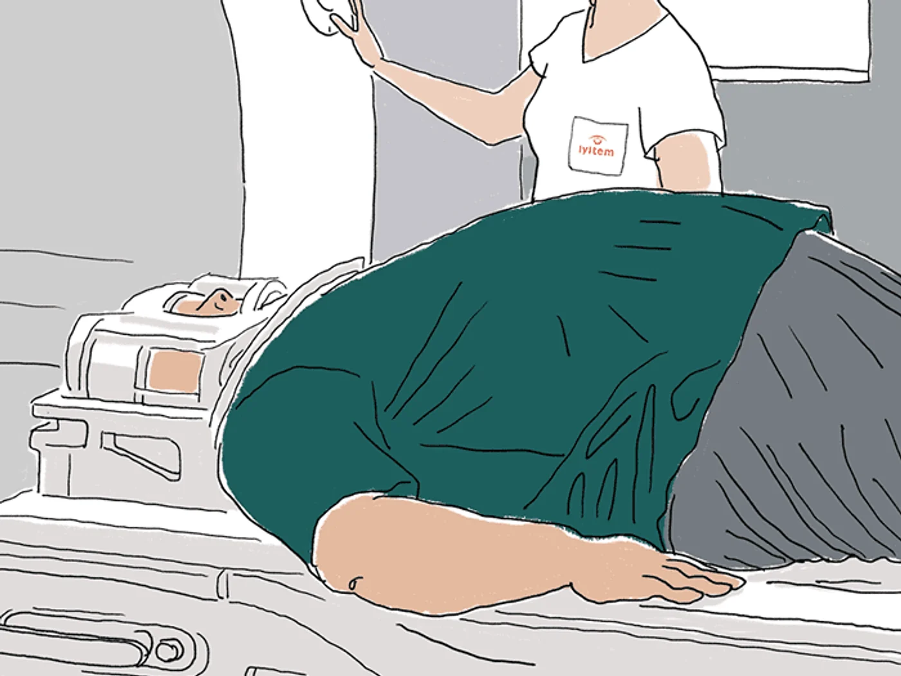

<strong>تستطيع الموجات الراديوية المستخدمة في الرنين المغناطيسي النفاذ عبر كميات كبيرة من الدهون. ومقارنةً بطرق التصوير الأخرى، فإن الرنين المغناطيسي هو الأقل تأثّرًا بالسمنة. ويؤدي قطر النفق وطوله وحدود وزن الطاولة وشدة المجال المغناطيسي دورًا مهمًا في إمكانية إجراء الفحص لذوي الوزن الزائد.</strong>

<figure></figure>

يستغرق فحص منطقة واحدة بالرنين المغناطيسي نحو 10 إلى 45 دقيقة، ويتوقّف هذا التفاوت على موضع المنطقة المفحوصة وكمية المعلومات المطلوب جمعها عن الحالة.

في أجهزة الرنين القديمة كان الوزن الذي يتجاوز 120 كجم يشكّل خطرًا على طاولة الجهاز. أما في مركزنا فيمكن تصوير المرضى حتى وزن 250 كجم، غير أن بعض الفحوصات قد تتعذّر إذا كان عرض جسم المريض كبيرًا جدًا.

ولذوي الوزن الزائد ينبغي ألا تقلّ شدة الجهاز عن 1.5 تسلا؛ فلأن المنطقة المطلوب جمع المعلومات عنها واسعة أصلًا، قد لا توفّر الأجهزة الأقل من 1.5 تسلا جودة صورة كافية. ومع جهاز 3 تسلا تُنتَج صور أعلى جودة وأدقّ مقاطع بفضل شدة المجال المغناطيسي الأعلى.

<!--faq-->
[
  {
    "q": "ماذا نفعل من أجل راحتكم وسلامتكم؟",
    "a": "يبلغ عرض النفق الذي يدخله المريض في جهاز 3 تسلا لدينا 70 سم، ما يوفّر أجواءً أكثر راحة. كما تزيد إمكانية مشاهدة التلفاز والاستماع إلى الموسيقى أثناء الفحص من هذه الراحة. ويختصر الذكاء الاصطناعي مدة الفحص. وعند الحاجة يمكن خفض مستوى الصوت كثيرًا بفضل خاصية «الرنين الصامت». ويُسلَّم التقرير بعد ساعات قليلة من الفحص. ولأن جهاز الرنين مغناطيس كبير، يجب ألا يبقى أي معدن على المريض أثناء الفحص؛ ولذلك تُخلع الملابس ويُرتدى ثوب الفحص. كما تتوفّر في غرفة الرنين منظومة أكسجين وشفط تحسّبًا لأي طارئ. ويرافق الفحوصات أطباء وفنيون ذوو خبرة إلى جانب ممرضة طوارئ.\n(تُحفظ الصور والتقارير في نظام PACS لدى مركزنا لمدة 15 عامًا على الأقل.)"
  }
]
