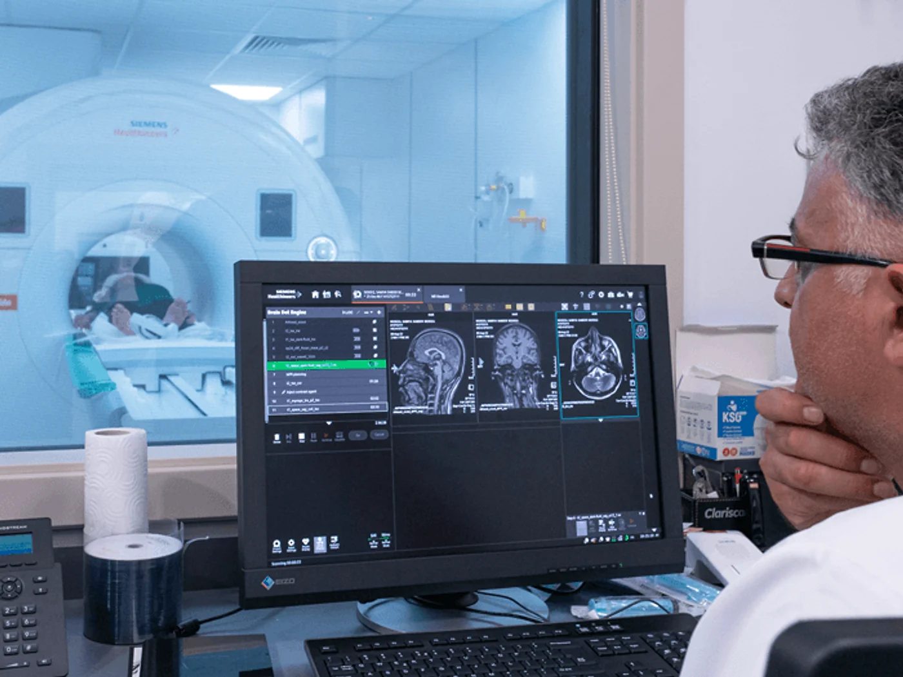

<strong>التصوير بالرنين المغناطيسي تقنية تصوير تعتمد على تغيير اتجاه المجالات المغناطيسية لذرات الهيدروجين في الجسم بواسطة موجات الراديو، ثم قياس الطاقة التي تُطلقها، مع الاستفادة من أن كل نسيج يُطلق قدرًا مختلفًا من الطاقة.</strong>

ولأن كل نسيج يحتوي على كمية مختلفة من الهيدروجين، يمكن التمييز بين الأنسجة المختلفة كالماء والدهون والعضلات والعظام والنسيج العصبي والأورام والأنسجة المصابة بالالتهاب. وتُقاس قوة جهاز الرنين المغناطيسي بوحدة التسلا. واليوم تكفي أجهزة 1.5 تسلا و3 تسلا للحصول على تصوير مثالي، وقد بدأت أجهزة 7 و10.5 تسلا تدخل حيّز الاستخدام حديثًا. غير أنه فوق حد معيّن من شدة المجال المغناطيسي يبدأ الجهاز بإحداث تأثير شبيه بفرن الميكروويف فترتفع حرارة الجسم.

<h4>تفاصيل أدق مع الرنين المغناطيسي 3 تسلا</h4>

نقدّم في مركز إيتيم للتصوير خدماتنا بجهاز سيمنس فيدا 3 تسلا موديل 2022. وإلى جانب فحوصات الرنين المغناطيسي الاعتيادية، يتيح لنا هذا الجهاز المتطور إجراء فحوصات متقدمة مثل الرنين المغناطيسي الوظيفي، والتحليل الطيفي بالرنين المغناطيسي، وتصوير المسالك العصبية، وتصوير الأمعاء بالرنين، ورنين القلب، والرنين متعدد المعايير للبروستاتا والكبد، وتصوير الأوعية في حالات التهاب الأوعية، وتصوير الأعصاب بالرنين، والرنين المغناطيسي للجسم بالكامل.

<figure></figure>

<!--faq-->
[
  {
    "q": "متى يكون التصوير بالرنين المغناطيسي ضروريًا؟",
    "a": "يوفّر الرنين المغناطيسي دقة تمييز عالية للأنسجة، ولذلك يُظهر الأنسجة الرخوة بوضوح كبير. كما أنه مهم في تصوير الجزء الإسفنجي (النخاعي) من العظم.\n \nولأن نسيج الرئة والجيوب الأنفية يحتويان في معظمهما على الهواء، لا يلتقط الرنين المغناطيسي إشارة منهما. لذا فإن التصوير المقطعي المحوسب أفضل عمومًا من الرنين في فحص نسيج الرئة ومنطقة الجيوب الأنفية. وفي المرارة مثلًا يمكن استخدام الرنين، إلا أن التصوير بالموجات فوق الصوتية أفضل منه عمومًا. وكذلك، ولأن الأمعاء تحتوي على هواء، فإن التصوير المقطعي المحوسب أو تصوير القولون بالتباين المزدوج أفضل عمومًا من الرنين في بعض الحالات. أما في سائر مناطق الجسم فيُستخدم الرنين المغناطيسي.\n\nويتفوق الرنين المغناطيسي عمومًا على الفحوصات الأخرى في دراسة الجهاز العصبي، وفي فحص مفاصل الكتف والورك والركبة والكاحل، وفي فحص مناطق الرقبة والظهر وأسفل الظهر. كما يُستخدم عادةً في تقييم العضلات والطبقات الدهنية تحت الجلد وأعضاء البطن."
  },
  {
    "q": "هل التصوير بالرنين المغناطيسي ضار؟",
    "a": "لا يستخدم الرنين المغناطيسي أي إشعاع، ولم يثبت حتى اليوم أي ضرر للمجال المغناطيسي المستخدم فيه على جسم الإنسان. بل يُستخدم الرنين إلى جانب التصوير بالموجات فوق الصوتية للتشخيص المبكر لدى الأجنة في رحم الأم. ومع أجهزة 7 و10 تسلا التي بدأت تدخل الاستخدام تدريجيًا ترتفع حرارة الجسم خلال الفحوصات الطويلة، غير أن هذا التأثير غير موجود في أجهزة 1.5 و3 تسلا. أما الأطراف الاصطناعية المعدنية فقد تسبب تسخينًا في الأنسجة المحيطة إن كانت من الحديد أو الفولاذ لا من التيتانيوم. ولا تتأثر الدعامات القلبية بالرنين المغناطيسي. وقد تتضرر صمامات القلب الاصطناعية إن لم تكن من التيتانيوم، علمًا بأن جميع صمامات القلب المستخدمة خلال العشرين إلى الثلاثين سنة الماضية مصنوعة من التيتانيوم. وقد تتضرر أجهزة تنظيم ضربات القلب، ولذلك ينبغي لمن يحمل جهاز تنظيم ألا يخضع للرنين المغناطيسي؛ إلا أنه يمكن إجراء الفحص في بيئة المستشفى تحت إشراف طبيب القلب وبحضور فنيي الشركة المصنّعة مع إبطاء الجهاز. ولا تتضرر الأطراف الاصطناعية العظمية المصنوعة من التيتانيوم، بل صار بالإمكان اليوم بفضل تسلسلات حديثة الحصول على معلومات عن النسيج الرخو والبنية العظمية المحيطة بالطرف الاصطناعي. ولا مانع كذلك من تصوير المناطق البعيدة عن الأطراف الاصطناعية التيتانيومية. ولأن الأشهر الثلاثة الأولى من الحمل هي مرحلة تكوّن الأعضاء، لا تخضع الحوامل للرنين المغناطيسي خلال الثلث الأول احتياطًا، رغم عدم ثبوت أي ضرر."
  },
  {
    "q": "هل يُستخدم الإشعاع في التصوير بالرنين المغناطيسي؟",
    "a": "جهاز الرنين المغناطيسي عبارة عن مغناطيس كبير، وتُنتَج الصور باستخدام المجال المغناطيسي. فلا إشعاع فيه ولا تُستخدم الأشعة السينية. وليس للرنين المغناطيسي أي أعراض جانبية معروفة، بل يُجرى حتى للأجنة في رحم الأم."
  },
  {
    "q": "هل يمكن لذوي الوزن الزائد إجراء الرنين المغناطيسي؟",
    "a": "في الأجهزة القديمة لم يكن يُسمح لمن يزيد وزنهم على 120 كجم بالدخول إلى الجهاز، إذ كان المرضى الأثقل وزنًا قد يُلحقون ضررًا بطاولة الجهاز. أما في الأجهزة الحديثة فيمكن تصوير جميع المرضى حتى وزن 250 كجم. وبطبيعة الحال تقلّ جودة الصورة قليلًا كلما زاد الوزن."
  },
  {
    "q": "من الذي لا يمكنه إجراء الرنين المغناطيسي؟",
    "a": "- حاملو أجهزة تنظيم ضربات القلب\n\n- من لديهم صمام قلب معدني غير تيتانيومي\n\n- من لديهم طرف اصطناعي معدني غير تيتانيومي لا يمكن تصوير المنطقة التي فيها الطرف الاصطناعي، إذ يتعذّر تقييمها بسبب التشوّه الذي يُحدثه المعدن.\n\n- الأطفال الذين لا يستطيعون البقاء بلا حركة أثناء الفحص، وذوو الإعاقة الذهنية، لا يمكن تصويرهم إلا تحت التخدير.\n\n- من لديهم حركات لا إرادية لا يمكن تصوير المناطق المتحركة لديهم.\n\n- من يزيد وزنهم على 250 كجم لا يمكن تصويرهم.\n\n- الحوامل في الثلث الأول من الحمل لا يمكنهن إجراء الفحص؛ فلأن الأشهر الثلاثة الأولى هي مرحلة تكوّن الأعضاء، لا تخضع الحوامل للرنين خلال هذه الفترة احتياطًا رغم عدم ثبوت أي ضرر.\n\n- من يُشتبه بوجود جسم معدني غريب في عينه لا يمكن تصويره.\n\n- إذا وُجد جسم معدني غريب في أي موضع من الجسم بجوار الأوعية الدموية، لا يُجرى الفحص خشية أن يتحرك ويُلحق ضررًا."
  },
  {
    "q": "هل هناك تحضير قبل الفحص؟ وما الذي يجب الانتباه إليه أثناءه؟ وهل يمكنني إجراؤه بمفردي؟ وهل هو فحص مخيف؟",
    "a": "الرنين المغناطيسي فحص يمكن إجراؤه بمفردك، وقد يحتاج كبار السن ومن يعانون صعوبة في المشي إلى مساعدة. ولا يُشترط عادةً أي تحضير قبل الفحص سوى الصيام من ساعتين إلى ثلاث ساعات، وهو احتياط لتفادي الغثيان والقيء — وهما نادران — في حال إعطاء مادة تباين عبر الوريد. والحساسية تجاه مادة تباين الرنين نادرة جدًا، غير أن المرضى التأتّبيين الذين لديهم حساسية من أدوية كثيرة قد يحتاجون إلى اختبار حساسية للمادة المستخدمة.\n \nويجب على المريض البقاء بلا حركة أثناء الفحص، فأي حركة تتجاوز التنفس الطبيعي تُفسد الصورة. وقد لا يتمكّن المصابون برهاب الأماكن المغلقة الحقيقي من إجراء الفحص؛ وهؤلاء لا يستطيعون ركوب المصعد أيضًا، ويمكن تصويرهم تحت التخدير. أما من لديهم قلق (اضطراب القلق) لا رهاب حقيقي فيمكنهم إجراء الفحص بيسر مع الدعم النفسي. وتوفّر مشاهدة التلفاز أو الاستماع إلى الموسيقى أثناء الفحص أجواءً أكثر راحة."
  },
  {
    "q": "ماذا نفعل من أجل راحتكم؟",
    "a": "يبلغ عرض النفق الذي يدخله المريض في جهاز 3 تسلا لدينا 70 سم، ما يوفّر أجواءً أكثر راحة. كما تزيد إمكانية مشاهدة التلفاز والاستماع إلى الموسيقى أثناء الفحص من هذه الراحة. ويختصر الذكاء الاصطناعي مدة الفحص. وعند الحاجة يمكن خفض مستوى الصوت كثيرًا بفضل خاصية «الرنين الصامت». ويُسلَّم التقرير بعد ساعات قليلة من الفحص.\n(تُحفظ الصور والتقارير في نظام PACS لدى مركزنا لمدة 15 عامًا على الأقل.)"
  },
  {
    "q": "ماذا نفعل من أجل سلامتكم؟",
    "a": "لأن جهاز الرنين المغناطيسي مغناطيس كبير، يجب ألا يبقى أي معدن على المريض أثناء الفحص؛ ولذلك تُخلع الملابس ويُرتدى ثوب الفحص. كما تتوفّر في غرفة الرنين منظومة أكسجين وشفط تحسّبًا لأي طارئ. ويرافق الفحوصات أطباء وفنيون ذوو خبرة إلى جانب ممرضة طوارئ."
  }
]
