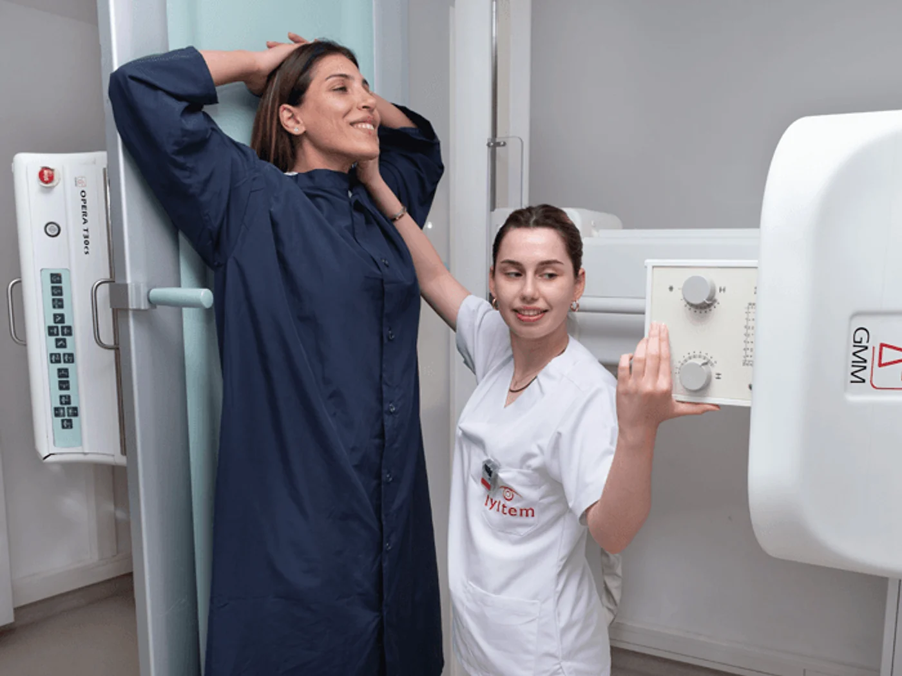
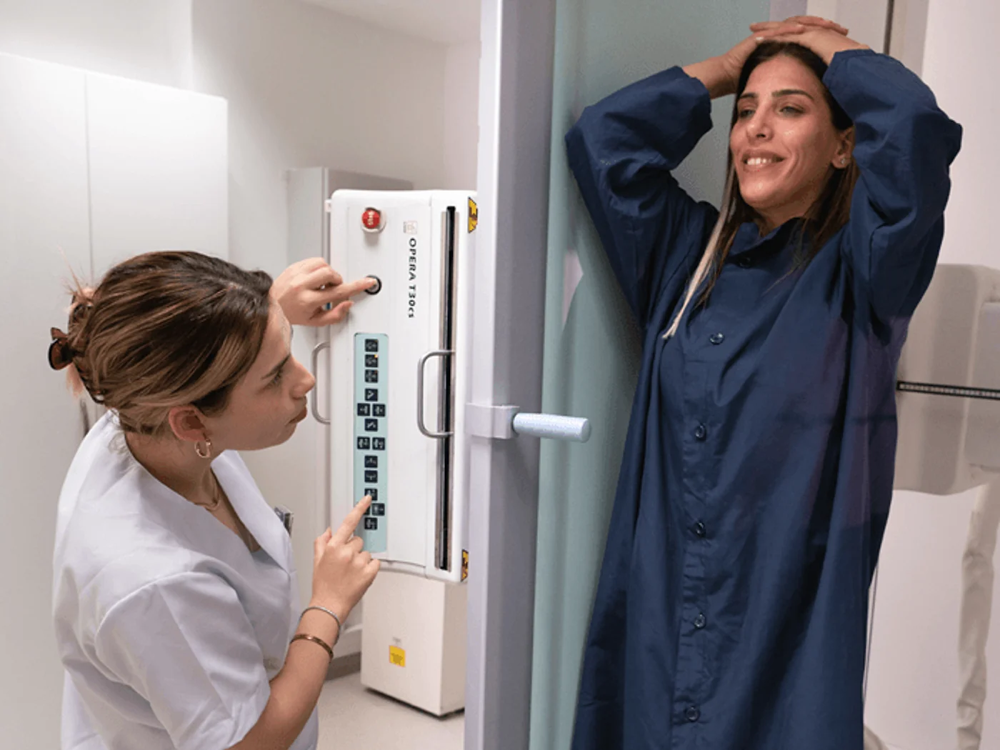
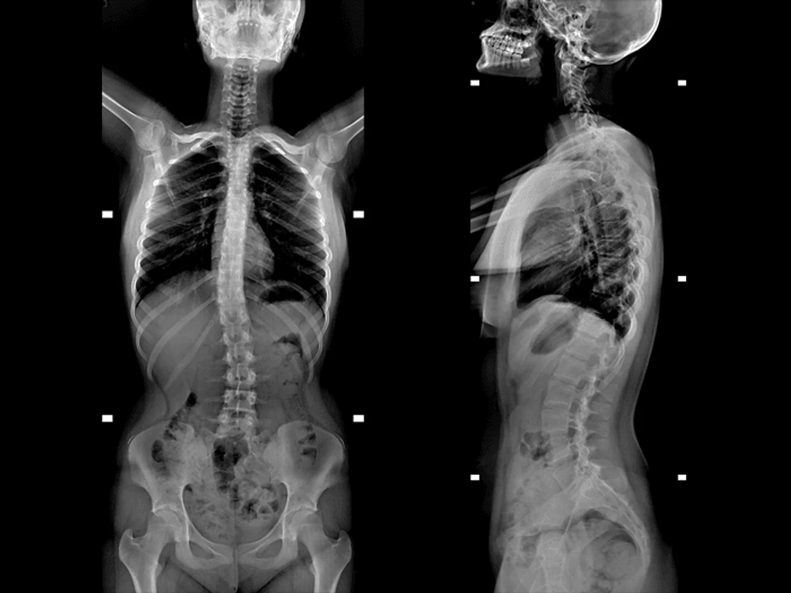

<strong>تصوير الجنف تقنية لتصوير الانحناءات في منطقتي الظهر وأسفل الظهر. وتُلتقط فيه صور أمامية-خلفية وجانبية بشكل معياري. ويُحدّد الفحص وجود الانحناء من عدمه، كما يُحدّد درجة الجنف عبر القياسات التي تُجرى على الصور.</strong>

<figure></figure>

الجنف انحناء جانبي في العمود الفقري، ويلزم تصحيحه جراحيًا على يد جرّاحي العمود الفقري إذا تجاوز زاوية معيّنة. ولذلك يجب أن يظهر العمود الفقري بأكمله في صورة واحدة، وأن تُجرى قياسات الزاوية (زاوية كوب) بدقة بالغة.

<h4>كيف يُجرى تصوير الجنف؟</h4>

لأنه لا يمكن التقاط العمود الفقري بأكمله في صورة واحدة، يلزم التقاط ثلاث أو أربع صور ودمجها. وكانت هذه الصور تُلتقط سابقًا بالتتابع وتُدمج يدويًا، ما جعل الحصول على صورة مركّبة موثوقة أمرًا بالغ الصعوبة. أما مع أجهزة الأشعة الرقمية الحديثة فيميل الحاسوب بالأنبوب آليًا أثناء التقاط الصور ثم يدمجها مباشرةً، فتنتج صورة للعمود الفقري كاملًا. وتُلتقط الصور الأمامية-الخلفية والجانبية معًا.

<figure></figure>

يُجرى تصوير الجنف في مركز إيتيم للتصوير بجهاز الأشعة الرقمي GMM المزوّد بالتنظير الفلوري، ما يتيح التقاط صور بزوايا مختلفة. ويدمج الحاسوب الصور فتنتج <strong>صور شعاعية رقمية عالية الجودة</strong>. ولأن الكاشف المستخدم عالي الدقة، فإن <strong>الجودة أفضل بكثير من الصور التقليدية وصور CR.</strong> ويُجري القياسات أطباؤنا ذوو الخبرة.

<figure></figure>

<!--faq-->
[
  {
    "q": "متى يكون تصوير الجنف ضروريًا؟",
    "a": "إذا اشتُبه بوجود انحناء في الظهر أو أسفل الظهر، يحتاج الطبيب إلى رؤية العمود الفقري بأكمله في صورة واحدة لتشخيص درجة الانحناء ومتابعتها. وبالأشعة الرقمية وتقنية التجميع يمكن إنجاز ذلك بدقة وبأدنى جرعة ممكنة. أما الأشعة التقليدية فتُعطي جرعة أعلى، ولأن الصور لا تُدمج بالحاسوب فلا يمكن الحصول على نتائج دقيقة تمامًا."
  },
  {
    "q": "هل يُستخدم الإشعاع في تصوير الجنف؟",
    "a": "يُجرى تصوير الجنف على جهاز أشعة رقمي بتقنية التجميع، ولذلك فهو ينطوي على إشعاع. ويميل الأنبوب فتُلتقط آليًا ثلاث أو أربع صور للعمود الفقري بأكمله، ثم يدمجها برنامج حاسوبي في صورة واحدة تُظهر العمود الفقري كاملًا. ولأن أقصى ما يمكن التقاطه في صورة واحدة نحو 40 سنتيمترًا، تُلتقط صور تغطي العمود الفقري كله وتُدمج آليًا. وبذلك تعادل الجرعة الإجمالية ثلاث أو أربع صور صدر شعاعية، وهي جرعة منخفضة جدًا."
  },
  {
    "q": "ماذا نفعل من أجل راحتكم وسلامتكم؟",
    "a": "لأن التقاط الصور ودمجها يتمّان بتحكّم حاسوبي كامل وبشكل آلي، يقلّ احتمال الخطأ في التركيب إلى أدنى حدّ. وبعد التقاط الصور تُجرى القياسات ويُجهَّز القرص المدمج والتقرير خلال ساعة أو ساعتين، ويُحفظان في أرشيف PACS لدينا لمدة 15 عامًا على الأقل. ودقة الكاشف الرقمي 9 ميغابكسل، ولذلك فإن جودة الصور عالية.\n(تُحفظ الصور والتقارير في نظام PACS لدى مركزنا لمدة 15 عامًا على الأقل.)"
  }
]
