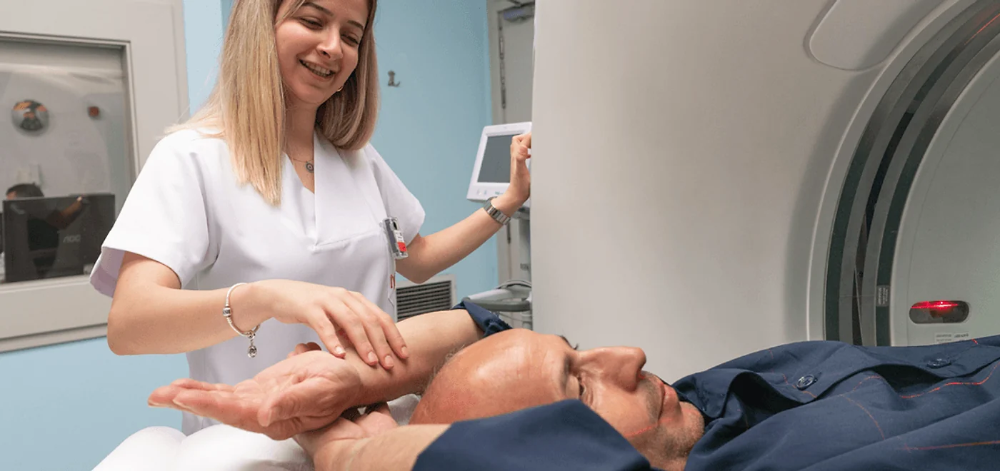

<h1><strong>خدمة جديرة بالثقة</strong></h1>

تأسّس مركز إيتيم للتصوير عام 1995 وانتقلت إدارته إلينا عام 2011، وهو معروف بجودته في مجاله. ويحرص مركزنا، الذي يهدف إلى تقديم خدمة جيدة بسعر مناسب، على أن يكون جديرًا بالثقة بكادره وأطبائه. <strong>فالأطباء والمرضى الذين يقدّرون الجودة والموثوقية يختارون إيتيم.</strong>

<figure></figure>

<h1><strong>مبادئنا</strong></h1>

إبداء أسمى درجات الاحترام لحياة الإنسان،

إعطاء الأولوية لصحة المريض وعافيته،

احترام استقلالية المريض وكرامته،

تقديم رعاية صحية عالية الجودة وفق المعايير المعاصرة،

العمل وفق القوانين النافذة ولوائح وزارة الصحة ومتطلبات نظام إدارة الجودة،

تقديم الدعم للفقراء والمحتاجين.

<h1><strong>رؤيتنا</strong></h1>

لطالما كان تقديم خدمة عالية الجودة بسعر مناسب مع المتابعة الحثيثة للتقنية أمرًا مهمًا بالنسبة إلينا. وهدفنا أن نُعرَف مركزًا جديرًا بالثقة، وأن ننال ثقة مرضانا ومحبتهم واحترامهم.

<h1><strong>رسالتنا</strong></h1>

معيارنا هو تقديم خدمة عالية الجودة لمرضانا دون الخروج قط عن المعايير الأخلاقية. ونقدّم خدمة عالية الجودة بأنسب سعر للمرضى الفقراء والمحتاجين. ولا ندخل في علاقات غير أخلاقية من أجل اجتذاب المرضى. فنحن نقدّم خدمتنا اعتمادًا على موثوقيتنا وجودتنا.

