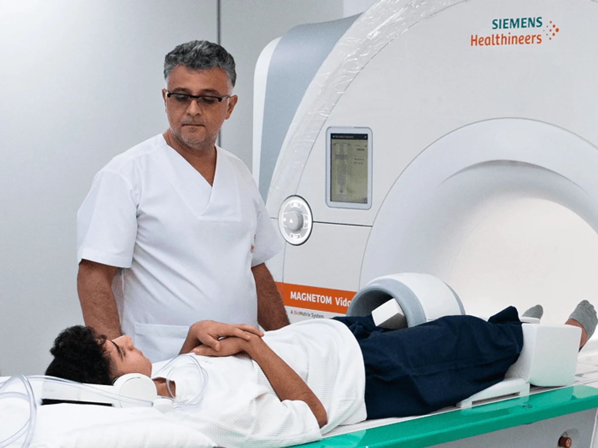

MRI scanners are classified by their field strength in tesla. The first scanners were 0.02 tesla: examinations took a very long time and images looked faint. Then 0.5 and 1 tesla scanners came into use, times shortened somewhat and images became clearer. Over the past 30 years, 1.5 tesla scanners made images clearer still and shortened examinations further. New techniques such as MR spectroscopy, MR tractography, functional MRI and cardiac MRI came into use. Over the past 20 years, 3 tesla scanners have improved all of these, along with the image quality of routine MRI, and shortened examinations further. The bores patients enter have widened and patient comfort has improved. Because of the higher field strength of 3 tesla, sequences are shorter than on 1.5 tesla scanners, slice thicknesses have decreased and images are sharper. Anatomy can be assessed far more clearly. MR spectroscopy can now be performed on much smaller areas, and advances in diffusion imaging mean multiparametric prostate MRI is now performed with much better, thinner-slice images. T1 and T2 mapping and perfusion MRI can be carried out in shorter times and with thinner slices.

<figure></figure>

<h4>What are the features of 3 Tesla MRI?</h4>

Thanks to its higher field strength, a 3 tesla scanner delivers <strong>faster, thinner-slice, higher-quality imaging</strong> than lower-field scanners. The difference is greater still in advanced studies such as functional MRI, tractography and spectroscopy. Spectroscopic examination of spinal masses becomes possible. With artificial intelligence, sequences can be accelerated up to fourfold. Where needed, <strong>“Quiet MRI”</strong> makes for a <strong>more comfortable</strong> experience. Whole-body MRI is faster and of higher quality. The scan is more comfortable, particularly for claustrophobic patients, thanks to the 70 cm wide magnet and the option of watching television or listening to music. Advanced studies such as cardiac MRI and multiparametric prostate and liver MRI are of higher quality on a 3 tesla scanner. Patients weighing up to 250 kg can be scanned. Vessel imaging for vasculitis and MR neurography for the peripheral nerves can also be performed.

