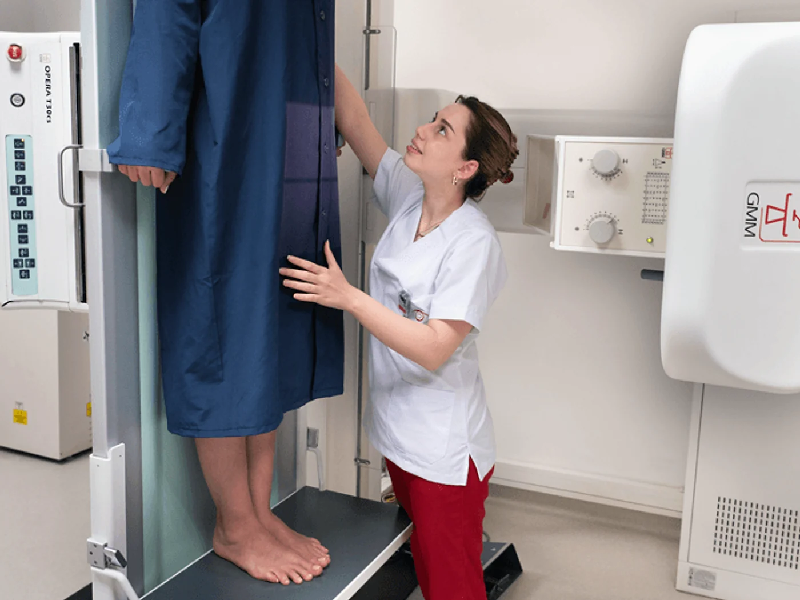
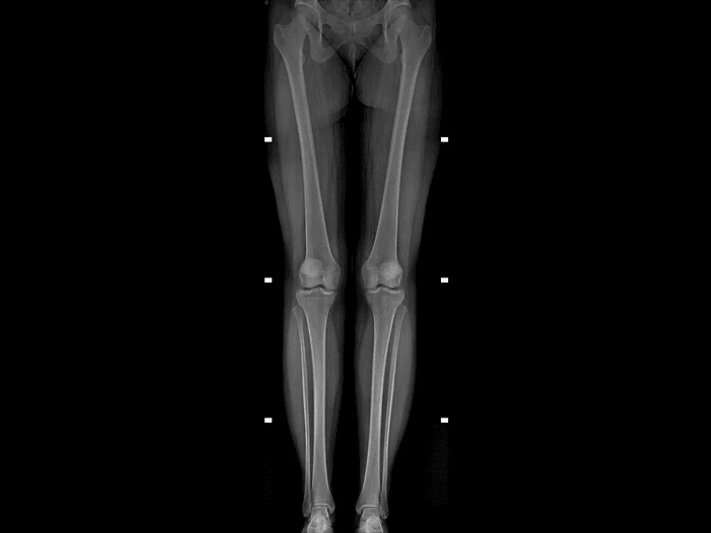

<strong>This is an X-ray that allows all the bony structures of both lower limbs — from hip to foot — to be assessed in a single image. As with the scoliosis X-ray, it is produced by taking three or four images and joining them together.</strong>

<figure></figure>

<h4>How is a full-length leg X-ray taken?</h4>

With our digital X-ray system, images are taken in sequence under computer control, the tube being angled while the patient remains completely still. The resulting images are joined using artificial intelligence to produce the full-length view. This allows the lengths of the two legs to be compared and the bony structures and joints to be assessed. Measurements are made by our experienced doctors.

<figure></figure>

<!--faq-->
[
  {
    "q": "When is a full-length leg X-ray needed?",
    "a": "A full-length leg X-ray covering both lower limbs is taken to show shortening and deformity in the legs on a single image. Because at most about 40 centimetres can be captured in one image, two or three radiographs are taken from the hip down to the sole of the foot using the stitching technique, with the tube angled automatically, and joined by computer."
  },
  {
    "q": "Is radiation used?",
    "a": "This is a digital X-ray study, and the total dose is equivalent to two or three chest X-rays. A chest X-ray is roughly 0.02 millisieverts. The annual dose permitted by the World Health Organization is around 50 millisieverts."
  },
  {
    "q": "What do we do for your comfort and safety?",
    "a": "Because both the acquisition and the joining are fully computer-controlled and automatic, the chance of error in the composite is reduced to a minimum. Once the images are taken, measurements are made and the CD and report are prepared within an hour or two. Reports are kept in our PACS archive for at least 15 years. The digital detector has 9 megapixels, so image quality is high.\n(Images and reports are kept in our centre's PACS system for at least 15 years.)"
  }
]
