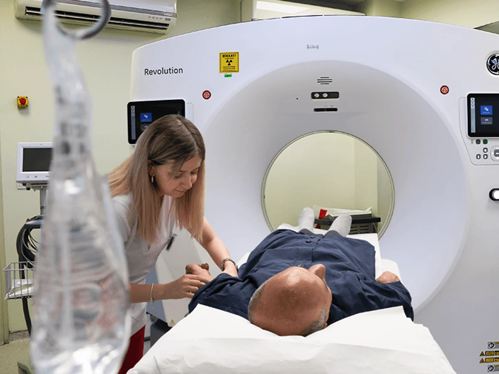
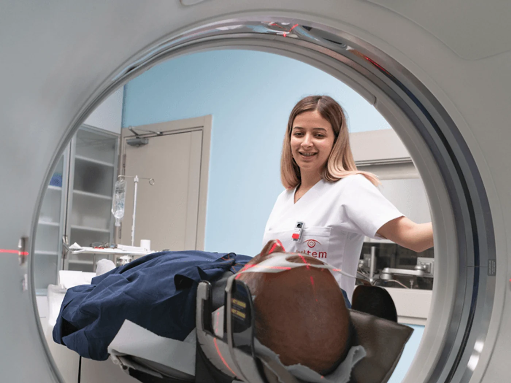
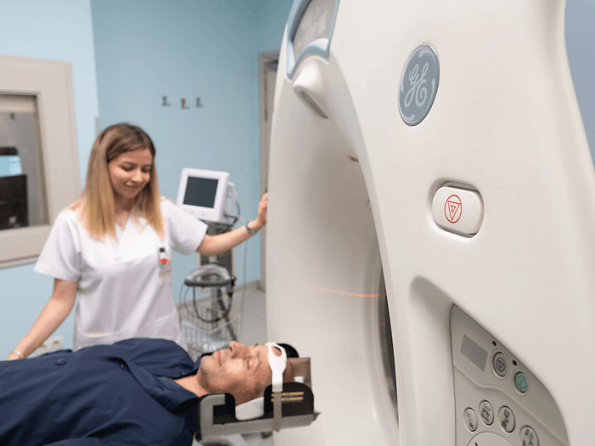

<strong>A CT scanner consists of a ring-shaped X-ray unit and a moving patient table. During the examination, cross-sectional images of organs, bones or tissues are taken from different angles. The computer then combines those slices into a three-dimensional image.</strong>

<figure></figure>

With our 128-slice GE Revolution Maxima CT scanner we perform low-dose coronary CT angiography and whole-body CT angiography. A 1024 matrix gives a clearer view of the lung parenchyma and of ear CT images. Cardiac angiography, virtual colonoscopy and QCT bone density studies are completed in 4–5 seconds.

<figure></figure>

CT examinations take 5–15 seconds in total. Cardiac CT angiography is also available. With virtual colonoscopy the bowel loops can be opened out and examined through 360 degrees, so the large bowel can be screened without the need for a conventional colonoscopy. QCT (Quantitative Computed Tomography) allows bone densitometry to be performed, giving bone density readings of much higher accuracy, particularly in older patients.

<figure></figure>

<!--faq-->
[
  {
    "q": "When is a CT scan needed?",
    "a": "Because CT can image every region of the body, it can be used in almost any condition that calls for imaging. It is generally superior to MRI in lung disease in particular. It is superior to every other examination for imaging the paranasal sinuses and the temporal bone — that is, the middle and inner ear. It is widely used for imaging the coronary arteries and the vessels of the whole body, because it can show both the structure of the vessel wall and the lumen. CT has advantages over MRI and other imaging for examining the abdominal organs and for demonstrating bleeding in the brain. It has an important place in bone fractures and in the assessment of joints. With virtual colonoscopy and bronchoscopy, organs with a lumen can be assessed from the inside in three dimensions. It is an important diagnostic tool for showing small kidney stones and appendicitis."
  },
  {
    "q": "Is radiation used in computed tomography?",
    "a": "CT is a device that produces images using radiation. With today's multislice scanners, both the amount of radiation and the time required have been reduced considerably."
  },
  {
    "q": "What do we do for your comfort and safety?",
    "a": "Because a CT examination takes 5 to 10 seconds and the dose delivered has been reduced considerably, our scans are performed well below the radiation limits permitted by the World Health Organization. In children, lead aprons are used over the regions not being scanned. Examinations are carried out by experienced technicians alongside a radiologist, and results are issued the same day. Through our PACS system, patients and their doctors can also access all images over the internet.\n(Images and reports are kept in our centre's PACS system for at least 15 years.)"
  }
]
