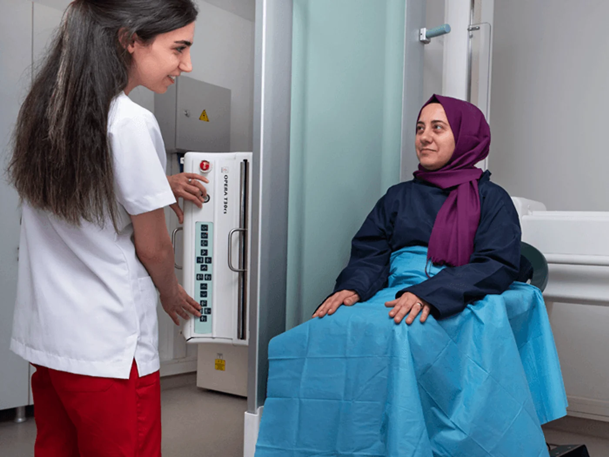

<strong>After an enema, a specially prepared contrast agent with a consistency similar to stool is introduced through the rectum, and the patient is imaged with a fluoroscopic digital X-ray system while passing it in a seated position. The study gives information about both the anatomy and the function of the organ.</strong>

<figure></figure>

<h4>How is defecography performed?</h4>

Performing the examination in a seated position and following it with fluoroscopy are both important for imaging the act of defecation. With the alternative, MR defecography, the patient lies inside the MRI bore, and the difficulty of that position makes physiological defecation very hard to image.

<h4>When is defecography needed?</h4>

Digital defecography allows disorders of the anal region — such as rectocele, anal insufficiency, rectoanal intussusception and enterocele — to be observed directly under fluoroscopy, diagnosed, and treated accordingly. It matters a great deal that the procedure is performed and interpreted by an experienced technician and radiologist on a high-quality digital X-ray system. Our defecography studies are performed painlessly at İyitem Imaging Centre using fluoroscopic digital X-ray. Patients examined this way also undergo an MRI scan so that the anatomical structures can be assessed.

<!--faq-->
[
  {
    "q": "Is radiation used in defecography?",
    "a": "Because defecography is performed with a fluoroscopic digital X-ray system, some radiation is involved, though the dose is low. During the study, pathology occurring during defecation can be followed in real time with fluoroscopy. At our centre a perianal MRI scan is also added to the defecography study so that the anatomical structures can be examined in greater detail."
  },
  {
    "q": "How much radiation does the study involve?",
    "a": "Defecography is performed with a fluoroscopic X-ray system, and very little radiation is used during fluoroscopy. After the fluoroscopic study the patient is taken to the MRI scanner for an additional examination of the anal region. No radiation is used in MRI."
  },
  {
    "q": "What do we do for your comfort and safety?",
    "a": "It is important that defecography is performed seated, in the normal position for defecation, as physiological anal movement can only be imaged that way. At our centre the fluoroscopic study is performed with the patient seated. An MRI scan then follows so that the anatomy can be seen more clearly. MR defecography alone, without the fluoroscopic study, can be performed lying inside the MRI scanner, but because it cannot be done seated in the normal position for defecation it does not give reliable results.\n(Images and reports are kept in our centre's PACS system for at least 15 years.)"
  }
]
