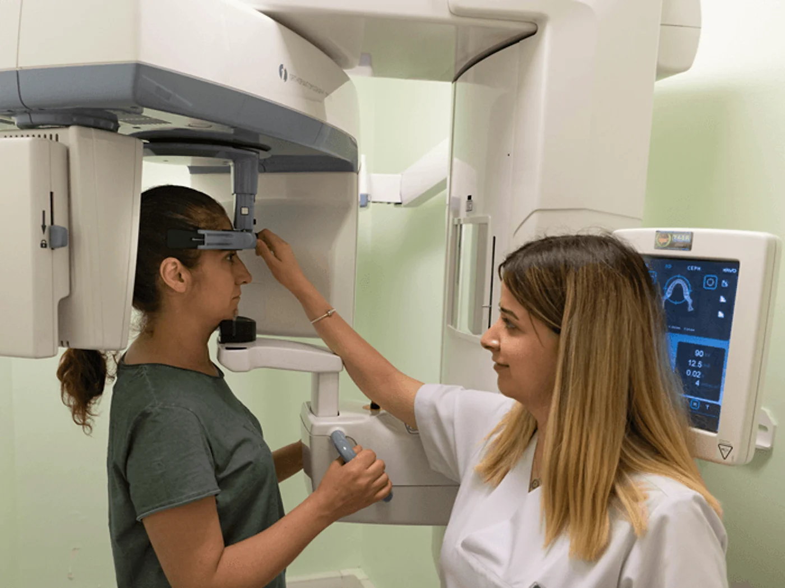
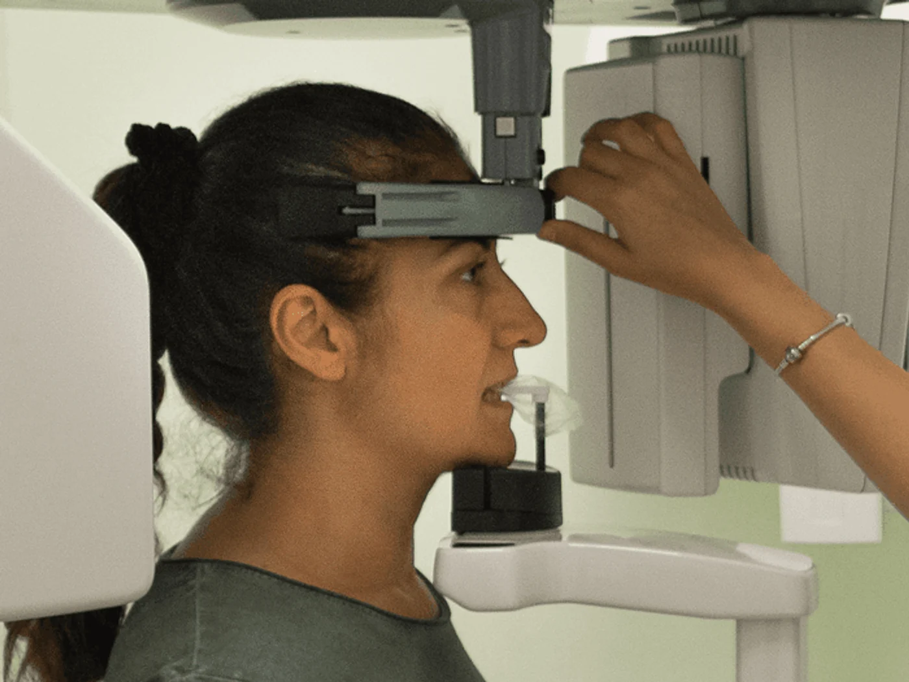
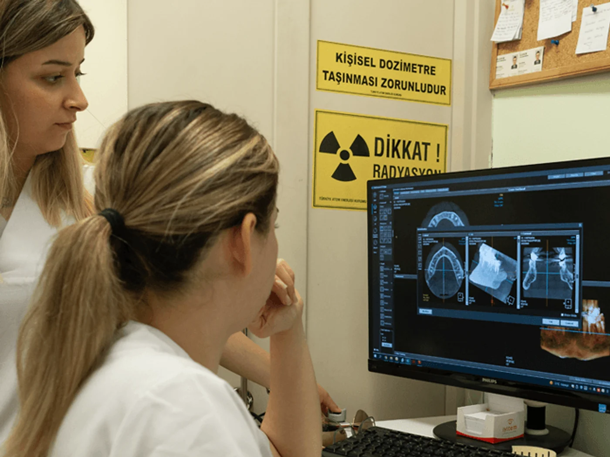

<strong>Our dental CT and panoramic X-ray system is a KAVO three-dimensional cone-beam volumetric dental CT scanner. Resolving down to 85 microns per voxel over a 5×5 cm field and allowing 3D endodontic assessment, it lets us — together with our experienced technicians — provide detailed, reliable information, particularly to dentists placing implants.</strong>

<figure></figure>

We can examine tooth roots in detail and give reliable information about the thickness and density of the bone. With a 13×15 cm field of view, the scanner also images the whole face and skull base, making it useful for jaw and maxillofacial surgery. The maxillofacial and paranasal regions can be assessed at high resolution with a 0.32 mm voxel and a very low dose.

<figure></figure>

In dental CT, images are processed and assessed using Cliniview software and the OnDemand 3D dental module, then delivered to the dentist through the PACS system, on CD or on film. Implants can be planned virtually with the In2Guide implant planning module.

<figure></figure>

<!--faq-->
[
  {
    "q": "When is dental CT needed?",
    "a": "Three-dimensional dental CT can be used in the diagnosis of any dental condition, as it gives detailed information about both anatomy and disease. It is, however, of vital importance before treatment in patients who are to receive a dental implant. Measuring the thickness and length of the jaw and maxillary bone allows the anatomical structures to be shown in three dimensions. Dental CT provides important information about how and at what angle the implant should be placed, and what its length and thickness should be. Anatomical detail and lesions that cannot be seen on a panoramic X-ray or on small dental films can be demonstrated with three-dimensional dental CT."
  },
  {
    "q": "Is radiation used in dental CT?",
    "a": "Dental CT is a device that works with radiation. A dental CT examination delivers about as much radiation as a panoramic X-ray, or less than a chest X-ray."
  },
  {
    "q": "What do we do for your comfort and safety?",
    "a": "Panoramic X-ray and dental CT examinations take less than a minute. Our KAVO system produces high-quality images at a very low radiation dose. Having our experienced radiology technicians perform the examination and the measurements improves the quality of the results.\n(Images and reports are kept in our centre's PACS system for at least 15 years.)"
  }
]
