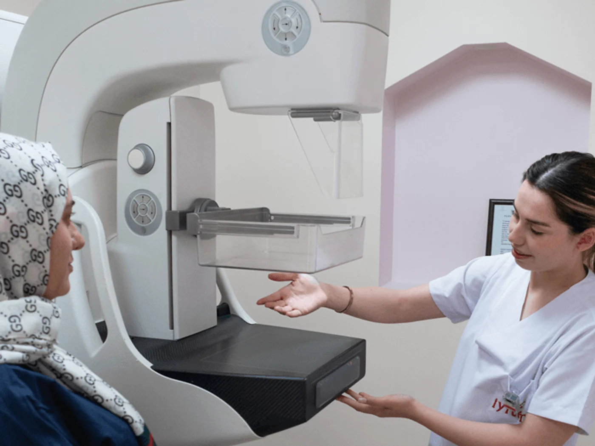
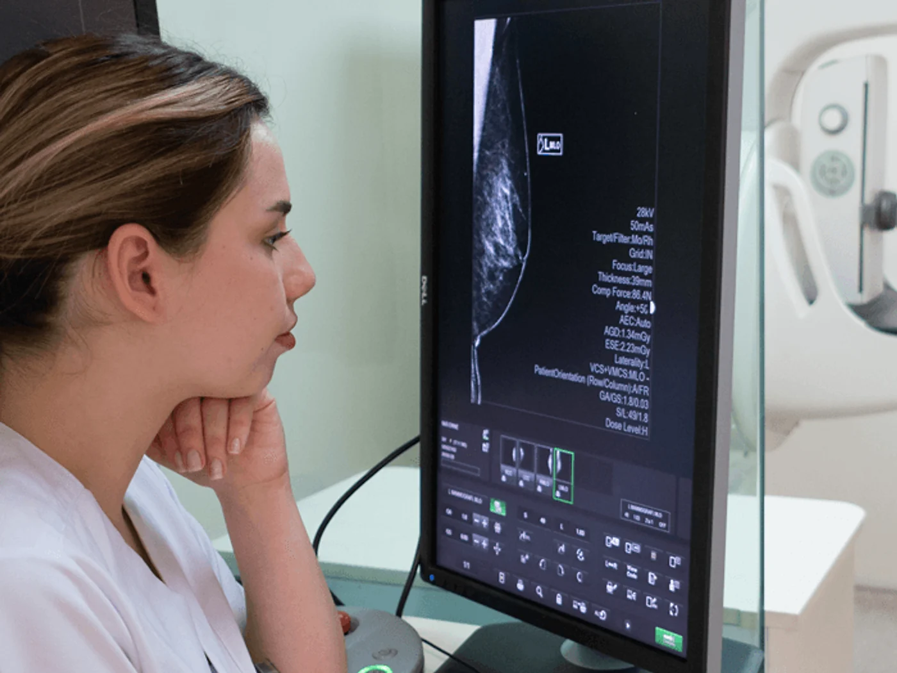

<strong>Digital mammography is a health screening recommended annually for women from their forties onwards. A digital image is taken of the breast, positioned between two dedicated plates. This examination takes a few minutes and can provide the early diagnosis that saves lives.</strong>

<figure></figure>

In digital mammography, breast tissue is projected onto the detector with X-rays and the image is formed on a computer. Far less radiation is used than with older analogue mammography, and image quality is far higher. Breast surgeons prefer digital mammography images. Because images can be magnified five- to sixfold on 5-megapixel medical monitors, calcifications only millimetres across can be identified. Irregularly outlined, millimetre-scale calcifications in breast tumours are best visualised with digital mammography — such small calcifications cannot be seen on analogue mammography, on ultrasound or on MRI.

<figure></figure>

<!--faq-->
[
  {
    "q": "When is digital mammography needed?",
    "a": "Digital mammography is used to visualise breast tumours, and in particular the millimetre-scale calcifications seen in tumours."
  },
  {
    "q": "How often should digital mammography be performed?",
    "a": "Women over 40 should have a routine scan once a year. If a suspicious lesion is seen, either further investigation is carried out or the interval between scans may be shortened to 4–6 months."
  },
  {
    "q": "What do we do for your comfort and safety?",
    "a": "Digital mammography is an examination in which the breast tissue is compressed slightly between two plates. The technician performing it must be experienced and careful. It is important that the images are assessed on 5-megapixel medical displays, and the radiologist's experience matters.\n(Images and reports are kept in our centre's PACS system for at least 15 years.)"
  }
]
