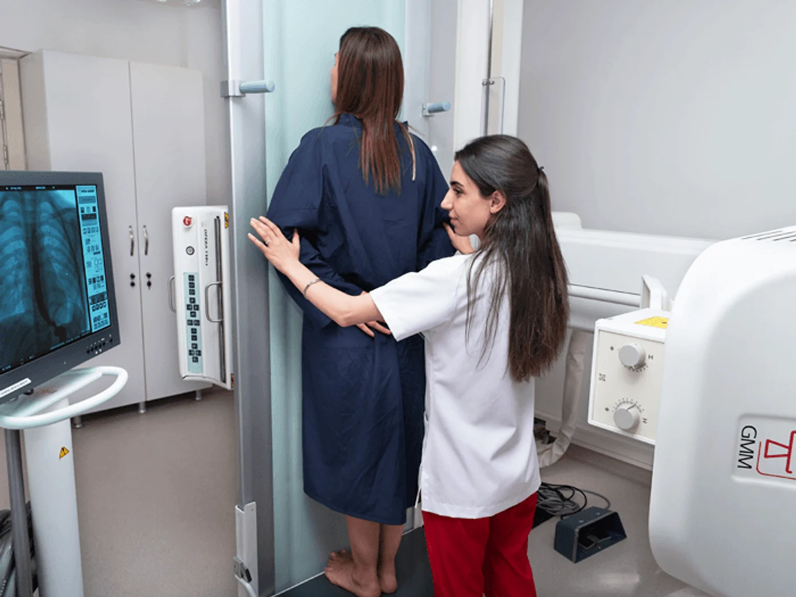
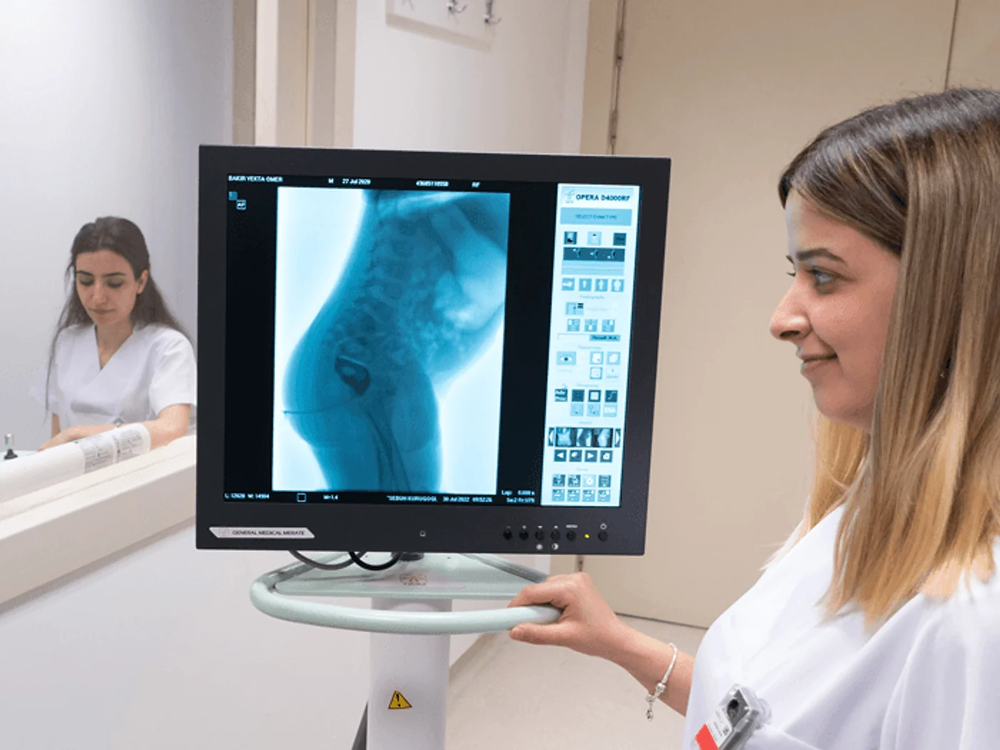
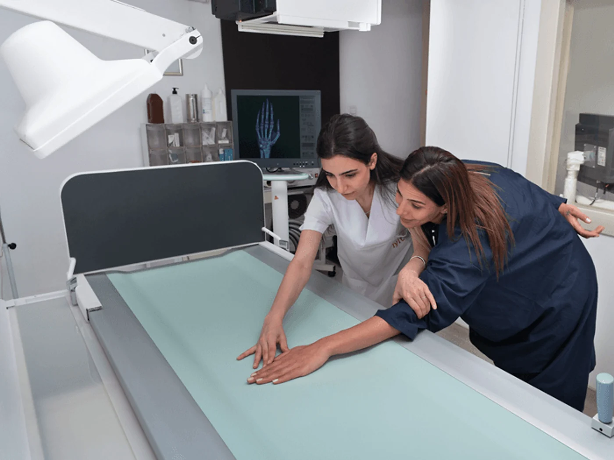

<strong>Digital X-ray supports examinations such as HSG (hysterosalpingography, or uterine imaging), orthoroentgenography (full-length leg imaging) and its measurements, oesophagus – stomach – duodenum studies, enteroclysis (double-contrast small bowel imaging), double-contrast large bowel (colon) imaging, voiding cystourethrography and retrograde urethrography.</strong>

An X-ray is the image produced when X-rays pass through tissue and fall onto a detector. X-rays pass easily through soft tissue and darken the image; they pass less easily through bone, so bone appears white. The technique therefore distinguishes soft tissue from bone and is used mostly to image bone pathology.

As the technology has advanced, digital detector panels have made it possible to obtain higher-quality images with a much lower X-ray dose. Fluoroscopy allows tissue to be followed live under X-ray, and is therefore used <strong>for imaging the oesophagus, stomach and intestines, for biopsy procedures and for hysterosalpingography (uterine imaging).</strong>

<figure></figure>

<h4>How are digital X-rays taken?</h4>

At İyitem Imaging Centre we use a GMM Opera T digital X-ray system with fluoroscopy. Scoliosis imaging is performed fully automatically using the stitching technique, with the tube angled by the machine and the images joined automatically. <strong>Orthoroentgenography (full-length leg imaging)</strong> and its measurements are carried out with the same technique. In routine radiography, a high-technology 9-megapixel digital flat panel delivers the best possible image quality.

<figure></figure>

<strong>Hysterosalpingography (HSG) — uterine imaging — is performed painlessly with a catheter, accompanied by a female technician.</strong> <strong>Oesophagus – stomach – duodenum studies, enteroclysis (double-contrast small bowel imaging) and double-contrast large bowel (colon) imaging</strong> can be performed for both children and adults. Voiding cystourethrography is an examination that shows urine refluxing from the bladder into the ureters, the ducts running from the kidneys to the bladder; it is performed at İyitem in experienced hands. <strong>Retrograde urethrography</strong> is an imaging technique that examines the urethra, the passage leading out of the bladder.

<figure></figure>

<!--faq-->
[
  {
    "q": "When is a digital X-ray needed?",
    "a": "X-rays are taken to look for problems in the bony structures of the body. In some situations an X-ray may also be taken for calcifications in soft tissue, for foreign bodies and for stones. A digital X-ray is produced when the X-ray beam passes through the body onto detectors and the image is formed on a computer. Once the image is on a computer it becomes easier both to transmit and to store. Detectors with a higher pixel count produce better image quality."
  },
  {
    "q": "Is radiation used in a digital X-ray?",
    "a": "Digital X-rays use X-rays and therefore radiation. Very low doses are used when following a live image with fluoroscopy. Each radiograph delivers roughly 0.02 millisieverts of radiation, which is a very small amount. For comparison, watching 2–3 hours of television a day exposes a person to 3–4 millisieverts a year."
  },
  {
    "q": "What do we do for your comfort and safety?",
    "a": "In digital radiography, high-technology detectors reproduce the image as faithfully as possible. Images can be obtained with 30–50 times less radiation than with conventional X-rays. The resulting images can be stored on a computer and sent over the internet.\n(Images and reports are kept in our centre's PACS system for at least 15 years.)"
  }
]
