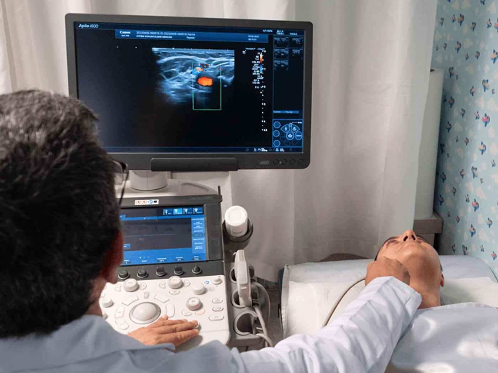
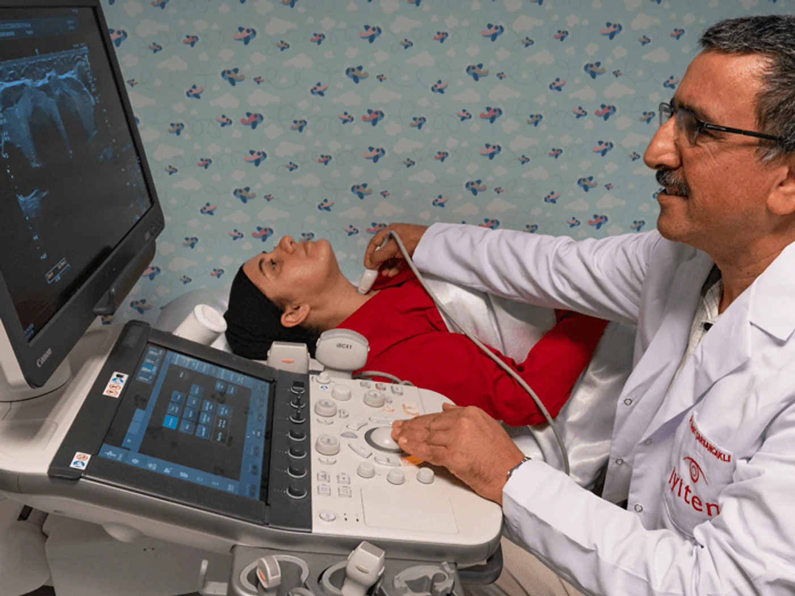

<strong>A colour Doppler ultrasound system consists of a main computer, a console, a screen and probes. The colour Doppler function shows the speed and pattern of blood flowing through the vessels in colour.</strong>

<figure></figure>

Colour Doppler ultrasound produces a live image from the differences in frequency measured as sound waves sent through a probe strike different tissues and return. For assessing certain tissues, such as the gallbladder, it has advantages over other imaging methods.

<figure></figure>

At İyitem Imaging Centre we work with a 2019-model Canon i800 colour Doppler ultrasound system. Colour Doppler ultrasound for examining the vessels throughout the body, echocardiography for examining the heart, and ultrasound-guided biopsies are all performed at our centre.

<figure></figure>

<!--faq-->
[
  {
    "q": "When is a colour Doppler ultrasound needed?",
    "a": "Ultrasound is an examination method that produces images using sound waves. It is particularly valuable for examining the abdominal organs, the thyroid and the structures of the neck. It has advantages over other imaging in gallbladder disorders, in breast disease and in examining thyroid tissue. The colour Doppler function also allows the direction and sound of blood flowing in the vessels, and the flow pattern, to be assessed. The blood supply of tumoural masses can be visualised. Ultrasound makes it possible to image a baby in the womb, and to examine brain tissue and vessels in children. It can also be used in the assessment of joint disease."
  },
  {
    "q": "Is radiation used in colour Doppler ultrasound?",
    "a": "As the name suggests, ultrasound is an examination method that produces images using sound waves. No radiation is used. Sound waves cause no harm to the human body — ultrasound can even be performed on a baby in the womb."
  },
  {
    "q": "What do we do for your comfort and safety?",
    "a": "Our centre uses a high-technology Canon colour Doppler ultrasound system that produces high-quality images. Alongside the probes used routinely, a special paediatric probe allows abdominal examination of children and infants. Echocardiography can be performed with the echo probe. Examinations are carried out by experienced radiologists, and a CD of the study together with the report is issued 10–15 minutes after the scan.\n(Images and reports are kept in our centre's PACS system for at least 15 years.)"
  }
]
