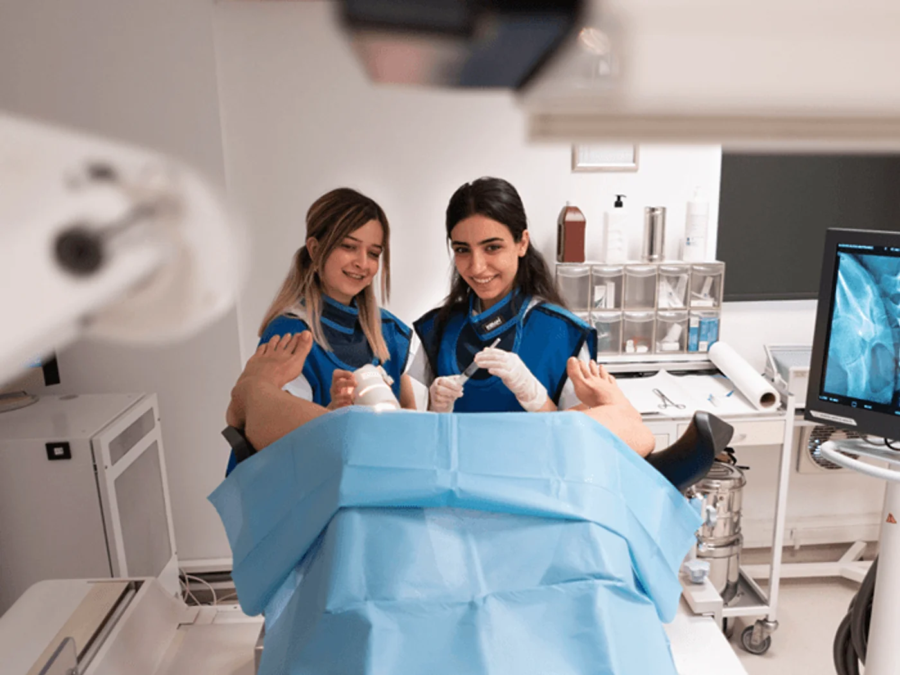
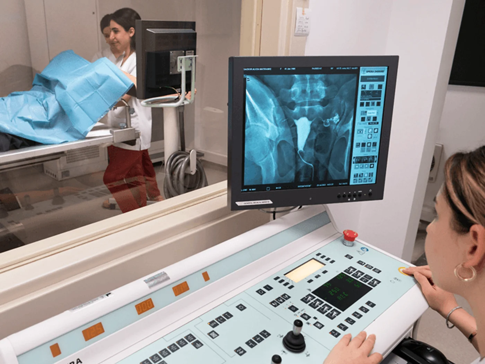
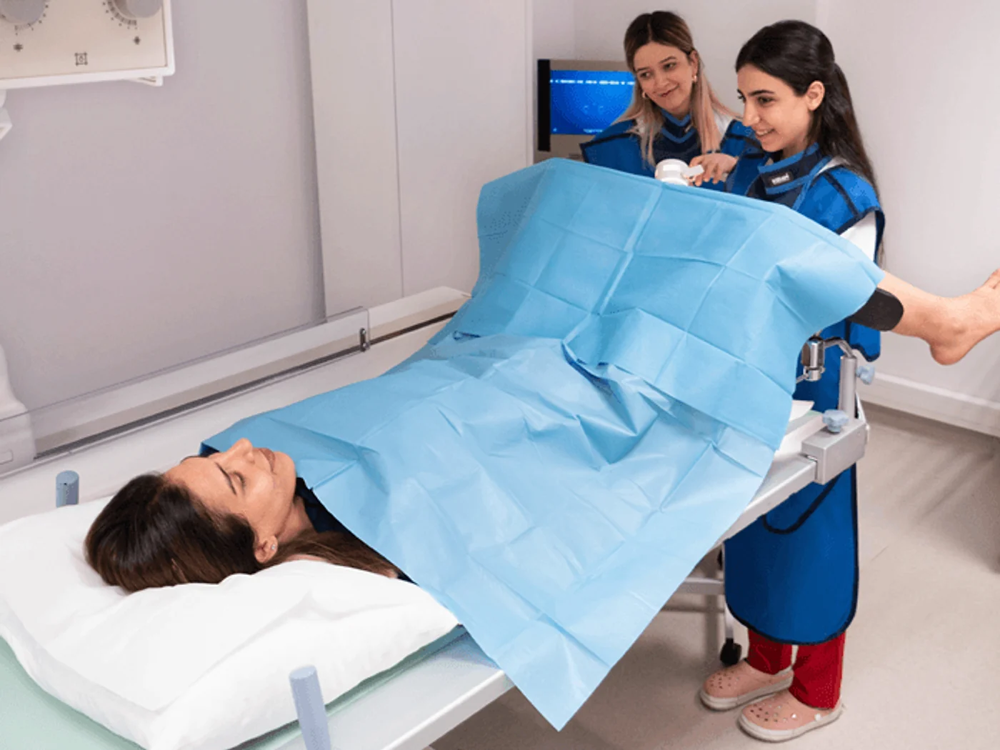
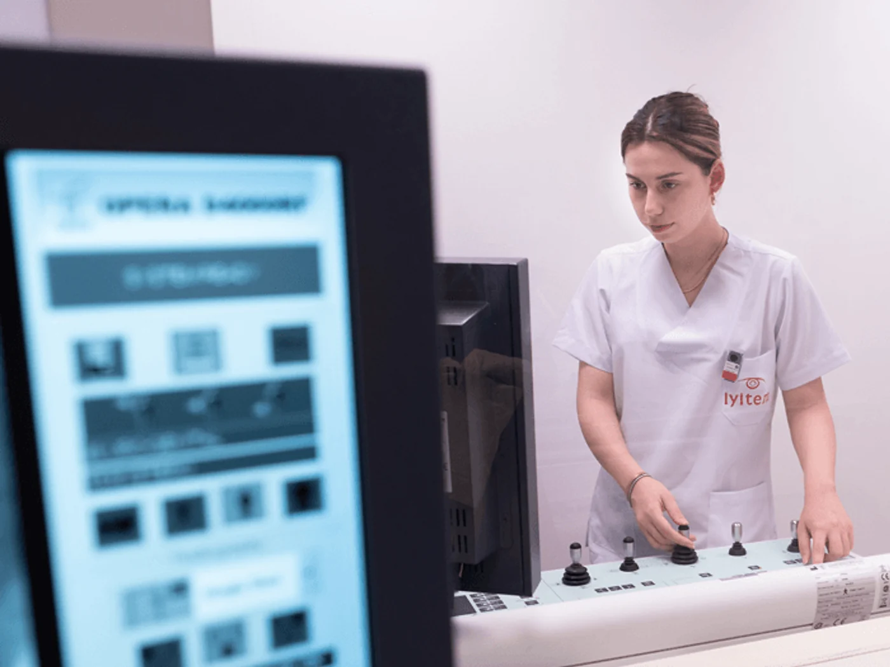

<strong>Hysterosalpingography (HSG) is an imaging method for examining the uterus and the fallopian tubes. It is an X-ray study taken to assess the condition of the fallopian tubes — the route by which sperm and egg meet — and of the uterine cavity, where a baby will spend roughly nine months.</strong>

<figure></figure>

HSG used to be a relatively expensive and difficult examination. Today, with digital X-ray equipment, special soft catheters and new-generation water-based contrast agents, and with more radiologists experienced in the procedure as the number of examinations has grown, the cost has come down to a reasonable level and high-quality, low-radiation studies have become possible with little pain and as few complications as possible. It matters that the person performing the study, whether radiologist or technician, is experienced. Our centre places particular emphasis on patient privacy, and produces high-quality images with our digital X-ray system. Pain during the procedure is what patients dread most; using a fine balloon catheter, and with our experienced female technicians, the study is performed painlessly.

<figure></figure>

<h4>HSG technique</h4>

This is an interventional radiology procedure in which the vagina is opened with an instrument called a speculum, a fine balloon catheter is placed at the entrance to the uterus and contrast is administered. HSG assesses the uterine walls and the fallopian tubes. Whether the tubes are open, and whether the contrast passes into the abdominal cavity, can be followed live with fluoroscopy.

If there is no blockage in the tubes and the contrast spreads normally into the abdominal cavity, then in this respect there is no obstacle to pregnancy. If, however, there are adhesions in the tubes, or dilatation and blockage following previous infection, and the contrast cannot spread freely into the abdominal cavity, then there is a problem with the passage of eggs into the uterus and with achieving pregnancy. Pregnancy is likewise not possible if there are structural anomalies or adhesions in the uterine cavity, or a mass narrowing it. Demonstrating and diagnosing these anomalies with HSG opens the way to treatment.

<figure></figure>

<strong>Performing HSG on a high-quality digital X-ray system matters a great deal for image quality</strong>, because the fallopian tubes are very fine and a high-resolution image is needed to show contrast passing through them. Adhesions in the tubes are sometimes opened by the pressure of the contrast during the examination, which in itself provides treatment towards achieving pregnancy.

HSG is performed between days 8 and 11 after the start of menstruation. Patients are asked to avoid intercourse between the end of their period and the examination. Because infection can occasionally follow HSG, antibiotic treatment is given before and after as a precaution. Patients can return to normal life after the procedure. As it is painless, anaesthesia is not required; anaesthesia increases both the duration and the cost. For patients who nevertheless request it, anaesthesia is administered by a female anaesthetist.

<figure></figure>

<!--faq-->
[
  {
    "q": "When is HSG — hysterosalpingography — needed?",
    "a": "HSG is a test your doctor may request to see the condition of the fallopian tubes, whether there are structural anomalies or adhesions in the uterine cavity, or whether there is a mass narrowing the cavity that would prevent pregnancy. Demonstrating and diagnosing these anomalies with HSG opens the way to treatment."
  },
  {
    "q": "Is radiation used in HSG?",
    "a": "Because hysterosalpingography is performed on a digital X-ray system with fluoroscopy, radiation is used. As the procedure is completed with two or three images, the dose is very low. The passage of the contrast agent into the uterus and fallopian tubes and its spread into the abdominal cavity is followed live with fluoroscopy."
  },
  {
    "q": "What do we do for your comfort and safety?",
    "a": "Hysterosalpingography is carried out entirely by female technicians, and privacy is respected throughout. Because contrast is administered through a catheter, the procedure is not painful and no anaesthesia is needed. The study is performed painlessly at our centre and the report is issued within 1–2 hours together with a CD of the images. Images and reports are kept at our centre for at least 15 years and can be viewed on our website on request."
  }
]
