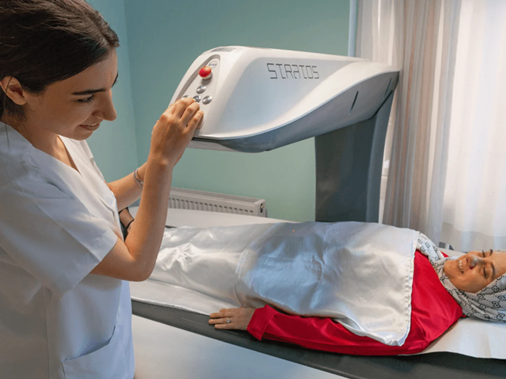
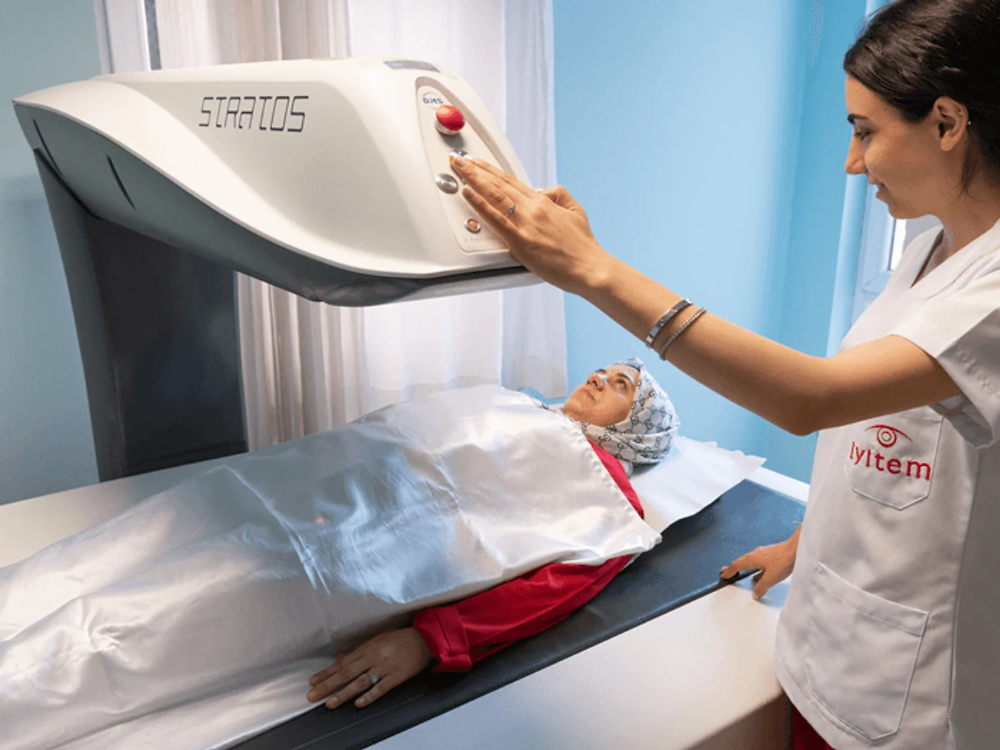
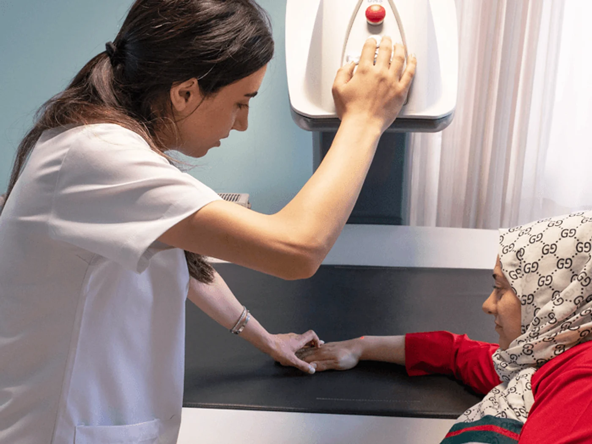

<strong>Bone densitometry is an advanced form of X-ray examination using a low dose of radiation. The vertebrae between L1 and L4 and the hip bone are imaged, as these show bone loss clearly. The examination establishes the degree of weakness in the bones and the risk of fracture.</strong>

<figure></figure>

Loss of bone density is a significant health problem today, particularly among older people. It matters that the degree of bone loss is measured and followed up using internationally accepted methods.

At İyitem Imaging Centre we provide this service with a DMS bone densitometry system. Alongside standard bone measurement, whole-body bone density, radial bone density and paediatric bone density measurements can be performed.

<figure></figure>

QCT bone density measurement is also available at our centre using the CT scanner. Because the QCT technique measures from the central part of the bone in the lumbar spine, it makes more reliable results possible in patients with osteophytes (bony outgrowths).

<figure></figure>

<!--faq-->
[
  {
    "q": "When is bone densitometry needed?",
    "a": "Loss of bone density is a serious problem, particularly in post-menopausal women. With early diagnosis and appropriate treatment, further loss can be prevented. It is important that bone density is measured and followed up in line with international standards and, where possible, on the same equipment. Measurement and follow-up are also needed in people with hormonal disorders, in those who have suffered trauma and in those who have spent a long period on bed rest."
  },
  {
    "q": "Is radiation used in bone density measurement?",
    "a": "Bone density scanners work with radiation, but the dose delivered is far lower than that of a chest X-ray. There is therefore no harm."
  },
  {
    "q": "What do we do for your comfort and safety?",
    "a": "Bone density measurement is carried out by experienced technicians on equipment that meets international standards. The scan is over in a few minutes and results are issued immediately after review by a radiologist.\n(Images and reports are kept in our centre's PACS system for at least 15 years.)"
  }
]
