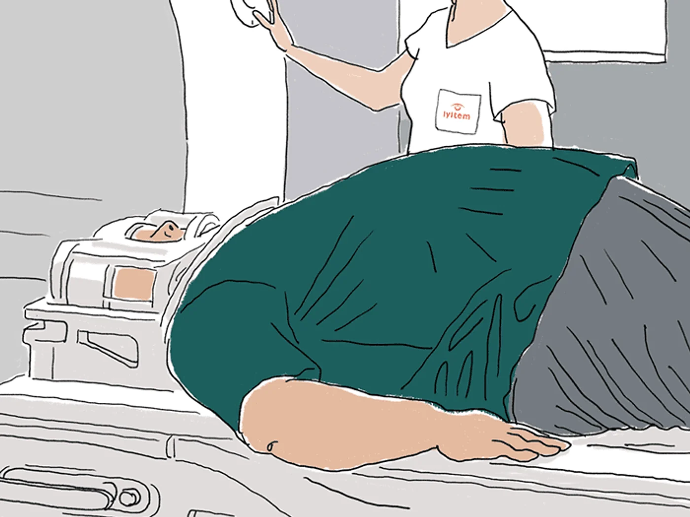

<strong>The radio waves used in MRI can penetrate a large amount of fat. Compared with other imaging methods, MRI is the one least affected by obesity. Bore diameter, bore length, table weight limits and magnetic field strength all matter in making MRI possible for patients with a higher body weight.</strong>

<figure></figure>

An MRI study of a single region takes roughly 10 to 45 minutes. The variation depends on where the area being examined is and how much information about the condition needs to be gathered.

On older MRI scanners, a weight above 120 kg posed a risk to the scanner table. At our centre, patients up to 250 kg can be scanned. For certain studies, however, and if the patient's body width is very large, a scan may not be possible.

For patients of higher body weight the scanner should be at least 1.5 tesla. Because the region from which information must be gathered is already very large, scanners below 1.5 tesla may not deliver sufficient image quality. With 3 Tesla MRI, the higher field strength produces better-quality, thinner-slice images.

<!--faq-->
[
  {
    "q": "What do we do for your comfort and safety?",
    "a": "The bore that the patient enters on our 3 Tesla scanner is 70 cm wide, which makes for a more comfortable experience. Being able to watch television and listen to music during the scan adds to that comfort. Artificial intelligence shortens the examination. Where needed, the “Quiet MRI” feature reduces the noise considerably. The report is issued a few hours after the scan. Because an MRI scanner is a large magnet, no metal may remain on the patient during the scan; clothing is therefore removed and a gown is put on. The MRI room also has an oxygen supply and a suction system in case of any emergency. Experienced doctors and technicians, together with an emergency nurse, are present throughout.\n(Images and reports are kept in our centre's PACS system for at least 15 years.)"
  }
]
