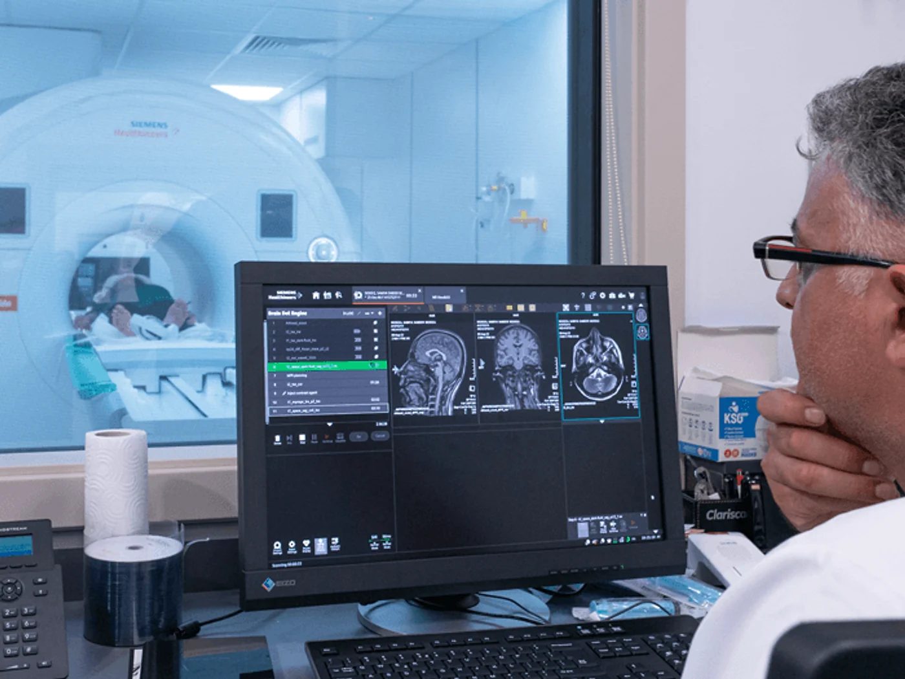

<strong>MRI is an imaging technique that works by using radiofrequency pulses to change the orientation of the magnetic fields of hydrogen atoms in the body, then measuring the energy they release — taking advantage of the fact that every tissue releases a different amount of energy.</strong>

Because each tissue contains a different amount of hydrogen, tissues such as water, fat, muscle, bone, nerve tissue, tumour and infected tissue can be told apart. The strength of an MRI scanner is measured in tesla. Today, 1.5 tesla and 3 tesla scanners are sufficient for optimal imaging. Scanners of 7 and 10.5 tesla are only now coming into use. Above a certain field strength, however, the machine begins to act like a microwave oven and body temperature rises.

<h4>Finer detail with 3 Tesla MRI</h4>

At İyitem Imaging Centre we work with a 2022-model Siemens Vida 3 tesla scanner. Alongside routine MRI studies, this state-of-the-art system lets us offer advanced examinations such as functional MRI, MR spectroscopy, MR tractography, MR enterography, cardiac MRI, multiparametric prostate and liver MRI, vessel imaging for vasculitis, MR neurography and whole-body MRI.

<figure></figure>

<!--faq-->
[
  {
    "q": "When is an MRI needed?",
    "a": "MRI offers high tissue resolution and therefore shows soft tissue particularly well. It is also important for imaging the spongy, medullary part of bone.\n \nBecause lung tissue and the paranasal sinuses contain mostly air, MRI cannot pick up a signal there. Computed tomography is generally superior to MRI for examining lung tissue and the paranasal region. For the gallbladder, for instance, MRI can be used, but ultrasound is generally superior. Likewise, because the bowel contains air, computed tomography or a double-contrast barium enema is generally superior to MRI for imaging the intestines in certain situations. For every other region of the body, MRI is used.\n\nMRI is generally superior to other examinations for studying the nervous system, for joints such as the shoulder, hip, knee and ankle, and for the neck, mid-back and lower back. It is also the usual choice for assessing muscles, subcutaneous fat planes and the abdominal organs."
  },
  {
    "q": "Is MRI harmful?",
    "a": "MRI does not use radiation. No harm to the human body from the magnetic field used in MRI has been demonstrated to date. MRI is in fact used alongside ultrasound for the early diagnosis of conditions in unborn babies. With the 7 and 10 tesla scanners now slowly entering use, body temperature rises over long examinations — but there is no such effect with 1.5 and 3 tesla scanners. Metal prostheses can cause heating in the surrounding tissue if they are made of iron or steel rather than titanium. Cardiac stents are not harmed by MRI. Prosthetic heart valves may be harmed if they are not titanium; all heart valves of the past 20–30 years are titanium-based. Pacemakers may be damaged by MRI, so people with a pacemaker should not have an MRI scan. A scan can, however, be performed in a hospital setting under the supervision of a cardiologist and with staff from the pacemaker manufacturer present, with the pacemaker slowed down. Titanium orthopaedic prostheses are not harmed. With newly developed sequences it is now even possible to obtain information about the soft tissue and bone around a prosthesis. There is likewise no objection to scanning regions away from a titanium prosthesis. Because the first three months of pregnancy are the period of organogenesis, pregnant women are not scanned during the first trimester as a precaution, even though nothing has been proven."
  },
  {
    "q": "Is radiation used during an MRI?",
    "a": "An MRI scanner is a large magnet. Images are produced using a magnetic field. There is no radiation and no X-rays are used. MRI has no known side effects — scans are even performed on foetuses in the womb."
  },
  {
    "q": "Can people who are overweight have an MRI?",
    "a": "On older scanners, people over 120 kg could not be scanned, as heavier patients risked damaging the table. On modern scanners all patients up to 250 kg can be scanned. Image quality does decrease slightly as weight increases."
  },
  {
    "q": "Who cannot have an MRI?",
    "a": "- People with a pacemaker\n\n- People with a non-titanium metallic heart valve\n\n- People with a non-titanium metallic prosthesis cannot be scanned in the region of that prosthesis. The artefact created by the metal makes that area impossible to assess with MRI.\n\n- Children who cannot stay still during the scan, and people with intellectual disability, can only be scanned under anaesthesia.\n\n- People with involuntary movements cannot be scanned in the affected region.\n\n- People over 250 kg cannot be scanned.\n\n- Women in the first trimester of pregnancy cannot be scanned. Because the first three months are the period of organogenesis, pregnant women are not scanned during the first trimester as a precaution, even though nothing has been proven.\n\n- People suspected of having a metallic foreign body in the eye cannot be scanned.\n\n- If there is a metallic foreign body anywhere in the body next to a blood vessel, MRI is not performed, because of the risk that it could move and cause harm."
  },
  {
    "q": "Is there any preparation before an MRI? What should I be aware of during the scan? Can I come on my own? Is an MRI something to be afraid of?",
    "a": "An MRI is a scan you can have on your own. Older patients and those with difficulty walking may need assistance. There is usually no preparation before an MRI — only 2–3 hours of fasting. That is a precaution against nausea and vomiting, which occur rarely, if contrast is given intravenously. Allergy to MRI contrast is very rare, but atopic patients who are allergic to many medicines may need an allergy test for the contrast agent to be used.\n \nThe patient must stay still during the scan. Any movement beyond normal breathing degrades the image. Genuinely claustrophobic patients may not be able to have an MRI; people with true claustrophobia cannot use a lift either. They can be scanned under anaesthesia. Patients with anxiety, as opposed to true claustrophobia, can comfortably be scanned with psychological support. Watching television or listening to music during the scan can make the experience more comfortable."
  },
  {
    "q": "What do we do for your comfort?",
    "a": "The bore that the patient enters on our 3 Tesla scanner is 70 cm wide, which makes for a more comfortable experience. Being able to watch television and listen to music during the scan adds to that comfort. Artificial intelligence shortens the examination. Where needed, the “Quiet MRI” feature reduces the noise considerably. The report is issued a few hours after the scan.\n(Images and reports are kept in our centre's PACS system for at least 15 years.)"
  },
  {
    "q": "What do we do for your safety?",
    "a": "Because an MRI scanner is a large magnet, no metal may remain on the patient during the scan. Clothing is therefore removed and a gown is put on. The MRI room also has an oxygen supply and a suction system in case of any emergency. Experienced doctors and technicians, together with an emergency nurse, are present throughout."
  }
]
