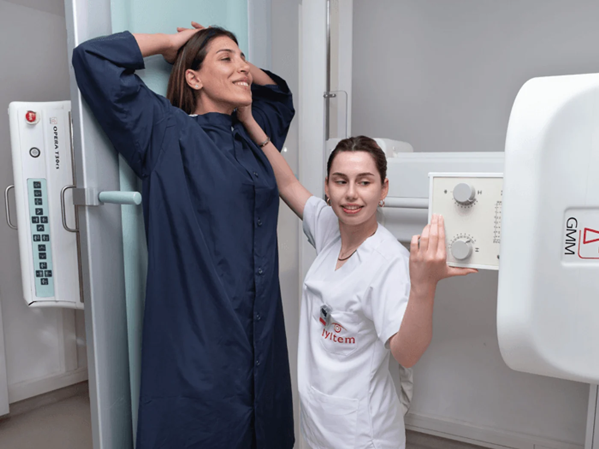
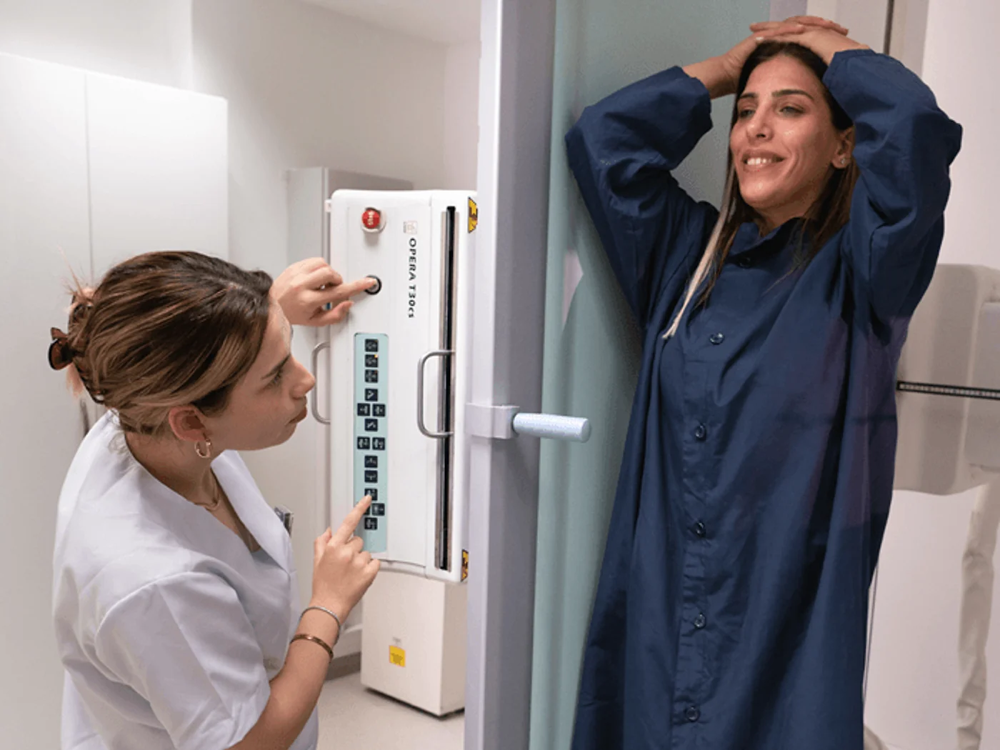
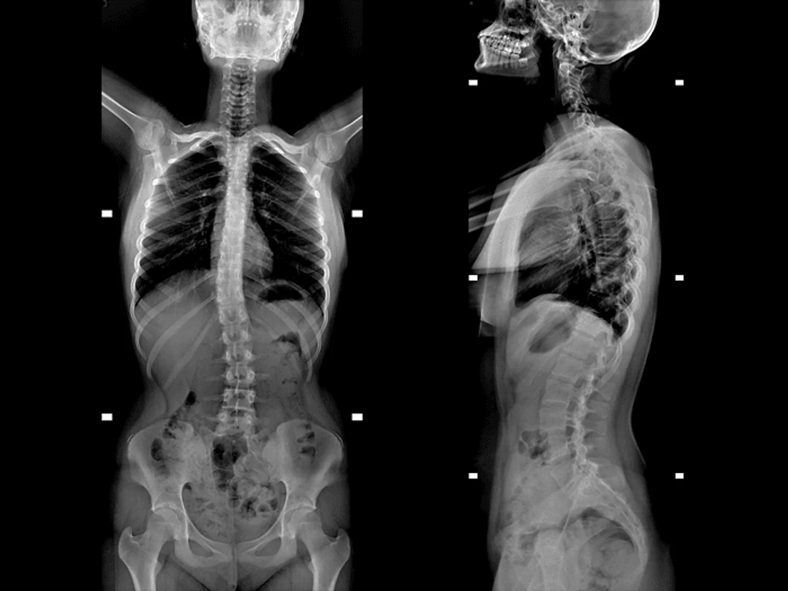

<strong>A scoliosis X-ray is a technique for imaging curvature in the mid-back and lower back. Front-to-back and lateral views are taken as standard. It establishes both whether a curvature is present and, by taking measurements on the images, the degree of the scoliosis.</strong>

<figure></figure>

Scoliosis is a sideways curvature of the spine. Beyond a certain angle it has to be corrected surgically by spinal surgeons. The whole spine must therefore be visible in a single image, and the angle measurements (the Cobb angle) must be made meticulously.

<h4>How is a scoliosis X-ray taken?</h4>

Because the whole spine cannot be captured in a single image, three or four images have to be taken and joined together. These images used to be taken in sequence and joined by hand, which made a reliable composite very difficult to produce. With modern digital X-ray systems, the computer angles the tube automatically as the images are taken and joins them directly, producing an image of the whole spine. Both AP (front-to-back) and lateral views are taken.

<figure></figure>

At İyitem Imaging Centre, scoliosis imaging is performed with our GMM digital X-ray system with fluoroscopy, which allows angled views to be acquired. The images are joined by the computer, producing <strong>high-quality digital radiographs</strong>. Because a high-resolution detector is used, <strong>the quality is far better than that of conventional and CR images.</strong> Measurements are made by our experienced doctors.

<figure></figure>

<!--faq-->
[
  {
    "q": "When is a scoliosis X-ray needed?",
    "a": "If curvature of the mid-back or lower back is suspected, the clinician needs to see the whole spine on one image in order to diagnose and follow the degree of that curvature. With digital X-ray and the stitching technique this can be done accurately and at the lowest possible dose. Conventional X-rays deliver a higher dose, and because the images are not joined by computer, fully accurate results cannot be obtained."
  },
  {
    "q": "Is radiation used in a scoliosis X-ray?",
    "a": "Scoliosis imaging is performed on a digital X-ray system using the stitching technique, so it does involve radiation. The tube is angled and three or four images of the whole spine are taken automatically. A computer program then joins these images into a single view of the entire spine. Because at most about 40 centimetres can be captured in one image, images are taken to cover the whole spine and joined automatically. The total dose is therefore equivalent to three or four chest X-rays, which is a very low dose."
  },
  {
    "q": "What do we do for your comfort and safety?",
    "a": "Because both the acquisition and the joining are fully computer-controlled and automatic, the chance of error in the composite is reduced to a minimum. Once the images are taken, measurements are made and the CD and report are ready within an hour or two; they are kept in our PACS archive for at least 15 years. The digital detector has 9 megapixels, so image quality is high.\n(Images and reports are kept in our centre's PACS system for at least 15 years.)"
  }
]
