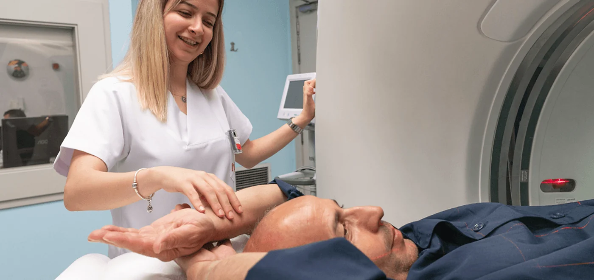

<h1><strong>Trusted Care</strong></h1>

Founded in 1995 and taken over by us in 2011, İyitem Imaging Centre is known for its quality in the field. Aiming to provide good care at a fair price, our centre takes care to be trustworthy, through both its staff and its physicians. <strong>Physicians and patients who value quality and reliability choose İyitem.</strong>

<figure></figure>

<h1><strong>Our Principles</strong></h1>

To show the highest respect for human life,

To give priority to the health and well-being of the patient,

To respect patient autonomy and dignity,

To provide quality healthcare to contemporary standards,

To work in line with the law in force, Ministry of Health regulations and quality management system requirements,

To support those in poverty and in need.

<h1><strong>Our Vision</strong></h1>

Providing quality care at a fair price while following technology closely has always mattered to us. Our aim is to be known as a centre that can be trusted, and to earn our patients' confidence, affection and respect.

<h1><strong>Our Mission</strong></h1>

Providing our patients with quality care without ever departing from ethical standards is our benchmark. We offer quality care at the most affordable price to patients who are poor or in need. We do not enter into unethical relationships in order to attract patients. We deliver our service on the strength of our reliability and our quality.

