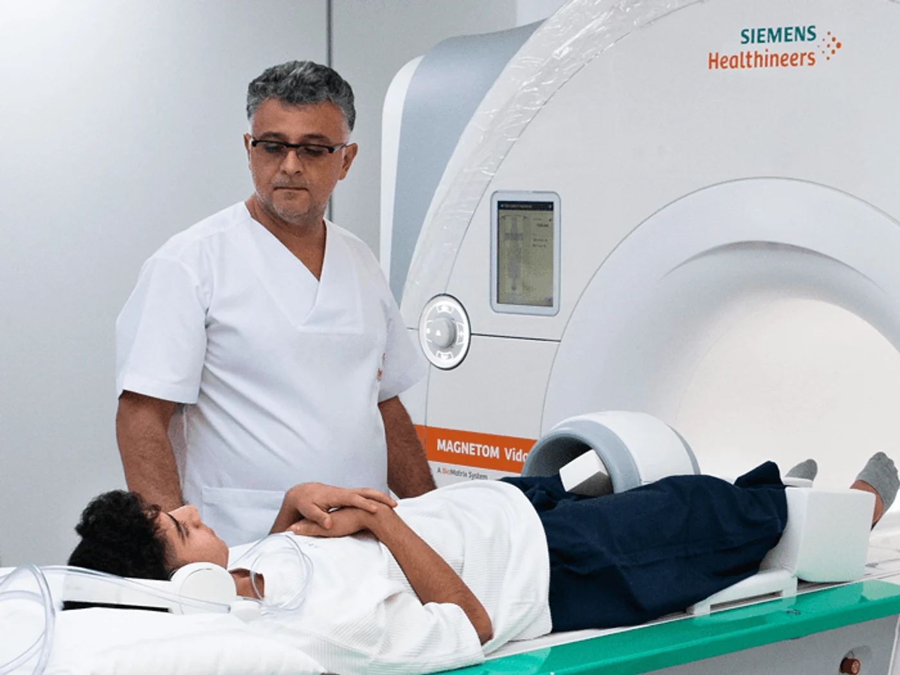

MR cihazları tesla gücüne göre sınıflandırılırlar. İlk MR cihazları 0.02 tesla gücündeydi ve çekimler çok uzun sürüyordu, görüntüler silik görünüyordu. sonra 0.5 ve 1 tesla MR cihazları kullanıma girdi ve süreler biraz kısaldı, görüntüler daha netleşti. Son 30 yılda 1.5 tesla MR cihazları kullanıma girince görüntüler daha netleşti ve çekim süreleri daha da kısaldı. MR Spektroskopi, MR Traktografi, Fonksiyonel MR, Kardiak MR gibi yeni MR çekim teknikleri kullanıma girdi. Son 20 yılda 3 tesla MR cihazları kullanıma girince tüm bu yenilikler ve normal MR çekimlerindeki görüntü kalitesi daha da arttı ve çekim süreleri kısaldı. Hastaların girdiği tüneller genişledi, hasta konforu arttı. 3 teslanın yüksek manyetik alan gücü nedeniyle 1.5 tesla cihazlara göre sekansların süresi kısaldığı gibi kesit kalınlıkları azaldı ve görüntülerdeki netlik arttı. Anatomi çok daha net değerlendirilebilir oldu. Ayrıca MR spektroskopi çok daha küçük alanlardan yapılabilir oldu, diffüzyon çekimlerindeki gelişmelerle Multiparametrik Prostat MR çok daha kaliteli ve ince kesitli görüntülerle çekilmeye başlandı. T1,T2 Mapping Perfüzyon MR çekimleri daha kısa sürelerde ve ince kesitlerle gerçekleştirilebilir oldu.

<figure></figure>

<h4>3 Tesla MR’ın özellikleri nelerdir?</h4>

3 tesla MR cihazının yüksek tesla gücü sayesinde düşük teslalı cihazlara göre <strong>daha hızlı, ince kesitli ve kaliteli görüntüleme</strong> yapılabilir. Ayrıca Fonksiyonel MR inceleme, Traktografi, Spektroskopi gibi ileri düzey görüntülemelerde fark daha fazladır. Spinal kitlelere spektroskopik inceleme yapılabilir. Yapay zeka sayesinde sekanslar normalden 4 kat daha hızlandırılabilir. Gerektiğinde <strong>“Sessiz MR”</strong> çekimi ile hastalarımız için <strong>daha konforlu</strong> ortam sağlanabilir. Tüm vücut MR çekimleri daha hızlı ve kalitelidir. MR çekimi, özellikle klostrofobik hastalar için 70 cm geniş magnet ve televizyon seyretme, müzik dinleme imkanı ile daha konforludur. Kalp MR, Multiparametrik Prostat ve Karaciğer MR gibi özellikli çekimler 3 tesla MR cihazı ile daha kalitelidir. 250 kiloya kadar ağırlığı olan hastalara MR çekimi yapılabilir. Vaskülit için damar görüntüleme, periferik sinirler için MR Nörografi çekimleri yapılabilir

