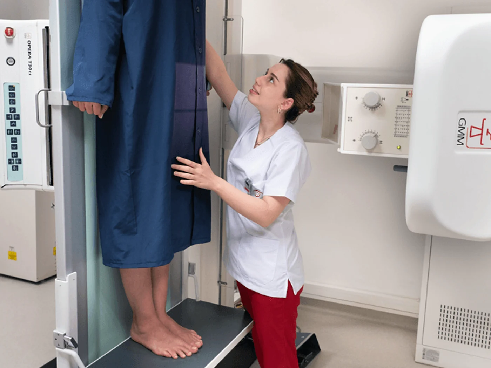
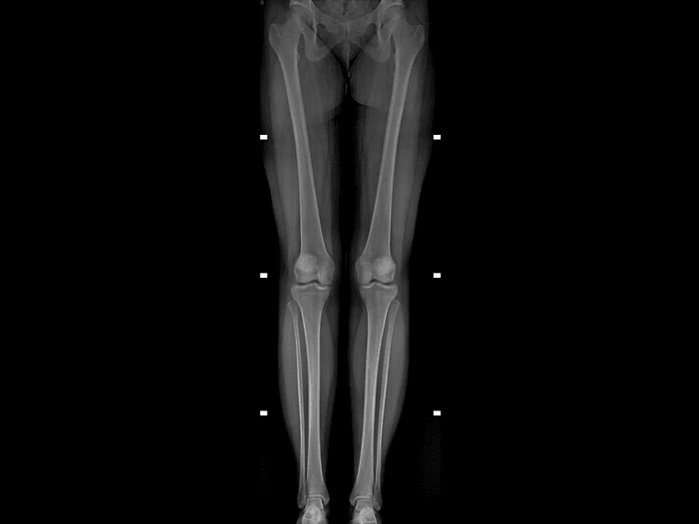

<strong>Her iki alt ekstremitenin yani kalçadan ayağa kadar tüm kemik yapıların bir görüntüde değerlendirilmesini sağlayan grafidir. Skolyoz grafisinde olduğu gibi üç ya da dört grafi alınarak birleştirilmesiyle elde edilir.</strong>

<figure></figure>

<h4>Boy grafisi (Ortoröntgenogram) nasıl çekilir?</h4>

Dijital röntgen cihazımızla, hasta hiç hareket etmeden, bilgisayar kontrolünde tüpe açı vererek sırasıyla grafiler alınır. Elde edilen görüntülerin yapay zekayla birleştirilmesi sağlanır ve boy grafisi elde edilir. Her iki bacağın uzunluklarının karşılaştırılması, kemik yapının ve eklemlerin değerlendirilmesi sağlanır. Ölçümler tecrübeli hekimlerimiz tarafından yapılır.

<figure></figure>

<!--faq-->
[
  {
    "q": "Boy grafisi (Ortoröntgenogram) hangi durumlarda gereklidir?",
    "a": "Her iki alt ekstremiteye yönelik çekilen Boy Grafisi (Orthoröntgenogram) alt ekstremitelerdeki boy kısalıklarını ve deformasyonları tek grafide görebilmek için çekilir. Bir grafide en fazla yaklaşık 40 santimlik bir bölüm çekilebildiğinden, kalçadan başlayarak ayak tabanına kadar, iki ya da üç röntgen grafisi, stiching tekniğiyle tüpe otomatik açı verilerek çekilir ve bilgisayar aracılığıyla otomatik birleştirilir."
  },
  {
    "q": "Boy grafisinde radyasyon kullanılır mı?",
    "a": "Boy Grafisi dijital röntgende çekilen bir grafidir ve toplamda iki ya da üç akciğer röntgeni dozu kadar radyasyon dozu verilir. Bir akciğer grafisi yaklaşık 0.02 milisievert kadardır. Dünya sağlık örgütünün bir yılda alınmasına izin verdiği radyasyon dozu yaklaşık 50 milisieverttır."
  },
  {
    "q": "Konforunuz  ve Güvenliğiniz için neler yapıyoruz?",
    "a": "Boy Grafisi çekimi ve birleştirmesi tamamen bilgisayar kontrolünde ve otomatik yapıldığından birleştirmede hata ihtimali minimuma indirilmiş olur. Grafi çekildikten sonra ölçümleri yapılarak CD’si ve raporu bir iki saat içinde hazırlanır. Raporlar PACS arşivimizde en az 15 yıl saklanır. Dijital röntgen dedektörü 9 milyon pikselli olduğundan grafiler oldukça kalitelidir.\n(Çekilen filmler ve raporlar en az 15 yıl boyunca merkezimizde pacs sisteminde kayıtlı durmaktadır.)"
  }
]
