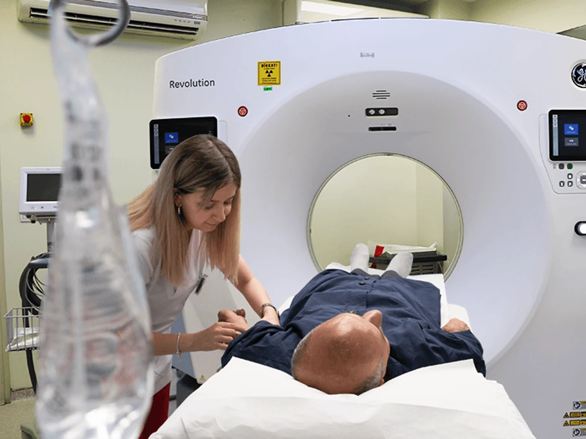
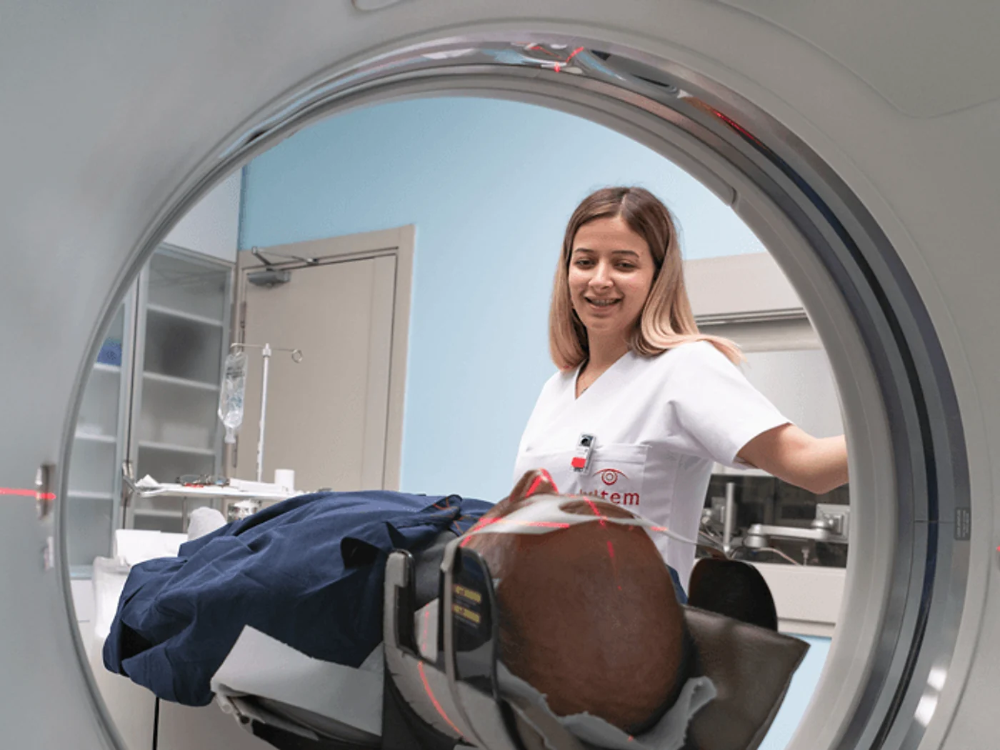
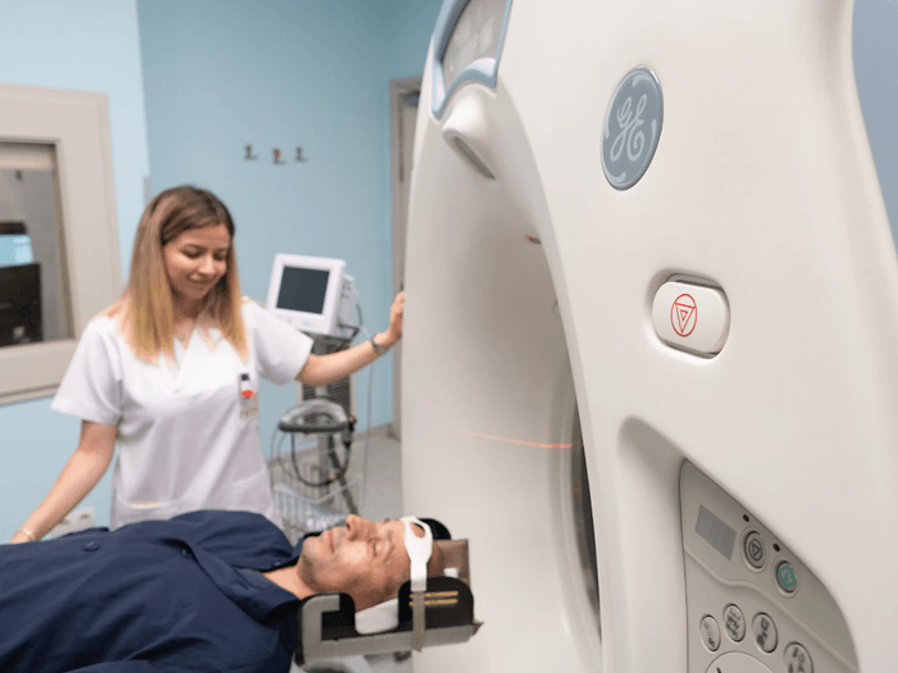

<strong>Bilgisayarlı Tomografi daire formunda bir röntgen cihazı ve hareketli hasta masasından oluşmaktadır. İşlem sırasında vücudun farklı açılarından organ, kemik veya dokuların kesit görüntüleri alınır. Kesit görüntüleri bilgisayar tarafından birleştirilir ve 3 boyutlu bir görüntü oluşturulur.</strong>

<figure></figure>

128 Multislice Revolution Maxima GE marka Bilgisayarlı Tomografi cihazımız ile düşük dozda Koroner BT Anjiyografi ve Tüm Vücut BT Anjiyografi çekimlerini yapmaktayız. 1024 matrix ile Akciğer Parankimini ve Kulak BT görüntüleri daha net izlenmektedir.&nbsp;4-5 saniyede Kalp Anjiyosu , Sanal Kolonoskopi , QCT Kemik Yoğunluğu çözümleri yapılmaktadır.

<figure></figure>

BT incelemeleri toplam 5-15 saniye sürmektedir. Ayrıca kardiak BT anjiografi çekimi yapılabilmektedir. Sanal kolonoskopi ile bağırsak ansları 360 derece açarak incelenebilir. Kalın bağırsak taraması kolonoskopiye gerek kalmadan sanal kolonoskopi ile yapılabilmektedir. QCT (Quantitative Computed Tomography) ile kemik dansitometri incelemesi yapılabilmekte, özellikle yaşlı hastalarda kemik yoğunluğu çok daha yüksek doğrulukta verilebilmektedir.

<figure></figure>

<!--faq-->
[
  {
    "q": "BT (Bilgisayarlı Tomografi) hangi durumlarda gereklidir?",
    "a": "Bilgisayarlı Tomografi ile tüm vücut bölgelerinin çekimi yapılabildiği için görüntüleme gereken hemen her hastalıkta kullanılabilir. Özellikle akciğer hastalıklarında genel olarak MR incelemeye üstündür. Paranazal sinüslerin temporal kemiğin yani orta ve iç kulağın görüntülenmesinde diğer tüm incelemelere üstünlüğü vardır. Kalp damarlarının ve tüm vücut damarlarının görüntülenmesinde damar duvarının yapısını ve lümeni gösterebildiği için yaygın kullanılır. Batın organlarının incelenmesinde beyinde kanamaların gösterilmesinde bilgisayarlı tomografinin MR incelemeye ve diğer görüntülemelere üstünlükleri vardır. Kemik kırıklarında ve eklemlerin değerlendirilmesinde önemli yeri vardır. Sanal kolonoskopi ve bronkoskopi ile üç boyutlu olarak lümeni olan organlar içeriden değerlendirilebilir. Küçük böbrek taşlarını, apandisiti göstermede önemli bir tanı aracıdır."
  },
  {
    "q": "Bilgisayarlı Tomografide radyasyon kullanılır mı?",
    "a": "Bilgisayarlı Tomografi radyasyon kullanarak görüntüleme yapan bir cihazdır. Günümüzde multislice (çok kesitli) tomografilerle radyasyon miktarı ve zamanı oldukça azalmıştır."
  },
  {
    "q": "Konforunuz ve güvenliğiniz için ne yapıyoruz?",
    "a": "Bilgisayarlı Tomografi çekimlerinde çekim süresi 5 ila 10 saniye sürdüğünden ve verilen radyasyon dozu oldukça azalmış olduğundan dünya sağlık örgütünün izin verdiği radyasyon miktarının çok altında dozla çekimler gerçekleştirilmektedir. Çocuklarda çekim yapılmayan bölgelere kurşun önlük giydirilmektedir. Çekimler tecrübeli teknisyen ve radyoloji uzmanı eşliğinde yapılmakta ve sonuçlar aynı gün içinde verilmektedir. Ayrıca PACS sistemiyle tüm görüntülere hastalar ve hekimleri internet üzerinden erişebilmektedir.\n(Çekilen filmler ve raporlar en az 15 yıl boyunca merkezimizde pacs sisteminde kayıtlı durmaktadır.)"
  }
]
