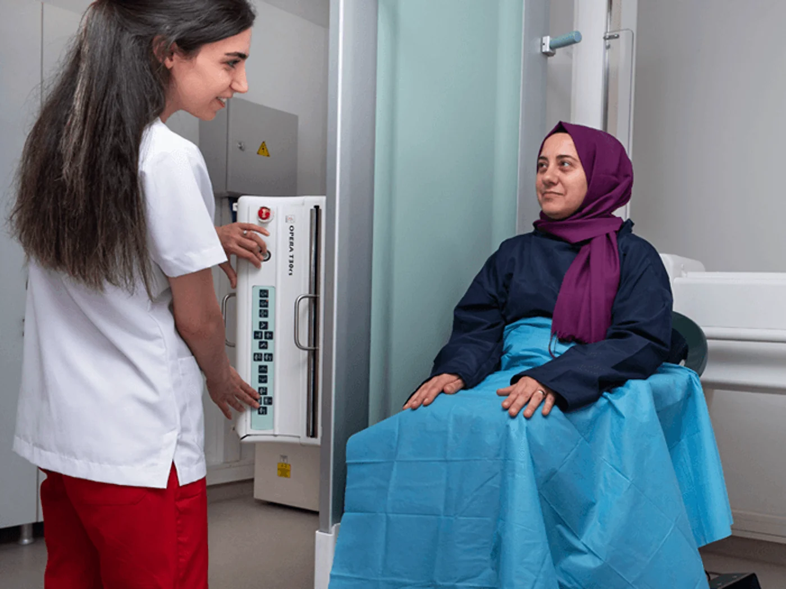

<strong>Lavman sonrası makattan dışkıya benzer kıvamda, özel olarak hazırlanan kontrastın verilerek hastanın oturur pozisyonda dışkı yaparken boşalması esnasında floroskopili dijital röntgen ile görüntülenmesidir. Hem organın anatomik yapısı hem de fonksiyonu hakkında bilgi verir.</strong>

<figure></figure>

<h4>Defekografi işlemi nasıl yapılır?</h4>

İncelemenin oturur pozisyonda yapılması ve floroskopi takibi dışkılama fonksiyonunun görüntülenmesi için önemlidir. Alternatifi olan MR defekografide MR tüpü içinde uzanmış hastanın defekasyonu görüntülenmeye çalışıldığında pozisyonun zorluğu nedeniyle fizyolojik defekasyonun görüntülenmesi çok zordur.

<h4>Defekografi işlemi hangi durumlarda gereklidir?</h4>

Dijital Defekografi çekimiyle rektosel, anal yetmezlik, rektoanal invaginasyon enterosel gibi anal bölge bozuklukları floroskopiyle direkt gözlenerek teşhis konulur ve tedaviye yardımcı olunur. İşlemin kaliteli dijital röntgen cihazı ile tecrübeli teknisyen ve radyolog tarafından gerçekleştirilmesi ve yorumlanması çok önemlidir. Defekografi çekimlerimiz İyitem Görüntüleme Merkezi’nde floroskopili dijital röntgen ile ağrısız bir şekilde gerçekleştirilmektedir. Dijital röntgen ile çekimi yapılan hastaya ayrıca MR çekimiyle anatomik yapılar değerlendirilmektedir.

<!--faq-->
[
  {
    "q": "Defekografi işleminde radyasyon kullanılır mı?",
    "a": "Defekografi işlemi floroskopili dijital röntgen cihazıyla gerçekleştirildiği için düşük de olsa radyasyon alımı söz konusudur. Çekim sırasında floroskopi ile anlık olarak defekasyon sırasındaki patolojiler takip edilebilir. Merkezimizde ayrıca defekografi çekimine perianal MR çekimi de eklenerek anatomik yapılar daha detaylı incelenmektedir"
  },
  {
    "q": "Defekografi çekiminde radyasyon kullanılır mı?",
    "a": "Defekografi çekimi floroskopili röntgen cihazıyla yapılır. Floroskopi sırasında çok düşük miktarda radyasyon kullanılır. Floroskopili çekimden sonra hasta MR cihazına alınır ve ek olarak anal bölgeye yönelik çekim yapılır. MR çekiminde radyasyon kullanılmaz."
  },
  {
    "q": "Defekografi çekiminde konforunuz ve güvenliğiniz için ne yapıyoruz?",
    "a": "Defekografi çekiminin normal defekasyon pozisyonunda oturarak yapılması önemlidir. Fizyolojik anal hareketler ancak böyle görüntülenebilir. Merkezimizde floroskopili defekografi çekiminde hasta oturtularak çekim yapılır. Daha sonra anatomiyi daha iyi görmek için MR çekimi yapılır. Floroskopili defekografi çekimi yapılmadan sadece MR defekografi çekimi MR cihazı içinde yatar pozisyonda yapılabilir fakat oturur pozisyonda, normal defekasyon pozisyonunda yapılamadığından sağlıklı sonuç veremez.\n(Çekilen filmler ve raporlar en az 15 yıl boyunca merkezimizde pacs sisteminde kayıtlı durmaktadır.)"
  }
]
