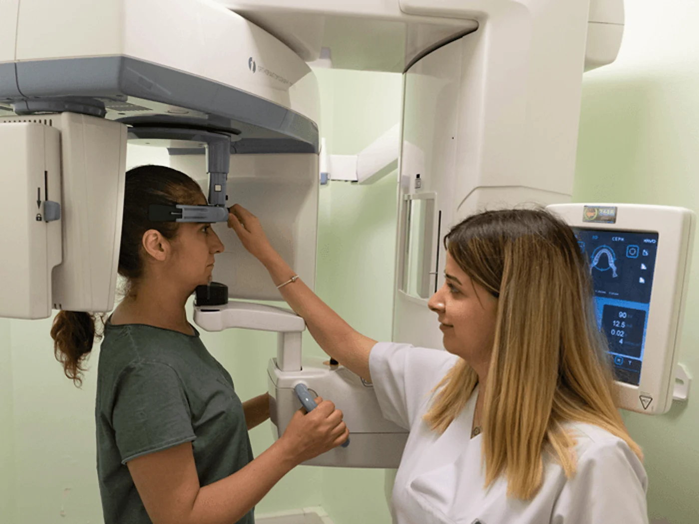
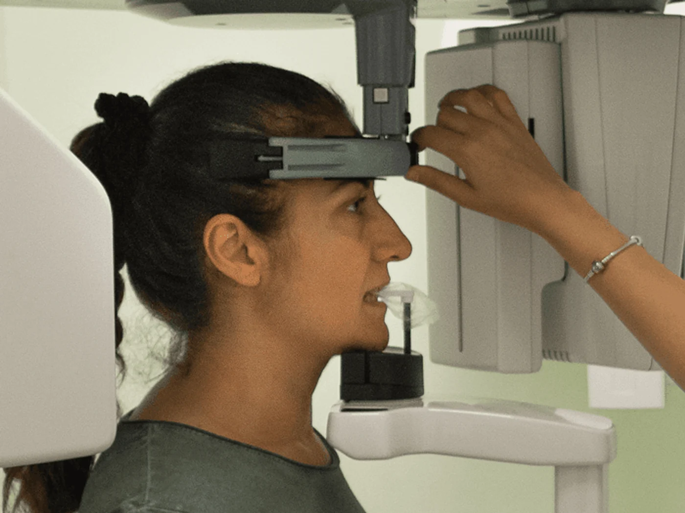
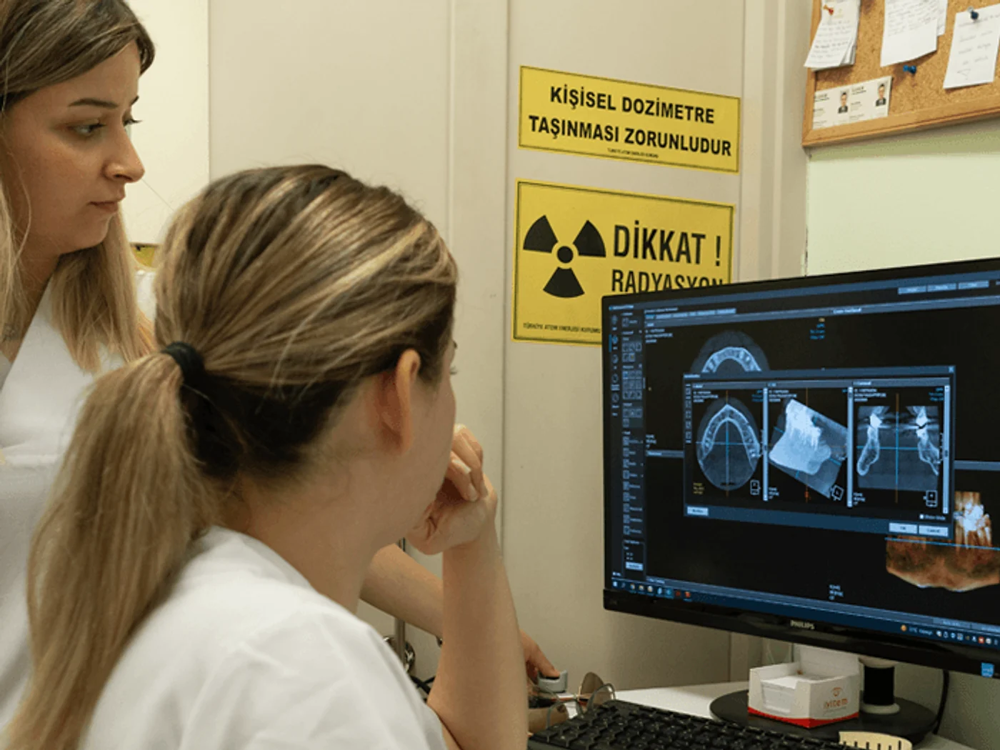

<strong>Dental Tomografi ve Panoramik Röntgen cihazımız KAVO firmasının üç boyutlu cone beam volumetrik 3D diş tomografi cihazıdır. 5×5cm görüntüde 85 mikron voxele kadar inebilen ve 3D endodontik değerlendirme imkanı veren cihazımızla ve tecrübeli teknisyenlerimizle özellikle implant yapacak diş hekimlerimize detaylı ve güvenilir bilgi sağlıyoruz.</strong>

<figure></figure>

Diş köklerinin detaylı incelenmesi ve kemik yapının kalınlığı ile yoğunluğu hakkında güvenilir bilgi verebiliyoruz. Aynı zamanda cihazımız 13×15 cm’lik tarama alanı (FOV) ile tüm yüzü ve kafatabanını görüntüleyerek çene cerrahisi ve maksillofasiyal cerrahiye kullanım imkanı verir. Maksillofasiyal bölge, paranazal bölge oldukça düşük dozla 0.32 mm voxelle yüksek rezolüsyonla değerlendirilebilir.

<figure></figure>

Dental tomografide Cliniview yazılımı ve OnDemand 3D dental modüler yazılımı kullanılarak görüntüler işlenir, değerlendirilir ve pacs sistemiyle, CD ya da film ile hekime ulaştırılır. In2Guide implant planlama modülü ile sanal ortamda implant planlaması yapılabilir.

<figure></figure>

<!--faq-->
[
  {
    "q": "Dental Tomografi hangi durumlarda gereklidir?",
    "a": "Üç boyutlu Dental Tomografi her türlü diş rahatsızlığının teşhisinde anatomi ve hastalıklar açısından detaylı bilgi verdiği için kullanılabilmektedir. Ancak özellikle diş implantı yapılacak hastalarda işlemden önce üç boyutlu Dental Tomografi çekimi hayati öneme sahiptir. Çene kemiği ve maksiller kemiğin kalınlığı ve uzunluğunun ölçümüyle anatomik yapıların üç boyutlu gösterilmesi sağlanır. Dental Tomografi implantın nasıl ve hangi açıda yerleştirileceği, implantın boyunun ve kalınlığının nasıl olması gerektiği hakkında önemli bilgiler verir. Panoramik Röntgende ve küçük diş filmlerinde görülemeyen anatomik detay ve lezyonlar üç boyutlu Dental Tomografiyle gösterilebilir."
  },
  {
    "q": "Dental Tomografi işleminde radyasyon kullanılır mı?",
    "a": "Dental Tomografi radyasyonla çalışan bir cihazdır. Dental Tomografi sırasında panoramik röntgen kadar ya da bir akciğer grafisinden daha az radyasyon alınır."
  },
  {
    "q": "Konforunuz ve güvenliğiniz için neler yapıyoruz?",
    "a": "Panoramik Röntgen ve Dental Tomografi çekimleri bir dakikadan daha az bir zamanda yapılır. Kavo marka cihazımızla oldukça düşük doz radyasyonla kaliteli görüntüler elde edilmektedir. Tecrübeli radyoloji teknisyenlerimizin çekimi ve ölçümleri gerçekleştirmesiyle sonuçlar daha kaliteli olmaktadır.\n(Çekilen filmler ve raporlar en az 15 yıl boyunca merkezimizde pacs sisteminde kayıtlı durmaktadır.)"
  }
]
