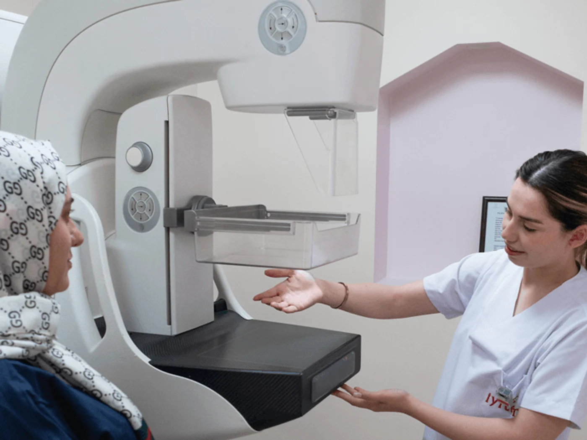
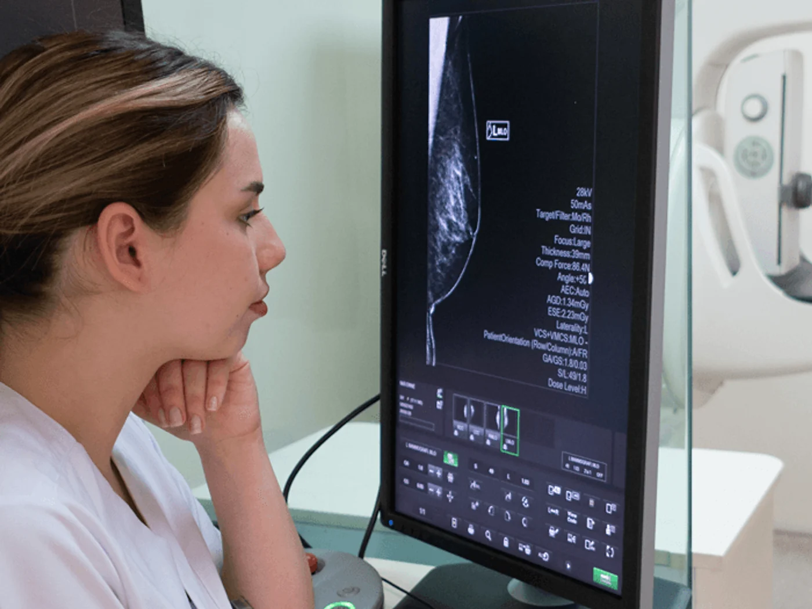

<strong>Dijital Mamografi, kırklı yaşlarından itibaren kadınların her yıl yaptırması tavsiye edilen bir sağlık taramasıdır. İki özel plaka arasına yerleştirilen memenin dijital görüntüsü alınır. Birkaç dakika süren bu işlem sayesinde hayat kurtaran erken tanı konabilir.</strong>

<figure></figure>

Dijital Mamografi incelemesinde meme dokusu radyasyon kullanılarak X ışını ile filme yansıtılıp bilgisayar ortamında görüntü oluşturulur. Daha eski analog mamografilere göre çok daha az radyasyon kullanılır ve görüntü kalitesi çok daha yüksektir. Meme cerrahları dijital mamografi görüntülerini tercih ederler. Bilgisayar ekranında 5 megapiksel tıbbi monitörler aracılığıyla görüntüler 5-6 kat büyütülerek incelenebildiğinden milimetrik çaplı kireçlenmeler tespit edilebilir. Meme tümörlerinde milimetrik çaplı düzensiz sınırlı kireçlenmeler en iyi Dijital Mamografi ile görüntülenebilir. Zira küçük kireçlenmeler analog mamografilerde de, ultrasonografide de, MR incelemede de görülemez.

<figure></figure>

<!--faq-->
[
  {
    "q": "Dijital Mamografi hangi durumlarda gereklidir?",
    "a": "Dijital Mamografi meme tümörlerinin ve özellikle tümörlerde görülen milimetrik çaplı kireçlenmelerin görüntülenmesinde kullanılır."
  },
  {
    "q": "Dijital Mamografi hangi aralıklarla çekilmelidir?",
    "a": "40 yaş üstü bayanlarda rutin olarak yılda bir çekilmesi gerekir. Şüpheli bir lezyon görüntülenmişse ya ileri tetkik yapılır ya da çekim aralıkları 4-6 aya kısaltılabilir."
  },
  {
    "q": "Konforunuz ve güvenliğiniz için neler yapıyoruz?",
    "a": "Dijital Mamografi çekimi iki plak arasında meme dokusu biraz sıkıştırılarak yapılan bir incelemedir. Çeken teknisyenin tecrübeli ve hassas olması gereklidir. Dijital Mamografi görüntülerinin 5 megapiksel tıbbi ekranlarda değerlendirilmesi ve radyoloğun tecrübesi önemlidir.\n(Çekilen filmler ve raporlar en az 15 yıl boyunca merkezimizde pacs sisteminde kayıtlı durmaktadır.)"
  }
]
