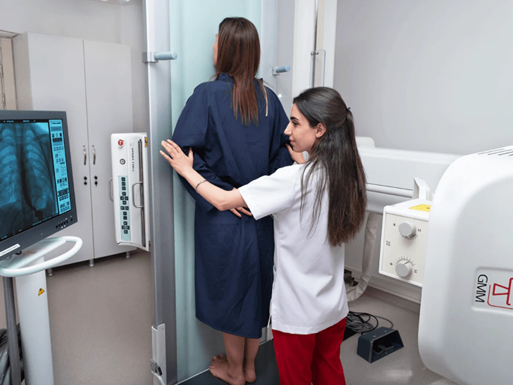
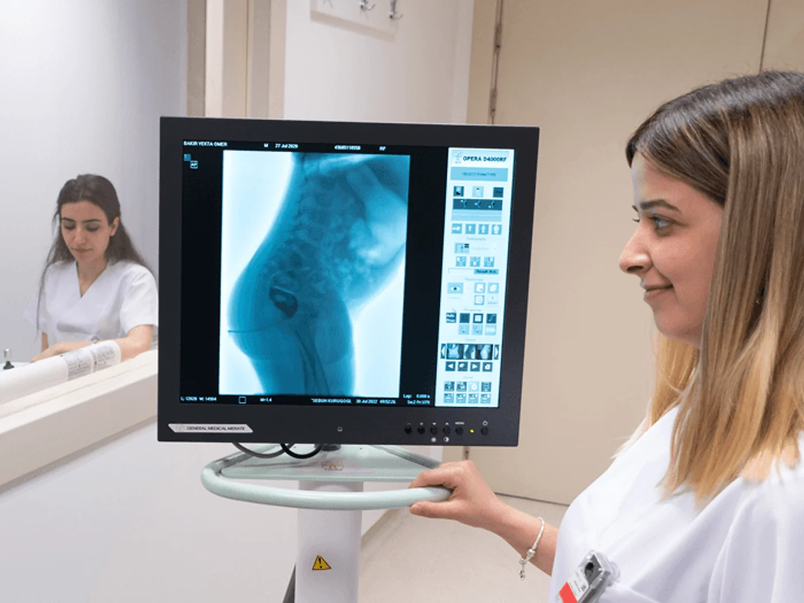
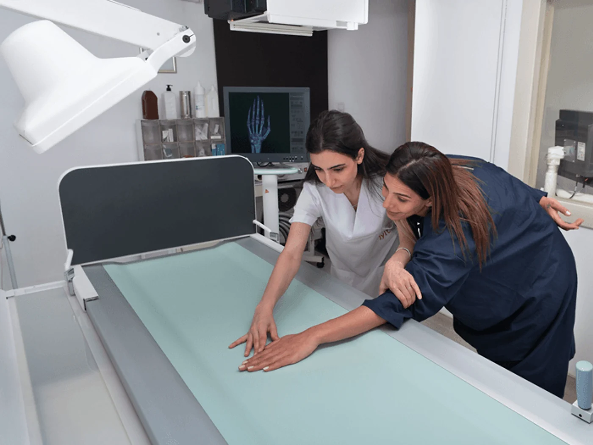

<strong>Dijital röntgen ile HSG-histerosalpingografi (rahim filmi), orthoröntgen (boy grafisi) çekimleri ve ölçümleri, özefagus (yemek borusu) – mide – duodenum (oniki parmak barsağı çekimleri, enteroklizis (çift kontrast ince barsak filmi), çift kontrast kalın barsak (kolon) filmi, voiding sistoüretrografi, retrograd üretrografi gibi çekimler yapılabilmektedir.</strong>

Röntgen, X ışınının dokulardan geçerek bir platforma yansıtılmasıyla elde edilen görüntüdür. Yumuşak dokudan kolay geçebilen X ışını filmi siyah yapar, kemikten daha zor geçebildiği için filmde kemikler beyaz görünür. Yani yumuşak doku kemik ayrımını yapabilir ve daha çok kemik patolojilerinin görüntülenmesinde kullanılır.

Teknolojinin gelişimiyle dijital film platformlarıyla X ışını miktarı çok düşürülerek daha kaliteli görüntüler elde etme imkanı ortaya çıkmıştır. Floroskopi, dokuyu X ışını ile canlı takip etme imkanı verdiğinden <strong>yemek borusu, mide ve bağırsakların görüntülenmesinde, biopsi işlemlerinde, histerosalpingografi (rahim filmi) çekimlerinde kullanılır.</strong>

<figure></figure>

<h4>Dijital röntgen çekimleri nasıl yapılır?</h4>

İyitem Görüntüleme Merkezi’nde GMM Opera T marka floroskopili dijital röntgen cihazını kullanmaktayız. Skolyoz grafisi, stitching tekniği ile tüpe açı vererek cihaz tarafından tamamen otomatik şekilde çekilmekte ve birleştirme otomatik yapılmaktadır. Aynı teknikle<strong> orthoröntgen (boy grafisi)</strong> <strong>çekimleri</strong> ve ölçümleri de yapılmaktadır. Normal radyografi çekimlerinde yüksek teknolojili 9 milyon pikselli dijital flat panel sayesinde en iyi görüntü kalitesi elde edilmektedir.

<figure></figure>

<strong>Histerosalpingografi (HSG)-rahim filmi incelemesi bayan teknisyen eşliğinde kataterle ağrısız</strong> yapılmaktadır. <strong>Çocuklara ve yetişkinlere özefagus (yemek borusu) – mide – duodenum (oniki parmak bağırsağı çekimleri, enteroklizis (çift kontrast ince bağırsak filmi), çift kontrast kalın bağırsak (kolon) filmi çekimi</strong> yapılabilmektedir. Voiding sistoüretrografi böbreklerden idrar kesesine giden yollara (üreter) idrar kesesinden idrar kaçışını görüntüleyen bir incelemedir ve İyitem’de ehil ellerde yapılmaktadır. Ayrıca <strong>retrograd üretrografi</strong> idrar kesesinden dışarıya çıkan yolu (ürethra) inceleyen bir görüntüleme tekniğidir.

<figure></figure>

<!--faq-->
[
  {
    "q": "Dijital röntgen hangi durumlarda gereklidir?",
    "a": "Röntgen, vücutta kemik yapılardaki problemleri görmek için çekilir. Bazı durumlarda yumuşak dokularda kireçlenmeler, yabancı cisimler ve taşlar için de röntgen çekimi yapılabilir. Dijital Röntgen, verilen x ışınının vücuttan geçerek dedektörlerin üzerine düşürülüp bilgisayar ortamında görüntü oluşturulması ile elde edilir. Bilgisayar ortamına alınan röntgen görüntüsünün hem iletilmesi hem saklanması kolaylaşır. Yüksek pikselli dedektörlerde görüntü daha kaliteli olur."
  },
  {
    "q": "Dijital Röntgen çekiminde radyasyon kullanılır mı?",
    "a": "Dijital röntgen çekiminde x ışını, dolayısıyla radyasyon kullanılır. Floroskopi ile canlı görüntü takibinde oldukça düşük dozlar verilir. Röntgen çekiminde her bir grafide yaklaşık 0.02 milisievert radyasyon verilir ki bu çok düşük bir miktardır. Bir insan günde 2-3 saat televizyon seyretmeyle yılda 3-4 milisievert radyasyon alır."
  },
  {
    "q": "Konforunuz ve güvenliğiniz için neler yapıyoruz?",
    "a": "Dijital Röntgende görüntü, yüksek teknolojili dedektörler sayesinde gerçeğe en yakın şekilde oluşturulabilir. Normal röntgenlere göre 30-50 kat daha az radyasyon verilerek görüntü elde edilebilir. Elde edilen görüntüler bilgisayar ortamında depolanabilir ve internet ile gönderilebilir. \n(Çekilen filmler ve raporlar en az 15 yıl boyunca merkezimizde pacs sisteminde kayıtlı durmaktadır.)"
  }
]
