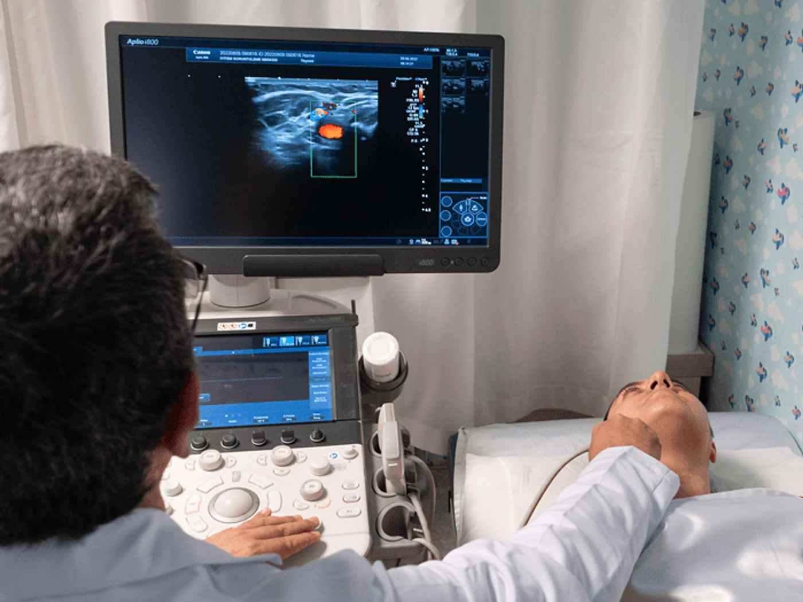
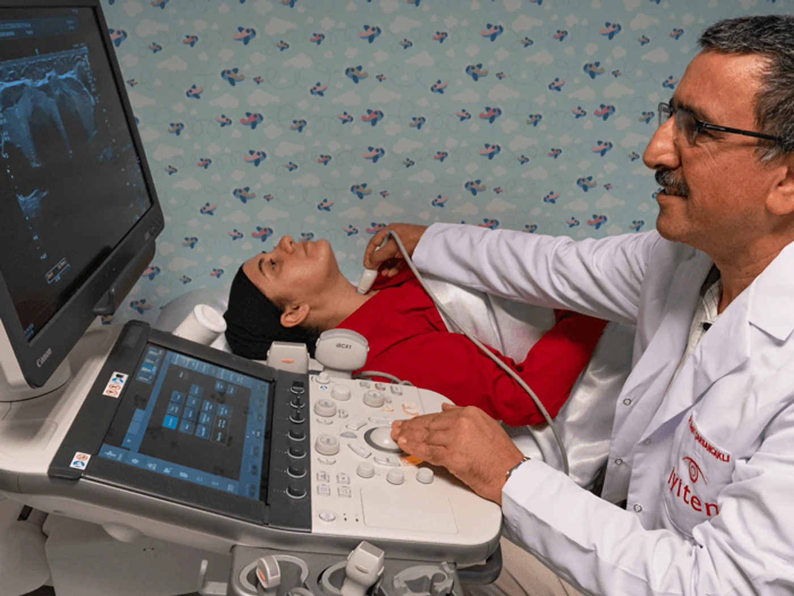

<strong>Renkli Doppler Ultrasonografi cihazı ana bilgisayar, konsol, ekran ve problardan oluşur. Renkli Doppler özelliğiyle damarlarda akan kanın hızı ve akım şekli renklendirilerek gösterilir.</strong>

<figure></figure>

Renkli Doppler Ultrasonografi, bir prob aracılığıyla gönderilen ses dalgalarının farklı dokulara çarpıp dönmesiyle ölçülen frekans farklılıklarından oluşan canlı görüntüdür. Safra kesesi gibi bazı dokuların değerlendirilmesinde diğer görüntüleme yöntemlerine üstünlükleri vardır.

<figure></figure>

İyitem görüntüleme merkezimizde 2019 model Canon I 800 marka Renkli Doppler Ultrasonografi cihazı ile hizmet veriyoruz. Tüm vücut damarlarının incelenmesinde Renkli Doppler Ultrasonografi, kalbin incelenmesinde Ekokardiografi çekimleri ve US altında biopsiler de merkezimizde yapılıyor.

<figure></figure>

<!--faq-->
[
  {
    "q": "Renkli Doppler Ultrasonografi hangi durumlarda gereklidir?",
    "a": "Ultrasonografi ses dalgalarını kullanarak görüntüleme yapan bir inceleme yöntemidir. Özellikle batın içi organların, tiroidin, boyun organlarının incelenmesinde değerlidir. Safra kesesi rahatsızlıklarında, meme hastalıklarında, tiroid dokusunun incelenmesinde diğer görüntülemelere üstünlükleri vardır. Ayrıca cihazın renkli doppler özelliğiyle damarlarda akan kanın yönü ve sesi ile akım şekli değerlendirilebilir. Tümöral kitlelerin damarlanması görüntülenebilir. Anne karnında bebeğin görüntülenmesi sağlanabilir. Çocuklarda beyin dokusu ve damarları incelenebilir. Eklem hastalıklarının değerlendirilmesinde kullanılabilir."
  },
  {
    "q": "Renkli Doppler Ultrasonografide radyasyon kullanılıyor mu?",
    "a": "Ultrasonografi adından da anlaşılabileceği gibi ses dalgalarını kullanarak görüntüleme yapan bir inceleme yöntemidir. Radyasyon kullanılmaz. Ses dalgalarının insan vücuduna herhangi bir zararı yoktur. Hatta anne karnındaki bebeğe dahi ultrasonografi çekimi yapılabilir."
  },
  {
    "q": "Konforunuz ve güvenliğiniz için neler yapıyoruz?",
    "a": "Merkezimizde yüksek teknolojili kaliteli görüntü veren Canon marka Renkli Doppler Ultrasonografi cihazı kullanılmaktadır. Rutin kullanılan problar dışında çocuk ve bebeklerin batın incelemesine imkan veren özel çocuk probu kullanılmaktadır. Ekokardiografi probuyla kalp ekosu yapılabilmektedir. Deneyimli radyoloji doktorları tarafından işlemler gerçekleştirilmekte, çekim bittikten 10-15 dakika sonra incelemenin cd'si ve raporu verilmektedir.\n(Çekilen filmler ve raporlar en az 15 yıl boyunca merkezimizde pacs sisteminde kayıtlı durmaktadır.)"
  }
]
