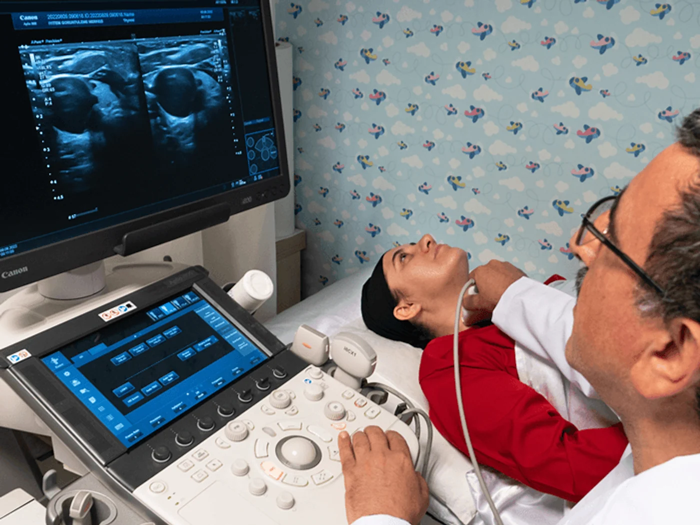

<strong>Girişimsel radyoloji, ultrasonografi, bilgisayarlı tomografi veya floroskopi eşliğinde, ince iğne ve kateterlerle yapılan tanısal ve tedaviye yönelik işlemlerin tümüdür. Görüntüleme rehberliğinde çalışıldığı için hedefe milimetrik doğrulukla ulaşılır; açık cerrahiye kıyasla çok daha küçük bir girişimle sonuç alınır.</strong>

İşlemler lokal anestezi altında, çoğu durumda aynı gün taburcu olacak şekilde gerçekleştirilir. Merkezimizde girişimsel işlemler radyoloji uzmanlarımız tarafından, işlemin gerektirdiği görüntüleme yöntemi eşliğinde yapılır.

<h4>Görüntüleme eşliğinde biyopsi</h4>

Tiroid, meme, karaciğer, böbrek ve yüzeyel yumuşak doku lezyonlarından ultrasonografi eşliğinde ince iğne aspirasyon biyopsisi (İİAB) veya tru-cut biyopsi alınabilir. Görüntüleme rehberliği, iğnenin hedef lezyona doğru ilerleyişinin gerçek zamanlı izlenmesini sağlar; böylece hem örnekleme doğruluğu artar hem de komşu damar ve organlardan kaçınılır.

<h4>Boşaltıcı ve tedaviye yönelik işlemler</h4>

Karın içi ve akciğer zarı boşluğunda biriken sıvının görüntüleme eşliğinde boşaltılması (parasentez, torasentez), apse ve kist içeriğinin iğne ya da kateterle drenajı bu başlık altındadır. İşlem hem tanı için örnek alınmasını hem de hastanın şikâyetinin hızla rahatlamasını sağlar.

<h4>İşlem öncesinde nelere dikkat edilmeli?</h4>

Girişimsel işlemler öncesinde kan sulandırıcı ilaç kullanımınızın ve kanama-pıhtılaşma değerlerinizin bilinmesi gerekir. Hekiminiz gerekli görürse işlemden birkaç gün önce bazı ilaçların kesilmesini isteyebilir. İşlem türüne göre açlık gerekebilir; randevu sırasında size özel hazırlık anlatılır.

<figure></figure>

<!--faq-->
[
  {
    "q": "Girişimsel radyoloji işlemleri ağrılı mıdır?",
    "a": "İşlemler lokal anestezi altında yapılır; iğnenin gireceği bölge uyuşturulduğu için işlem sırasında keskin bir ağrı beklenmez. Basınç ve dokunma hissi olabilir. İşlem sonrası hafif hassasiyet birkaç gün sürebilir ve basit ağrı kesicilerle geçer."
  },
  {
    "q": "İşlemde radyasyon kullanılır mı?",
    "a": "Kullanılan görüntüleme yöntemine bağlıdır. Ultrasonografi eşliğinde yapılan işlemlerde radyasyon kullanılmaz. Bilgisayarlı tomografi veya floroskopi eşliğinde yapılan işlemlerde düşük dozda radyasyon söz konusudur; doz, işlemin gerektirdiği en az seviyede tutulur."
  },
  {
    "q": "İşlemden sonra hemen evime gidebilir miyim?",
    "a": "Çoğu girişimsel işlem sonrası bir süre gözlem altında dinlendirilirsiniz ve aynı gün taburcu olursunuz. İşlem türüne göre o gün araç kullanmamanız veya ağır kaldırmamanız istenebilir; ayrıntılı bilgi işlem öncesinde verilir."
  },
  {
    "q": "Biyopsi sonucu ne zaman çıkar?",
    "a": "Biyopsi örneği patoloji laboratuvarında değerlendirilir; sonuç süresi laboratuvara ve incelemenin türüne göre değişir. Görüntüleme raporunuz ise işlemin ardından merkezimizde hazırlanır ve online erişiminize açılır."
  },
  {
    "q": "Hangi işlemlerin yapılabildiğini nasıl öğrenebilirim?",
    "a": "Uygulanabilecek işlem, şikâyetinize ve hekiminizin isteğine göre belirlenir. Çağrı merkezimizi arayarak elinizdeki tetkik istem belgesiyle birlikte hangi işlemin merkezimizde yapılabileceğini öğrenebilirsiniz."
  }
]
