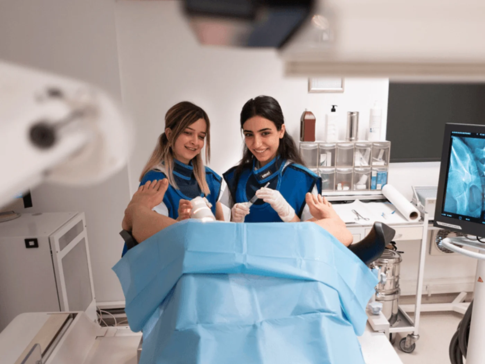
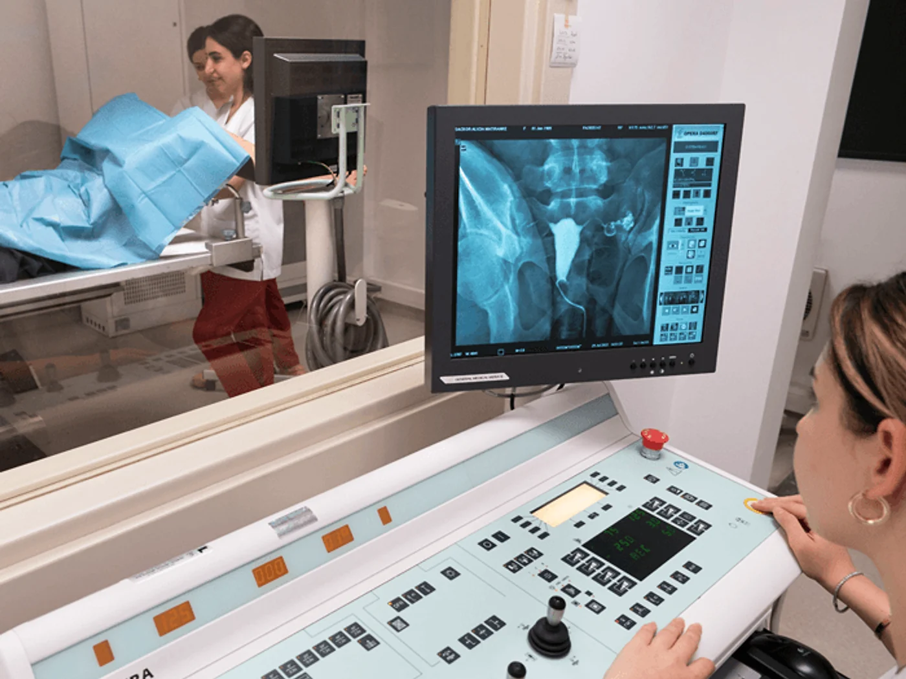
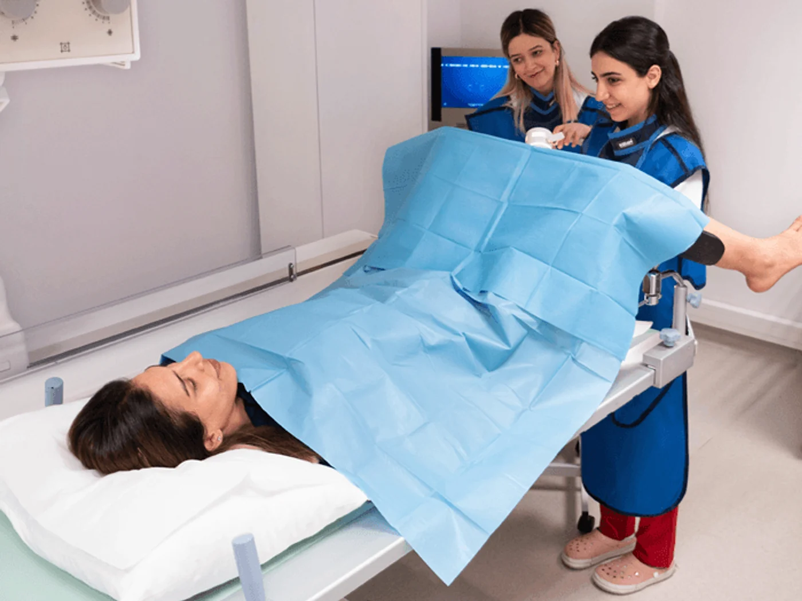
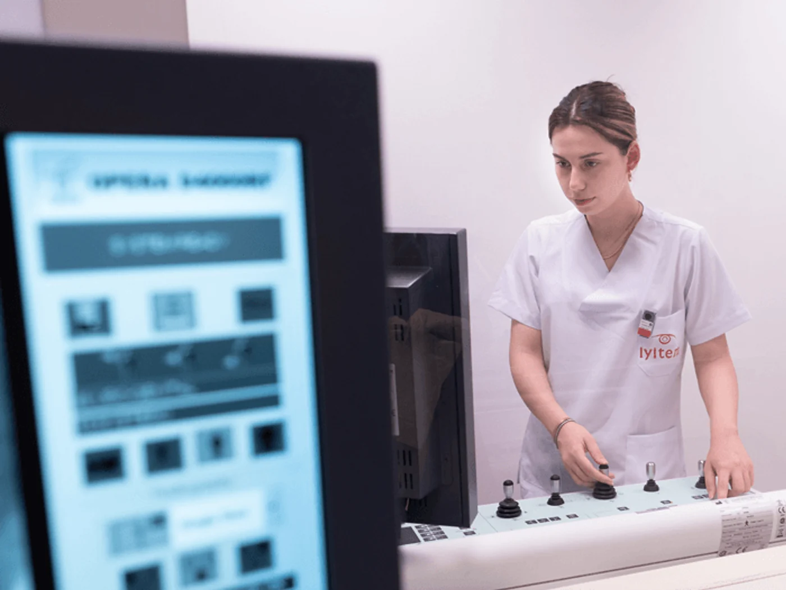

<strong>Histerosalpingografi-HSG rahim ve yumurtalık kanallarının incelenmesini sağlayan görüntüleme yöntemidir. Rahim filmi olarak da bilinir. Sperm ile yumurtanın buluşmasını sağlayan yol olan yumurtalık kanallarının ve bebeğin anne karnındaki yaklaşık 9 aylık hayatını geçireceği mekan olan rahim boşluğunun durumunu incelemek için çekilen röntgen filmidir.</strong>

<figure></figure>

Eskiden rahim filmi nispeten pahalı ve zor bir inceleme yöntemiydi. Ancak günümüzde digital röntgen cihazlarının, özel yumuşak kateterlerin ve yeni jenerasyon su bazlı kontrast maddelerin kullanıma girmesi, artan inceleme sayıları nedeniyle bu filmi çeken tecrübeli radyoloji uzmanlarının artması neticesinde hem rahim filmi fiyatları makul bir seviyeye gerilemiş hem de ağrısız ve olabildiğince komplikasyonsuz bir şekilde düşük radyasyonlu ve yüksek kalitede rahim filmi incelemeleri mümkün hale gelmiştir. Çekimi yapan kişinin radyolog ya da teknisyen olması ve işinde tecrübeli olması önemlidir. Hasta mahremiyetine özel önem verilen merkezimizde yüksek kalitede dijital röntgen cihazımızla başarılı görüntüleme yapılmaktadır. Rahim filmi çekimi sırasında ağrı hastaların korkulu rüyasıdır. İnce balonlu kateter kullanımı ve tecrübeli bayan teknisyenlerimizle ağrısız rahim filmi çekilmektedir.

<figure></figure>

<h4>HSG Çekim Tekniği</h4>

Spekulum adı verilen aletle vajina genişletildikten sonra rahim girişine ince bir balonlu katater koyup konrast vererek çekilen girişimsel bir radyoloji işlemidir. HSG ile rahim duvarları ve yumurtalık boruları değerlendirilir. Yumurtalık kanallarının açık olup olmadığı ve verilen ilacın karın boşluğuna geçip geçmediği floroskopi ile canlı olarak takip edilebilir.

Yumurtalık yollarında bir tıkanıklık yoksa ve ilaç karın boşluğuna normal yayılıyorsa hastada hamilelik için bu açıdan problem yok demektir. Ancak yumurtalık yollarında yapışıklıklar varsa, eski geçirilmiş enfeksiyonlara bağlı genişlemeler, tıkanıklıklar varsa verilen ilaç karın boşluğuna serbest olarak dağılamıyorsa, hastada yumurtaların rahime geçişinde ve hamileliğin gerçekleşmesinde problem var demektir. Ayrıca rahim kanalında yapısal anomaliler veya yapışıklık varsa ya da hamileliğin gerçekleşmesini engelleyecek rahim kanalını daraltan bir kitle varsa hamileliğin gerçekleşmesi mümkün olmaz. Bu anomalilerin HSG incelemesi ile gösterilmesi ve teşhis edilmesi ile tedavi yolu açılmış olur.

<figure></figure>

<strong>HSG incelemesinin yüksek kalitede dijital röntgen cihazında yapılması görüntü kalitesi için çok önemlidir</strong>, çünkü yumurtalık kanalları çok ince olduğunda kontrast geçişinin görüntülenmesi için yüksek çözünürlüklü görüntü gerekir. Yumurta kanallarındaki yapışıklıklar bazen HSG incelemesi sırasında kontrastın basıncıyla açılır ve hamileliğin gerçekleşmesi için tedavi sağlanmış olur.

HSG çekimi adet başlangıcından sonra 8 ila 11. günde yapılmaktadır. Adet sonrası çekime kadar hastanın cinsel ilişkiye girmemesi istenmektedir. HSG çekimi sonrası nadiren enfeksiyon görülebildiğinden önlem olarak çekim öncesi ve sonrası antibiyotik tedavisi uygulanmaktadır. İşlem sonrası kişi normal hayatına devam edebilir. İşlem ağrısız olduğundan anesteziye gerek kalmamaktadır. Anestezi işlem süresini ve maliyetini arttırmaktadır. Ancak yine de anestezi isteyen hastalarımız için bayan anestezist tarafından anestezi verilmektedir.

<figure></figure>

<!--faq-->
[
  {
    "q": "HSG - Histerosalpingografi hangi durumlarda gereklidir?",
    "a": "HSG - Histerosalpingografi, doktorunuzun yumurtalık yollarının durumunu, rahim kanalında yapısal anomaliler veya yapışıklık olup olmadığını ya da hamileliğin gerçekleşmesini engelleyecek rahim kanalını daraltan bir kitle olup olmadığını görmek için isteyebileceği bir testtir. Bu anomalilerin HSG incelemesi ile gösterilmesi ve teşhis edilmesi ile tedavi yolu açılmış olur."
  },
  {
    "q": "HSG işleminde radyasyon kullanılır mı?",
    "a": "Histerosalpingografi işlemi floroskopili dijital röntgende yapıldığından radyasyon kullanılır. 2 ya da 3 görüntü ile işlem tamamlandığından radyasyon dozu çok düşüktür. İşlem sırasında kullanılan kontrast maddenin rahime ve yumurtalık kanallarına geçişi ve karın boşluğuna yayılımı floroskopi ile canlı olarak takip edilir."
  },
  {
    "q": "Konforunuz ve Güvenliğiniz için neler yapıyoruz?",
    "a": "Histerosalpingografi işlemini tamamen bayan teknisyenler gerçekleştirir. Mahremiyete dikkat edilir. Çekim sırasında kateterle kontrast verildiğinden ağrı olmaz. Anesteziye ihtiyaç duyulmaz. Çekim, merkezimizde ağrısız olarak gerçekleştirilir ve rapor 1-2 saat içinde film CD’si ile birlikte verilir. Görüntüler ve rapor merkezimizde en az 15 yıl saklanır. İstenildiğinde web sitemizden görülebilir"
  }
]
