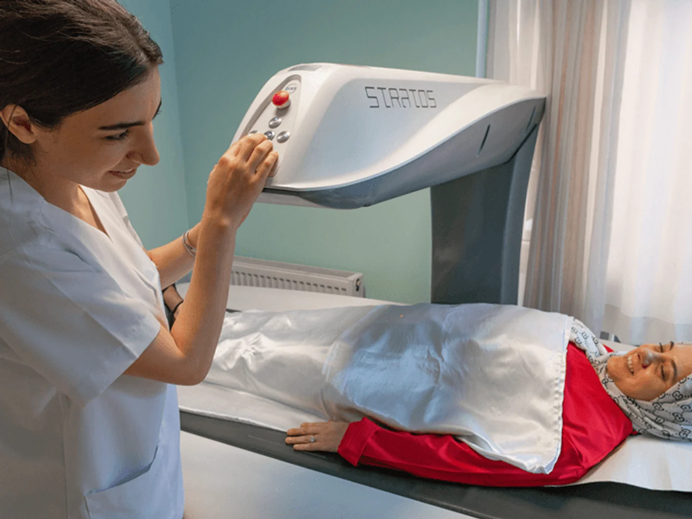
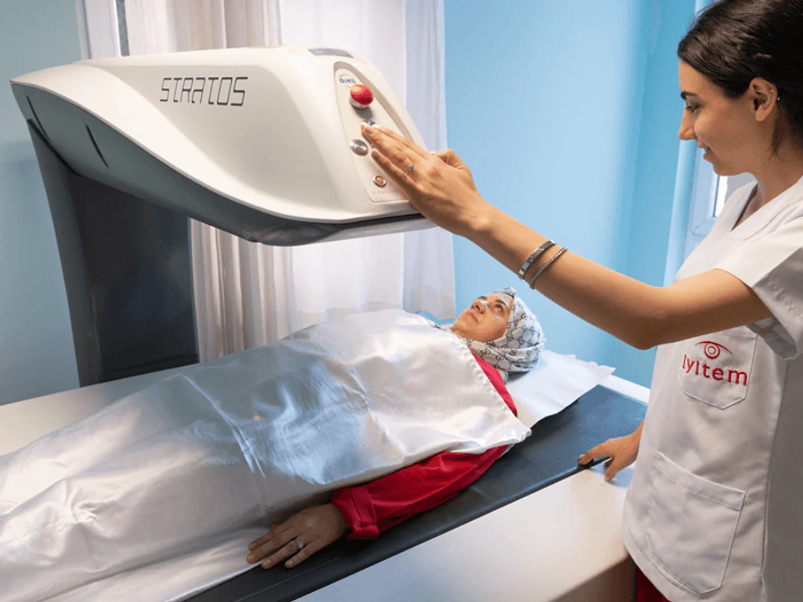
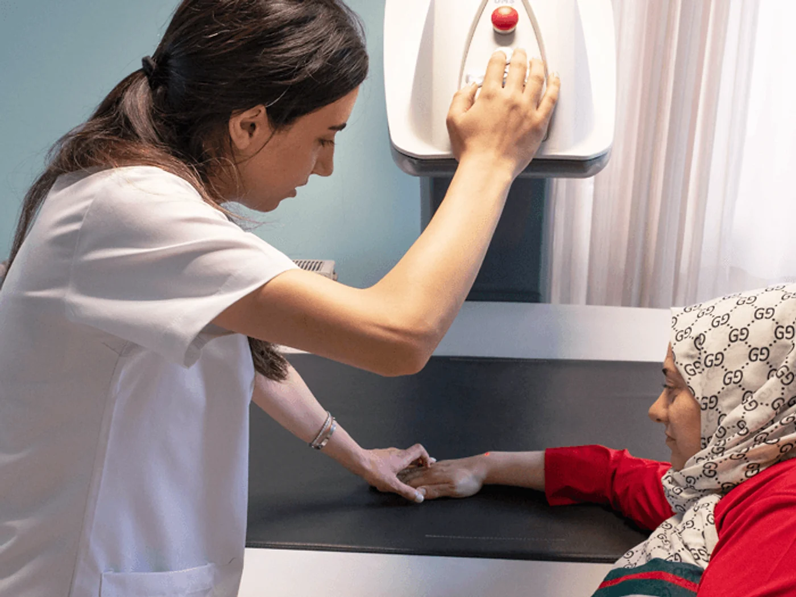

<strong>Kemik Dansitometri gelişmiş bir röntgen çekimidir. Düşük miktarda X ışını kullanılır. L1 ve L4 arasındaki omurlar ve kalça kemiği görüntülenir. Omurlar ve kalça kemiği, kemik erimesini net bir şekilde gösterir. Kemiklerdeki güçsüzlüğü ve kırılganlık riskini belirler.</strong>

<figure></figure>

Kemik yoğunluğu kaybı günümüzde özellikle yaşlı nüfusda önemli bir sağlık problemidir. Kemik yoğunluğu kaybının derecesinin uluslararası ölçekte kabul edilen yöntemlerle ölçümü ve takibi önemlidir.

İyitem görüntüleme merkezimizde DMS model kemik dansitometri cihazıyla güvenilir hizmet vermekteyiz. Standart kemik ölçümü yanında tüm vücut kemik yoğunluğu, radial kemik yoğunluğu ve çocuklara kemik yoğunluğu ölçümleri yapılabilmektedir.

<figure></figure>

Ayrıca merkezimizde BT (Bilgisayarlı Tomografi) cihazıyla QCT kemik yoğunluğu ölçümü de yapılmaktadır. QCT tekniğinde bel omurga bölgesinde kemik orta bölümünden ölçüm yapıldığından osteofit (kemik çıkıntı) olan hastalarda daha sağlıklı sonuçlar almak mümkün olmaktadır.

<figure></figure>

<!--faq-->
[
  {
    "q": "Kemik Dansitometri hangi durumlarda gereklidir?",
    "a": "Kemik yoğunluk kaybı özellikle menapoz sonrası bayanlarda ciddi bir problemdir. Erken teşhis edilmesi ve gerekli tedavinin uygulanması ile kemik yoğunluğu kaybı önlenebilir. Kemik yoğunluğunun uluslararası standartlara uygun olan ve mümkünse aynı cihazlarla ölçülmesi ve takibi önemlidir. Ayrıca hormonal bozukluğu olan bireylerde travma geçiren ve uzun süre yatak istirahati yaşayan kişilerde kemik yoğunluğu ölçümü ve takibi gereklidir."
  },
  {
    "q": "Kemik yoğunluğu işleminde radyasyon kullanılır mı?",
    "a": "Kemik yoğunluğu ölçen cihazlar radyasyonla çalışır ancak verilen radyasyon dozu bir akciğer filminden çok daha azdır. O nedenle herhangi bir zararı yoktur."
  },
  {
    "q": "Konforunuz ve güvenliğiniz için neler yapıyoruz?",
    "a": "Kemik yoğunluğu ölçümünü deneyimli teknisyenler ve uluslararası standartlara uygun cihazla gerçekleştiriyoruz. Çekim birkaç dakikada bitmekte ve sonuçlar radyolog kontrolünden sonra hemen verilmektedir.\n(Çekilen filmler ve raporlar en az 15 yıl boyunca merkezimizde pacs sisteminde kayıtlı durmaktadır.)"
  }
]
