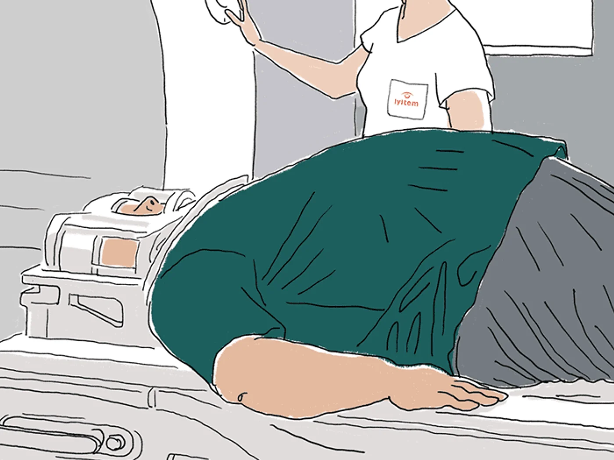

<strong>MR görüntülemede kullanılan radyo dalgaları büyük miktarda yağa nüfuz edebilir. Diğer görüntüleme yöntemlerine kıyasla MR görüntüleme obeziteden en az etkilenen yöntemdir. Kilolu, şişman hastalarda MR inceleme yapılabilmesinde tüp çapı, tüp uzunluğu, masa ağırlık limitleri, manyetik alan gücü gibi unsurlar önemlidir.</strong>

<figure></figure>

Bir bölge MR incelemesi yaklaşık 10 ile 45 dakika arasında bir sürede tamamlanır. Sürenin değişkenliği incelenecek olan alanın yerine ve hastalık hakkında toplanması gereken bilgi miktarına bağlıdır.

Eski MR cihazlarında 120 kilo üzerinde hastalarda ağırlık MR cihazı masası için risk taşır. Merkezimizde 250 kiloya kadar hasta çekimi yapılabilmektedir. Ancak bazı çekimlerde ve hastanın vücut genişliği çok fazlaysa çekim yapılamayabilir.

Yüksek kilolu hastalarda MR cihazı gücünün en az 1.5 tesla olması gerekir. Bilgi toplanması gereken bölge zaten çok geniş olduğundan 1.5 teslanın altındaki cihazlarda yeterli görüntü kalitesi sağlanamayabilir. 3 Tesla MR ile yüksek manyetik alan gücünden dolayı daha kaliteli ve ince kesitli MR görüntüleri elde edilmektedir.

<!--faq-->
[
  {
    "q": "Konforunuz ve güvenliğiniz için neler yapıyoruz?",
    "a": "3 Tesla MR cihazımızda hastanın çekim sırasında girdiği tüp 70 cm genişlikte olduğundan daha rahat bir ortam sağlar. Çekim sırasında televizyon seyretme ve müzik dinleme imkanı konforu arttırır. İncelemenin yapay zeka sayesinde daha kısa sürmesi sağlanır. Ayrıca gerektiğinde “Sessiz MR” özelliğiyle ses miktarı oldukça azaltılabilir. Çekimden birkaç saat sonra rapor verilir. MR cihazı büyük bir mıknatıs olduğundan çekim sırasında hastanın üzerinde metal kalmamalıdır. Onun için elbiseler çıkarılıp forma giydirilir. Ayrıca MR odasında herhangi bir ihtimale karşı oksijen ve aspiratör sistemi bulunmaktadır. Deneyimli doktor ve teknisyenlerle acil hemşiresi çekimlere refakat etmektedir.\n(Çekilen filmler ve raporlar en az 15 yıl boyunca merkezimizde pacs sisteminde kayıtlı durmaktadır.)"
  }
]
