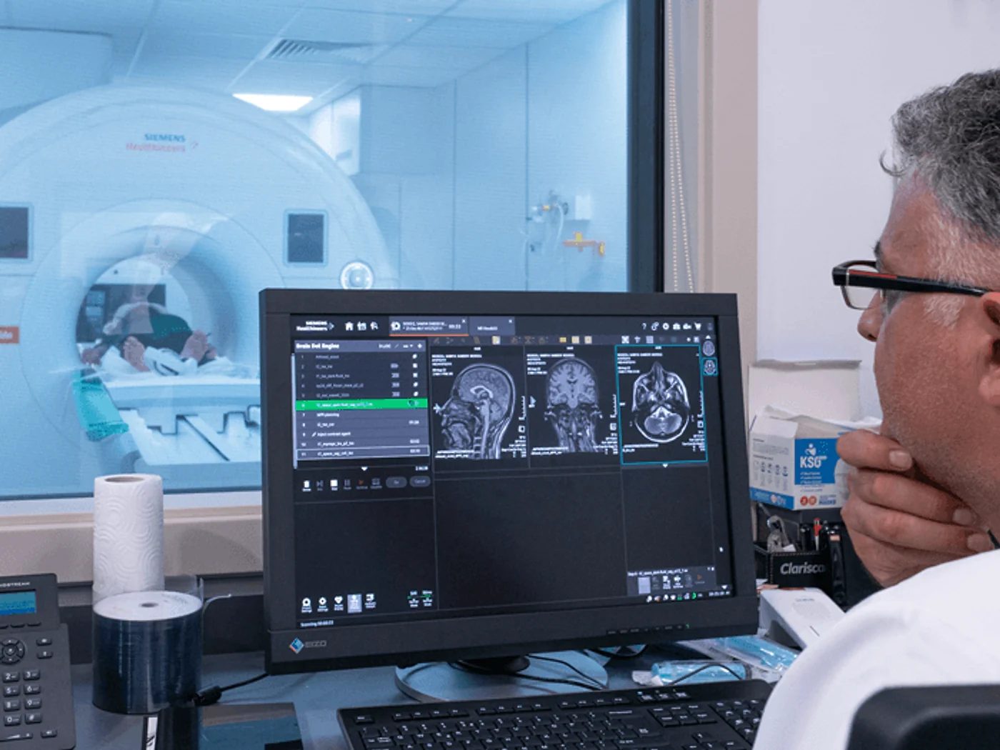

<strong>MR inceleme, vücuttaki hidrojen atomlarının manyetik alanlarının yönlerinin radyofrekanslarla değiştirilerek çıkardıkları enerjinin ölçülmesiyle ve her dokunun farklı enerji çıkarmasından faydalanılarak oluşturulan görüntüleme tekniğidir.</strong>

Her doku farklı miktarda hidrojen içerdiğinden su, yağ, kas, kemik, sinir dokusu, tümör, enfeksiyon dokusu gibi çeşitli dokular birbirlerinden ayırt edilebilir. MR makinesinin gücü tesla birimi ile ölçülür. Günümüzde 1.5 tesla ve 3 tesla cihazlar optimum görüntüleme için yeterlidir. 7 ve 10.5 tesla cihazlar da yeni yeni kullanıma girmeye başlamıştır. Ancak belli bir manyetik alanın üzerinde makine mikrodalga fırın etkisi yaptığından vücut ısısı artmaktadır.

<h4>3 Tesla MR ile daha detaylı görüntü</h4>

İyitem görüntüleme merkezimizde 2022 model Siemens Vida 3 tesla cihazımızla hizmet veriyoruz. En son teknolojiye sahip cihazımızla normal mr çekimleri yanında fonksiyonel mr, mr spektroskopi, mr traktografi, mr enterografi, kardiak mr, multiparametrik prostat ve karaciğer mr, vaskülit için damar görüntüleme, mr nörografi, tüm vücut mr gibi özellikli çekimlerle hizmet vermekteyiz.

<figure></figure>

<!--faq-->
[
  {
    "q": "MR hangi durumlarda gereklidir?",
    "a": "MR inceleme yüksek doku rezolüsyonu ile yumuşak dokuların daha iyi görüntülenmesini sağlar. Kemik dokunun da medüller kemik denilen süngerimsi kısmının görüntülenmesinde önemlidir.\n \nAkciğer dokusunda ve paranazal sinüs bölgesinde daha çok hava olduğundan MR görüntülemede sinyal alınamaz. Bilgisayarlı tomografi akciğer dokusunun ve paranazal bölgenin incelenmesinde genelde MR incelemeye üstündür. Mesela safra kesesinin incelenmesinde MR görüntüleme de kullanılmakla birlikte ultrasonografik inceleme genel olarak MR incelemeye üstündür. Aynı şekilde bağırsaklarda hava bulunduğundan bağırsakların görüntülenmesinde bazı durumlarda bilgisayarlı tomografi ya da çift kontrast kolon grafisi MR incelemeye genelde üstündür. Bunun dışındaki tüm vücut bölgelerinin görüntülenmesinde MR kullanılır.\n\nÖzellikle sinir sisteminin incelenmesinde omuz, kalça, diz, ayak bileği gibi eklemlerin incelenmesinde boyun sırt ve bel bölgesinin incelenmesinde MR inceleme diğer incelemelere göre genelde üstündür. Kasların, cilt altı yağlı planların, batın içi organların değerlendirilmesinde genelde MR inceleme kullanılır."
  },
  {
    "q": "MR görüntüleme zararlı mıdır?",
    "a": "MR görüntülemede radyasyon kullanılmaz. MR görüntülemede kullanılan manyetik alanın insan vücuduna zararı henüz gösterilememiştir. Hatta anne karnında bebeklere erken tanı için ultrasonografi yanında MR inceleme kullanılmaktadır. Günümüzde kullanıma yavaş yavaş giren 7 ve 10 tesla MR cihazlarında vücut ısısı uzun sürede artmaktadır. Ancak 1.5 ve 3 tesla MR cihazlarında böyle bir etki yoktur. Ancak metal protezler eğer titanyum bazlı değilse demir ya da çelik ise çevre dokuda ısınmaya neden olabilirler. Kalbe konan stentler MR incelemede herhangi bir zarar görmez. Kalbe konan kalp kapakçıkları eğer titanyum değilse zarar görebilir. Son 20-30 yıldaki tüm kalp kapakları titanyum içeriklidir. Kalp pilleri MR incelemede zarar görebilir Bu nedenle kalp pili olanların MR çektirmemeleri gerekir. Ancak hastane ortamında, kardiyoloji uzmanı kontrolünde, pil şirketinin elemanları eşliğinde, kalp pili yavaşlatılarak MR çekimi yapılabilir. Ortopedik protezlerde titanyum içerikli ise herhangi bir zarar görülmez. Hatta günümüzde yeni geliştirilen sekanslarla protez çevresindeki yumuşak doku ve kemik yapı hakkında da bilgi elde edilebiliyor. Titanyum içerikli protezlere uzak olan bölgelerin MR çekiminde de herhangi bir mahsur yoktur. Gebeliğin ilk üç ayı organogenez dönemi olduğundan ispatlanmış bir şey olmamasına rağmen her ihtimale karşı gebeler ilk üç ayda MR çekimine alınmaz."
  },
  {
    "q": "MR işleminde radyasyon kullanılır mı?",
    "a": "MR cihazı büyük bir mıknatıstır. MR çekiminde manyetik alan kullanılarak görüntü elde edilir. Radyasyon içermez, X ışını kullanılmaz. MR incelemenin bilinen bir yan etkisi yoktur. Hatta anne karnında fetüslere yönelik MR çekimi yapılmaktadır."
  },
  {
    "q": "Fazla kilolu kişiler MR inceleme yaptırabilir mi?",
    "a": "Eski MR cihazlarında 120 kilo üzerindeki kişiler MR cihazına alınmıyordu. Kilolu hastalar MR cihazının masasına zarar verebiliyordu. Yeni MR cihazlarında 250 kiloya kadar tüm hastalar MR çektirebiliyor. Tabii ki kilo arttıkça görüntü kalitesi hafif azalıyor."
  },
  {
    "q": "Kimler MR inceleme yaptıramaz?",
    "a": "- Kalp pili olanlar\n\n- Titanyum dışı metalik kalp kapağı olanlar\n\n- Titanyum dışı metalik protezi olanların protez olan bölgelerine MR çekimi yapılamaz. Metalin oluşturduğu artefakt nedeniyle o bölge MR ile değerlendirilemez.\n\n- Çekim sırasında hareket etmeden duramayan çocuklar mental geriliği olanlar ancak anesteziyle uyutularak MR cihazına alınabilir.\n\n- İstemsiz hareketleri olanların hareketli olan bölgelerine MR çekimi yapılamaz.\n\n- 250 kilo üstündeki kişilere MR çekimi yapılamaz.\n\n- Birinci trimesterda yani gebeliğin ilk üç ayındaki gebeler MR çekimi yaptıramaz. Çünkü gebeliğin ilk üç ayı organogenez dönemi olduğundan ispatlanmış bir şey olmamasına rağmen her ihtimale karşı gebeler ilk üç ayda MR çekimine alınmaz.\n\n- Gözde metalik yabancı cisim şüphesi olanlara MR inceleme yapılamaz.\n\n- Vücutta herhangi bir bölgede metalik yabancı cisim damarların yanındaysa hareket ederek zarar verme ihtimaline karşın MR inceleme yapılmaz."
  },
  {
    "q": "MR inceleme öncesi hazırlık var mıdır? İnceleme sırasında neye dikkat etmem gerekir? MR çekimini tek başıma yaptırabilir miyim? MR çekimi korkulacak bir işlem midir?",
    "a": "MR inceleme tek başına yaptırılabilecek bir çekimdir. Yaşlı ve yürümede problemi olan hastalarda yardım gerekebilir. MR çekimi öncesi genelde bir hazırlık söz konusu değildir. Sadece 2-3 saatlik açlık gerekir. İnceleme sırasında damardan kontrast verilirse -nadiren de olsa- bulantı kusma olmaması için bir önlemdir. MR kontrastı alerjisi çok nadir görülür ancak birçok ilaca alerjisi olan atopik hastalarda uygulanacak MR ilacına karşı alerji testi yapılması gerekebilir.\n \nMR çekimi sırasında hastanın hareketsiz kalması gerekir. Normal nefes alıp verme dışında hareket görüntüyü bozar. Gerçek klostrofobik (kapalı alan korkusu olan) hastalar MR çekimi yaptıramayabilir. Gerçek klostrofobik hastalar asansöre de binemez. Gerçek klostrofobik hastalar anestezi ile uyutarak MR çekilebilir. Onun dışındaki anksiyetesi (kaygı bozukluğu) olan hastalar psikolojik destekle rahatça MR çekimi yaptırabilir. MR inceleme sırasında televizyon seyretme ya da müzik dinleme daha konforlu bir ortam sağlanabilir."
  },
  {
    "q": "Konforunuz için neler yapıyoruz?",
    "a": "3 Tesla MR cihazımızda hastanın çekim sırasında girdiği tüp 70 cm genişlikte olduğundan daha rahat bir ortam sağlar. Çekim sırasında televizyon seyretme ve müzik dinleme imkanı konforu arttırır. İncelemenin yapay zeka sayesinde daha kısa sürmesi sağlanır. Ayrıca gerektiğinde “Sessiz MR” özelliğiyle ses miktarı oldukça azaltılabilir. Çekimden birkaç saat sonra rapor verilir.\n(Çekilen filmler ve raporlar en az 15 yıl boyunca merkezimizde pacs sisteminde kayıtlı durmaktadır.)"
  },
  {
    "q": "Güvenliğiniz için neler yapıyoruz?",
    "a": "MR cihazı büyük bir mıknatıs olduğundan çekim sırasında hastanın üzerinde metal kalmamalıdır. Onun için elbiseler çıkarılıp forma giydirilir. Ayrıca MR odasında herhangi bir ihtimale karşı oksijen ve aspiratör sistemi bulunmaktadır. Deneyimli doktor ve teknisyenlerle acil hemşiresi çekimlere refakat etmektedir."
  }
]
