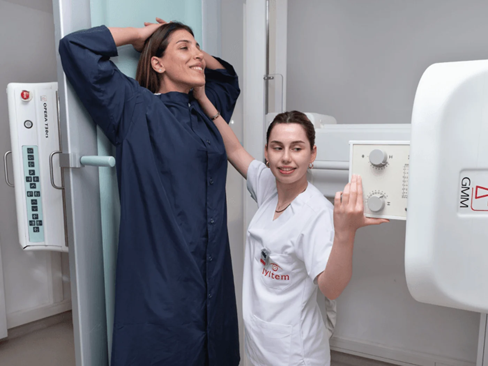
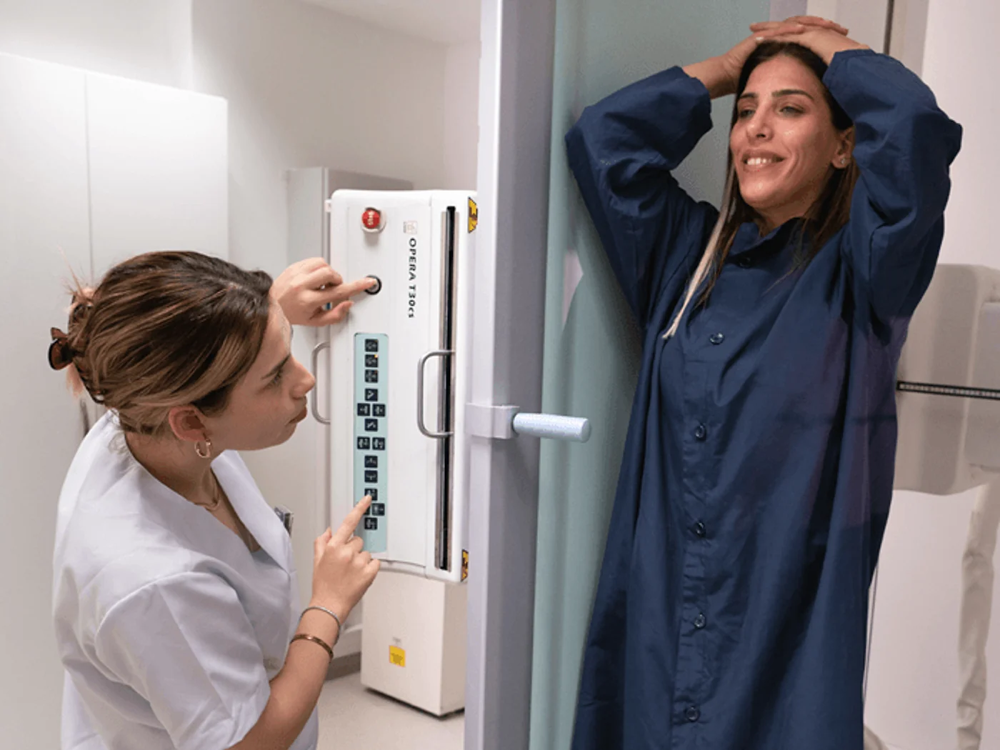
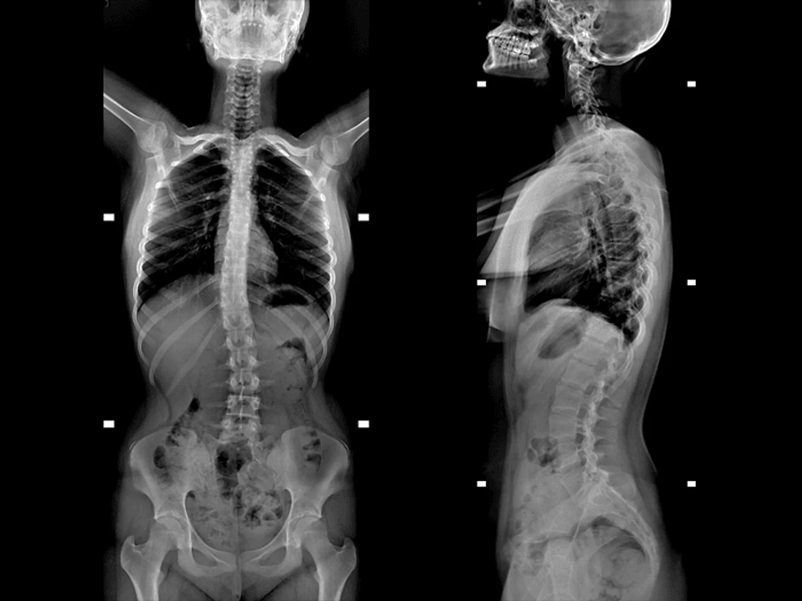

<strong>Skolyoz grafisi sırt ve bel bölgesindeki eğrilikleri görüntüleme tekniğidir. Standart olarak ön-arka ve yan görüntüler alınır. Skolyoz grafisi sayesinde hem eğriliğin varlığı tespit edilir hem de alınan grafiler üzerinde ölçüm yapılarak skolyozun derecesi belirlenir.</strong>

<figure></figure>

Skolyoz, omurganın yana doğru eğrilmesidir. Belli bir açının üzerinde omurga cerrahları tarafından ameliyatla düzeltilmesi gerekir. Onun için omurganın tümü aynı görüntüde izlenebilmeli ve açı ölçümleri (COBB açısı) titizlikle yapılmalıdır.

<h4>Skolyoz Grafisi nasıl çekilir?</h4>

Omurganın tümünün tek bir grafide çekilmesi mümkün olmadığından üç ya da dört grafide çekim yapılarak birleştirilmesi gerekir. Eskiden bu grafiler sırayla çekilir ve elle birleştirilirdi. Bu nedenle sağlıklı birleşik görüntü almak çok zordu. Ancak yeni dijital röntgen cihazları sayesinde tüpe, bilgisayar aracılığıyla otomatik açılar verdirerek görüntüler alınmakta ve görüntüleri doğrudan bilgisayarın birleştirmesiyle tüm omurga yani skolyoz grafisi elde edilmektedir. Hem A-P (ön ve arka), hem lateral (yan) grafiler çekilmektedir.

<figure></figure>

İyitem Görüntüleme Merkezi’nde GMM marka floroskopili dijital röntgen cihazımızla skolyoz grafisi çekimi yapılmaktadır. Böylece açılı görüntüler alınabilmektedir. Görüntüler bilgisayar tarafından birleştirilmekte ve <strong>kaliteli dijital grafiler</strong> elde edilmektedir. Yüksek çözünürlüklü dedektör kullanıldığından<strong> konvansiyonel ve CR görüntülerle karşılaştırıldığında çok daha iyi kalitede hizmet sağlanmaktadır.</strong> Ölçümler tecrübeli hekimlerimiz tarafından yapılır.

<figure></figure>

<!--faq-->
[
  {
    "q": "Skolyoz grafisi hangi durumlarda gereklidir?",
    "a": "Sırtta ya da belde eğrilik olma şüphesi varsa klinisyenin bu eğriliğin derecesinin teşhisi ve takibi için tüm omurgayı bir filmde görmesi gerekir. Dijital Röntgen ve stiching tekniğiyle bu işlem en düşük dozda radyasyonla ve doğrulukla gerçekleştirilebilir. Normal röntgenlerde hem daha yüksek radyasyon dozu verilir hem birleştirmeler bilgisayar aracılığıyla yapılmadığından tam doğru sonuçlar elde edilemez."
  },
  {
    "q": "Skolyoz grafisinde radyasyon kullanılır mı?",
    "a": "Skolyoz Grafisi stiching tekniğiyle dijital röntgende çekilir. Bu nedenle radyasyon içerir. Tüpe açı vererek tüm omurganın otomatik olarak üç ya da dört röntgen çekilir. Bu filmler bilgisayar programı aracılığıyla birleştirilip tüm omurgayı bir filmde gösteren Skolyoz Grafisi elde edilir. Bir grafide en fazla yaklaşık 40 santimlik bir bölüm çekilebildiğinden tüm omurgayı içerecek şekilde grafiler alınır ve bilgisayar aracılığıyla otomatik birleştirilir. Yani toplamda üç ya da dört akciğer grafisi kadar radyasyon dozu alınır ki bu çok düşük bir radyasyon dozudur."
  },
  {
    "q": "Konforunuz ve güvenliğiniz için neler yapıyoruz?",
    "a": "Skolyoz Grafisi çekimi ve birleştirmesi tamamen bilgisayar kontrolünde ve otomatik yapıldığından birleştirmede hata ihtimali minimuma indirilmiş olur. Grafi çekildikten sonra üzerinde ölçümler yapılarak CD’si ve raporu bir iki saat içinde hazırlanmış olur ve PACS arşivimizde en az 15 yıl saklanır. Dijital röntgen dedektörü 9 milyon pikselli olduğundan grafiler oldukça kalitelidir.\n(Çekilen filmler ve raporlar en az 15 yıl boyunca merkezimizde pacs sisteminde kayıtlı durmaktadır.)"
  }
]
