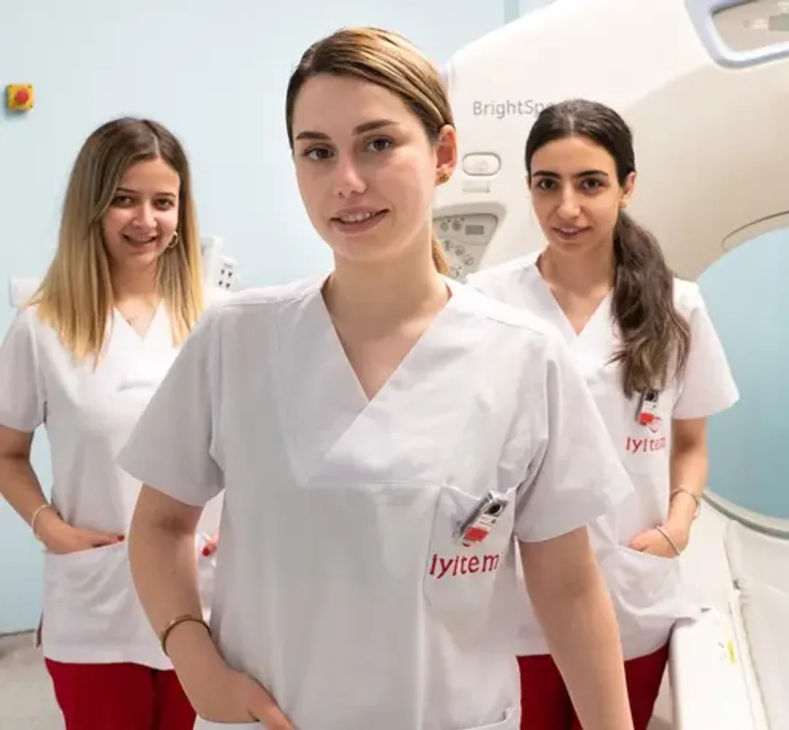
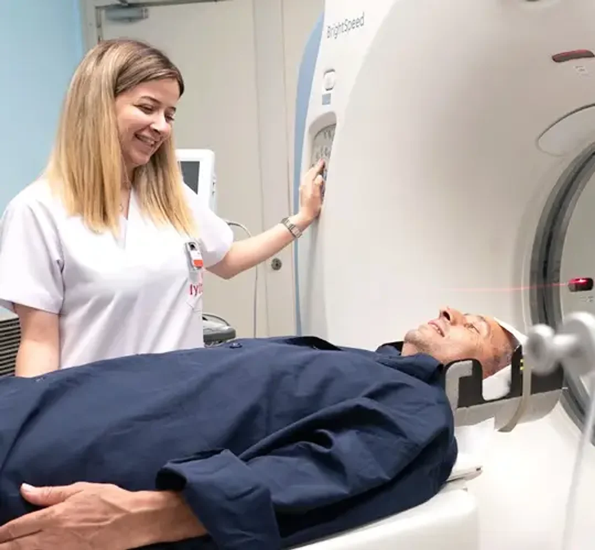
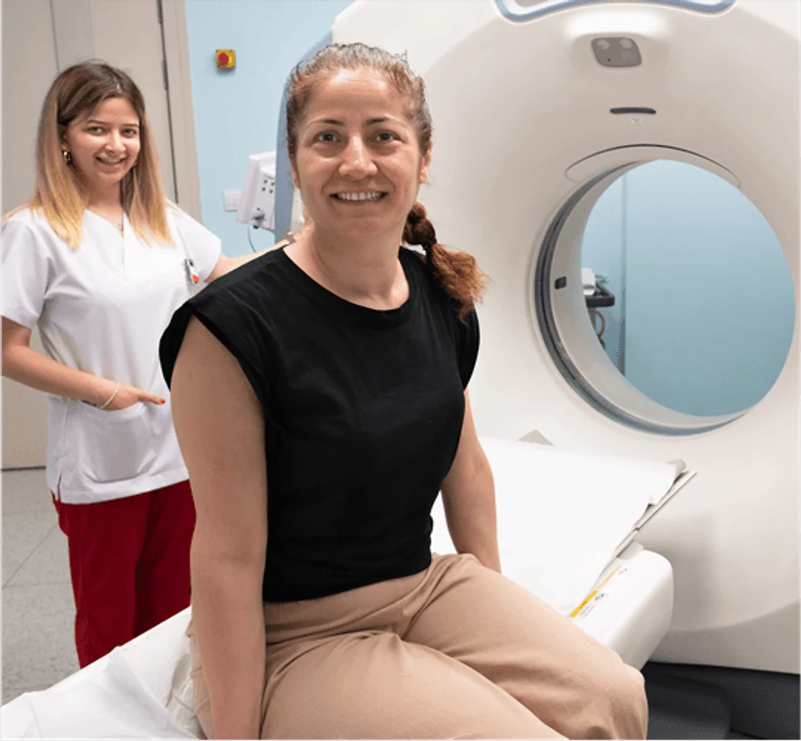

<h2>Hoşgeldiniz!</h2>
İyitem görüntüleme merkezi <strong>1995’den beri</strong> hizmetinizde. <strong>Siemens</strong> marka 3 Tesla Vida, <b>General Elektrik</b> marka 128 Multislice Revolition Maxima Bilgisayarlı Tomografi, Canon I800 marka Doppler Ultrasonografi, GMM opera T marka floroskopili Dijital Röntgen, DMS Kemik Dansitometri, Kavo marka Dental Tomografi-Dijital Panoramik Röntgen cihazlarımız ve<strong> tecrübeli kadromuz</strong> ile <strong>güvenilir hizmete</strong> devam ediyoruz.

<figure></figure>

<h2><strong>Hizmetlerimiz</strong></h2>
Tüm görüntüleme ihtiyaçlarınız için kapsamlı ve kaliteli çözümler sunuyoruz.

<h2><strong>Hakkımızda</strong></h2>
1995 yılında kurulan ve 2011 yılında devraldığımız İyitem Görüntüleme Merkezi, kendi alanında kalitesiyle anılmaktadır. İyi hizmeti uygun fiyata vermeyi hedefleyen merkezimiz çalışan kadrosuyla hekimleriyle güvenilir olmaya özen göstermektedir. <strong>Kaliteye ve güvenilirliğe önem veren hekimler ve hastalar İyitem’i tercih etmektedir.</strong>

<figure></figure>

<h2><strong>“Çifte Kontrol”</strong></h2>
Tüm hastalarımızın görüntüleri deneyimli doktorlarımız tarafından özenle raporlanmaktadır. Tüm görüntülemeler için iki ayrı doktor tarafından yapılan çifte kontrol, standardımızdır.

<figure></figure>

<h2><strong>Hasta Yorumları</strong></h2><blockquote>
Tecrübeli doktorları, güler yüzlü ekibiyle içeri girer girmez özel hissettiren bir kurum. İlgileri için ayrıca teşekkür ederim.
</blockquote><h5><strong>-Yıldız Ahmetoğlu</strong></h5>

<h2><strong>Online Randevu</strong></h2>
<strong>0212 632 00 00</strong> numaralı telefondan bizimle doğrudan iletişime geçerek veya aşağıdaki formu doldurarak randevu alabilirsiniz.

<figure></figure>

<h2><strong>Son Makaleler</strong></h2>

<h2><strong>Son Videolar</strong></h2>
