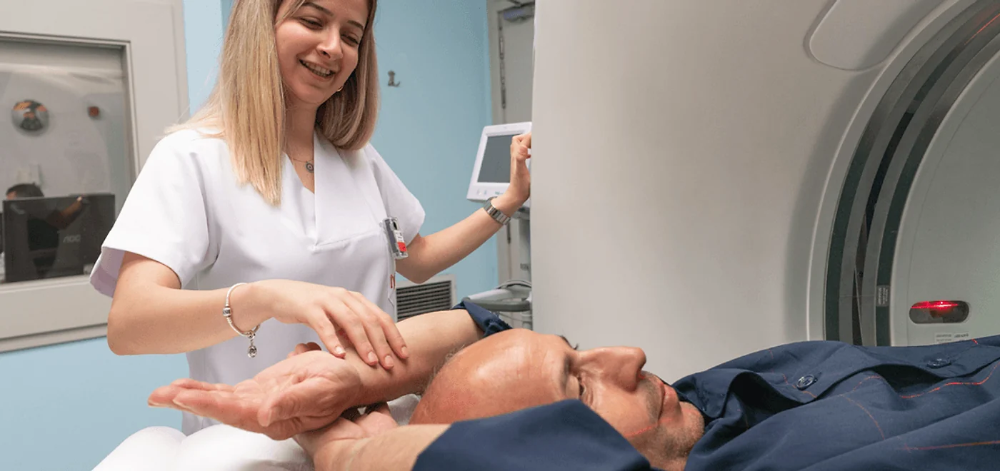

<h1><strong>Güvenilir Hizmet</strong></h1>

1995 yılında kurulan ve 2011 yılında devraldığımız İyitem Görüntüleme Merkezi, kendi alanında kalitesiyle anılmaktadır. İyi hizmeti uygun fiyata vermeyi hedefleyen merkezimiz çalışan kadrosuyla hekimleriyle güvenilir olmaya özen göstermektedir. <strong>Kaliteye ve güvenilirliğe önem veren hekimler ve hastalar İyitem’i tercih etmektedir.</strong>

<figure></figure>

<h1><strong>İlkelerimiz</strong></h1>

İnsan yaşamına en üst düzeyde saygı göstermek,

Hasta sağlık ve esenliğine öncelik vermek,

Hasta özerkliğine ve onuruna saygı göstermek, 

Çağdaş düzeyde kaliteli sağlık hizmeti sunmak, 

Yürürlükteki yasal şartlar, Sağlık Bakanlığı mevzuatı ve KYS şartları doğrultusunda çalışmak,

Yoksul ve yardıma muhtaç kimselere destek sağlamak.

<h1><strong>Vizyonumuz</strong></h1>

Kaliteli hizmeti uygun fiyata vererek teknolojiyi yakından takip etmek bizim için her zaman önemlidir. Güvenilir merkez olarak bilinip hastalarımızın güvenini, sevgi ve saygısını kazanmak hedefimizdir.

<h1><strong>Misyonumuz</strong></h1>

Ahlaki ölçülerin dışına asla çıkmadan hastalarımıza kaliteli hizmet vermek standardımızdır. Fakir ve ihtiyaç sahibi hastalara kaliteli hizmeti en uygun fiyata veriyoruz. Hasta kazanmak için etik olmayan ilişkilere girmiyoruz. Güvenilirliğimiz ve kalitemizle hizmet üretiyoruz.

